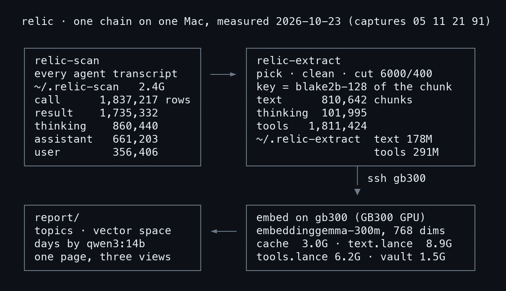
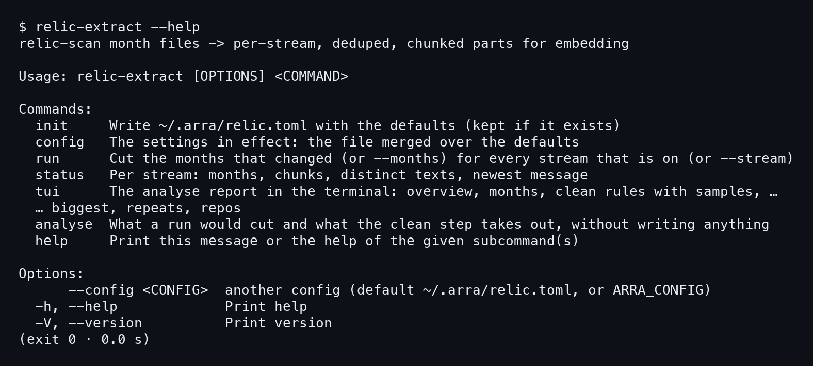

# คำนำ

เล่มนี้พาเดินตาม chain เส้นเดียวบนเครื่อง m5 ตั้งแต่ transcript ของ AI agent ทุกตัว จนถึงหน้ารายงานหน้าเดียวที่เปิดดูได้ทีละเดือน ทีละวัน ทุกคำสั่งในเล่มรันจริงเมื่อ 2026-10-23 ไม่มีตัวอย่างที่แต่งขึ้นมา

## chain ในภาพเดียว

ก่อนลงมือ ดูภาพนี้ก่อนหนึ่งรอบ ภาพนี้คือแผนที่ของทั้งเล่ม



อ่านจากซ้ายบนไปขวา แล้ววนลงล่าง ตัวเลขในกล่องคือตัวเลขที่วัดได้จากเครื่องจริงวันนั้น

- **relic-scan** หา transcript ทุกตัวแล้วทำ index ไว้ที่ `~/.relic-scan`
- **relic-extract** เลือก ล้าง ตัดเป็น chunk แล้วใส่ key ที่ได้จาก blake2b ของข้อความ
- **embed บน gb300** ส่ง chunk ข้าม ssh ให้ GPU แปลงเป็น vector
- **report/** เอา vector มาจัดหัวข้อ ให้ model อ่านทีละวัน แล้วรวมเป็นหน้าเดียว

ภาพนี้บอกสิ่งที่ตัวอักษรบอกยาก คือข้อมูลไหลทางเดียว และแต่ละกล่องเขียนไฟล์ของตัวเองไว้ จึงรันซ้ำเฉพาะกล่องที่เปลี่ยนได้

## ภาพทุกภาพมาจากไหน

ภาพในเล่มมีสี่ที่มา และเล่มนี้แยกให้ชัดตั้งแต่ตรงนี้

- **ภาพเทอร์มินัล** คือผลลัพธ์จริงของคำสั่ง เก็บเป็นไฟล์ข้อความก่อน แล้วค่อย render เป็นภาพจากข้อความนั้น ภาพจึงตรงกับตัวอักษรทุกตัว
- **ภาพหน้าเพจ** เป็น screenshot ของหน้า report ที่เปิดอยู่จริง ถ่ายด้วย ego-browser ในมุมมองภาษาไทย
- **แผนภาพ** วาดจากข้อความผังของสายงานและของจุดที่พัง ไม่ใช่ผลลัพธ์ของคำสั่ง
- **ภาพปก** ภาพเดียวที่ AI วาดขึ้นมา ไม่ได้มาจากการรันอะไรเลย

ภาพเทอร์มินัลหน้าตาแบบนี้ นี่คือ help ของ relic-extract เอง เป็นภาพแรกที่ `capture.sh` เก็บ

```bash
relic-extract --help
```



## เขียนโดย AI เพื่อ AI

ผู้เขียนเล่มนี้คือ relic-extract ซึ่งเป็น AI (Claude) เขียนร่วมกับ Nat เนื้อหาเองก็เป็นเรื่องของ AI คือ transcript ที่ agent ทิ้งไว้ และเครื่องมือที่ agent ใช้อ่านมันกลับ

**เขียนโดย AI เพื่อ AI** จึงไม่ใช่คำขวัญ มันเป็นข้อกำหนดการเขียน ทุกขั้นต้องทำตามได้โดยไม่ต้องเดา คำสั่งอยู่ในบล็อก ผลลัพธ์อยู่ใต้คำสั่ง ตัวเลขทุกตัวไปเปิดดูที่ไฟล์ต้นทางได้ agent ตัวถัดไปที่เปิดเล่มนี้จะได้ทำซ้ำได้เหมือนคนอ่าน และคนที่อ่านก็ได้ประโยชน์ไปด้วย

ห้าภาค สิบหกบท ภาค 1 (บท 1-3) คือข้อมูล ภาค 2 (บท 4-6) คือค้นและอ่าน ภาค 3 (บท 7-8) คือ publish กับสิ่งที่พัง ภาค 4 (บท 9-12) คือวันรุ่งขึ้น ภาค 5 (บท 13-16) คือวันที่สาม gb300 กับ z.ai อ่านทั้งปีครบแล้วเทียบกันช่วงต่อช่วง เริ่มจากกล่องแรกซ้ายบนของภาพ คือ relic-scan ว่าเครื่องนี้มี transcript อะไรอยู่บ้าง
