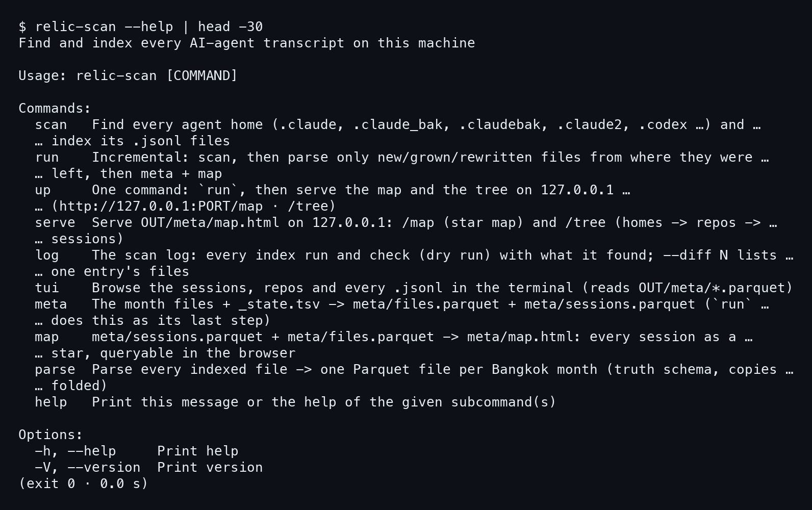
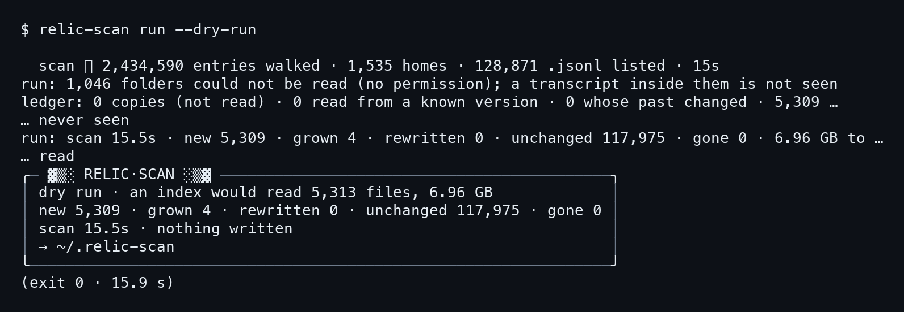
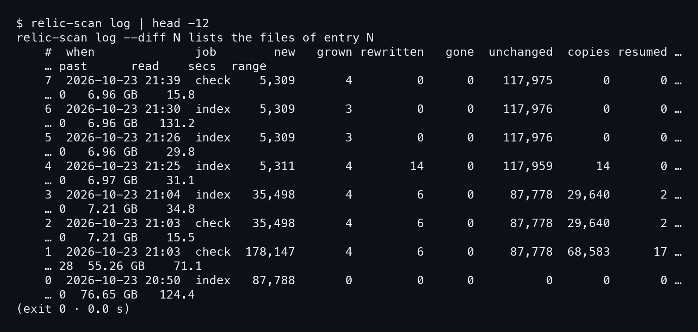
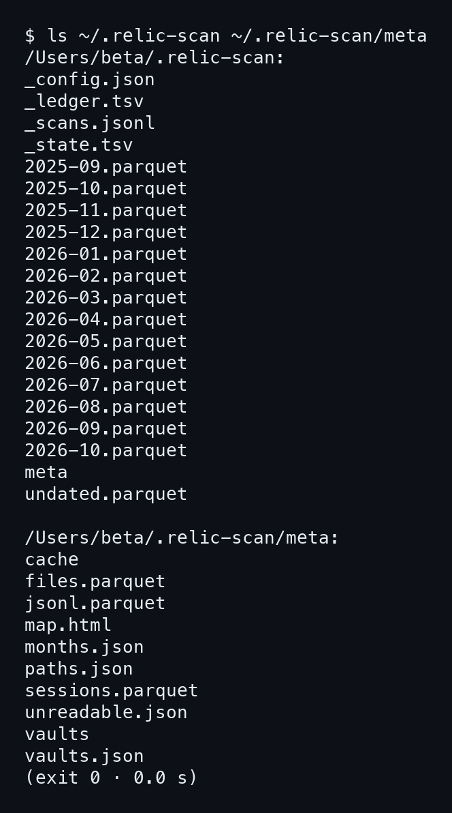
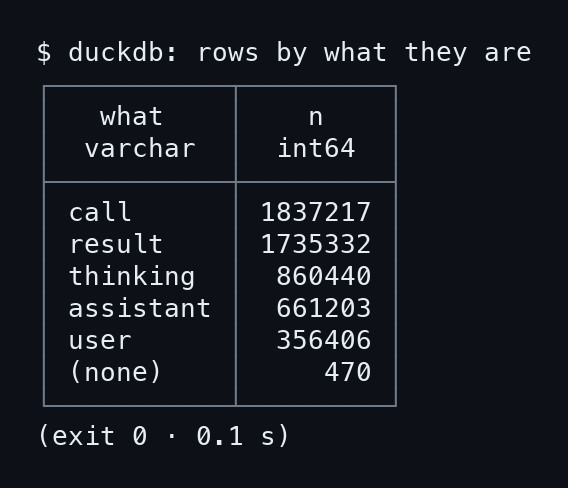

# บทที่ 1: relic-scan — เครื่องนี้มีอะไร

ก่อนจะตัดหรือ embed อะไร ต้องรู้ก่อนว่าเครื่องนี้ถืออะไรอยู่ บทนี้ใช้ `relic-scan`
ดูให้ครบ ตั้งแต่ชุดคำสั่ง การรันแบบไม่เขียนอะไรลงดิสก์ ประวัติทุกรอบ ไฟล์ที่มันทิ้งไว้
และปิดท้ายด้วยการนับทุกแถวตามชนิดของมัน

## 1.1 help — มีคำสั่งอะไรบ้าง

### ขั้นที่ 1 — เปิด help ดูชุดคำสั่ง

พิมพ์ `relic-scan --help` แล้วอ่านรายการ Commands ก่อน เพราะแต่ละคำสั่งคือหนึ่งขั้นของงาน
`scan` หา agent home ทุกที่ (.claude, .claude_bak, .claudebak, .claude2, .codex …)
แล้ว index ไฟล์ .jsonl ส่วน **`run` คือคำสั่งหลัก** เพราะทำแบบ incremental
คือ scan แล้ว parse เฉพาะไฟล์ใหม่ ไฟล์ที่โตขึ้น หรือไฟล์ที่ถูกเขียนทับ

```bash
relic-scan --help | head -30
```



คำสั่งที่เหลือแบ่งเป็นสองกลุ่ม กลุ่มดูผลคือ `log`, `tui`, `serve` ส่วน `up` รัน `run` ก่อนแล้วจึง serve และกลุ่มสร้างไฟล์คือ
`parse`, `meta`, `map` โดย `run` เรียก parse, meta และ map ให้เองเป็นขั้นสุดท้าย
ดังนั้นปกติไม่ต้องเรียกแยก

## 1.2 run --dry-run — ดูก่อนว่าจะอ่านอะไร

### ขั้นที่ 1 — รัน dry run

พอยังไม่แน่ใจว่ารอบนี้จะอ่านมากแค่ไหน ก็เติม `--dry-run` เข้าไป มัน scan จริงทั้งเครื่อง
แต่ **ไม่เขียนอะไรลงดิสก์เลย** แล้วรายงานว่าถ้า index จริงจะอ่านกี่ไฟล์กี่ GB

```bash
relic-scan run --dry-run
```



### ขั้นที่ 2 — อ่านตัวเลขในกล่องสรุป

สองบรรทัดแรกของ scan บอกขนาดเครื่อง เดินไป 2,434,590 entries เจอ 1,535 homes และ
128,871 ไฟล์ .jsonl ใช้เวลา 15 วินาที บรรทัดที่ต้องจำคือบรรทัดที่สาม
เพราะมัน**บอกตรง ๆ ว่ามีของที่มองไม่เห็น**

```
run: 1,046 folders could not be read (no permission); a transcript
     inside them is not seen
run: scan 15.5s · new 5,309 · grown 4 · rewritten 0 · unchanged 117,975
     · gone 0 · 6.96 GB to read
dry run · an index would read 5,313 files, 6.96 GB
```

1,046 โฟลเดอร์อ่านไม่ได้เพราะไม่มีสิทธิ์ transcript ในนั้นจะไม่ถูกนับ ตัวเลขทั้งเล่มนี้จึงเป็น
"เท่าที่เห็น" ไม่ใช่ "ทั้งเครื่อง" ส่วนไฟล์ที่จะอ่านคือ new 5,309 บวก grown 4 รวม 5,313
ไฟล์ ราว 6.96 GB ที่เหลือ 117,975 ไฟล์ unchanged ไม่ต้องแตะ

## 1.3 log — ประวัติทุกรอบ

### ขั้นที่ 1 — ดู scan log

ทุกครั้งที่ index หรือ check (dry run) มันจดลงสมุด ใช้ `relic-scan log` อ่านย้อนหลัง
**ใหม่สุดอยู่บนสุด** ถ้าอยากเห็นรายชื่อไฟล์ของรอบไหน ให้ต่อด้วย `--diff N`

```bash
relic-scan log | head -12
```



### ขั้นที่ 2 — อ่านตารางจากล่างขึ้นบน

อ่านจากรอบ 0 ขึ้นไป รอบ 0 (20:50) เป็น index แรกของเครื่อง เห็นไฟล์ใหม่ 87,788 ไฟล์
อ่าน 76.65 GB ใช้ 124.4 วินาที **รอบ 1 กระโดดขึ้น** เป็น check ที่เจอ 178,147
ไฟล์ใหม่ (55.26 GB) ในนั้นมี copies 68,583 แล้วลดเหลือ 35,498 ไฟล์ตั้งแต่รอบ 2 และรอบ 3 ที่ index จริง


สังเกตว่ารอบ 5 ถึง 7 ตัวเลข new ค้างอยู่ที่ 5,309 ทุกรอบ ตารางนี้ไม่ได้บอกเหตุผล
เป็นข้อสังเกตไว้ก่อน ถ้าจะใช้ตัวเลขนี้ต้องตามไปดูด้วย `--diff N` ว่าเป็นไฟล์อะไร

## 1.4 ไฟล์ที่ relic-scan ทิ้งไว้

### ขั้นที่ 1 — ls ดู ~/.relic-scan

ผลของทุกรอบลงที่ `~/.relic-scan` จึงควรรู้ว่าอะไรอยู่ตรงไหน ใช้ `ls` ดูสองโฟลเดอร์ในคำสั่งเดียว
**ไฟล์ขึ้นต้นด้วย `_` คือสถานะของ scan เอง** ส่วนที่เหลือคือข้อมูลที่ chain ถัดไปจะอ่าน

```bash
ls ~/.relic-scan ~/.relic-scan/meta
```



### ขั้นที่ 2 — แยกให้ออกว่าไฟล์ไหนเป็นอะไร

มี 4 ไฟล์สถานะ: `_config.json`, `_ledger.tsv`, `_scans.jsonl` (สมุดที่ `log` อ่าน)
และ `_state.tsv` ถัดมาคือ **parquet หนึ่งไฟล์ต่อหนึ่งเดือน** ตั้งแต่ 2025-09 ถึง 2026-10
รวมสิบสี่เดือน กับ `undated.parquet` สำหรับแถวที่ไม่มีวันที่ โฟลเดอร์ `meta/` เก็บ
`files.parquet`, `sessions.parquet`, `map.html`, `unreadable.json` (ไฟล์ unreadable.json คือรายการโฟลเดอร์ที่อ่านไม่ได้)

## 1.5 นับทุกแถวก่อนเชื่อ slice ใด ๆ

### ขั้นที่ 1 — group by ตามชนิดของแถว

ก่อนจะดึงชิ้นไหนไปใช้ **ต้องรู้ก่อนว่า parquet รายเดือนมีแถวชนิดอะไรเท่าไร** เพราะ
"ข้อความ" ในที่นี้ไม่ได้มีแค่คนพิมพ์กับ AI ตอบ ใช้ DuckDB นับแถวทั้งหมดแยกตามคอลัมน์ `what`

```
$ duckdb: rows by what they are
```



### ขั้นที่ 2 — อ่านสัดส่วน

```
│ call      │ 1837217 │
│ result    │ 1735332 │
│ thinking  │  860440 │
│ assistant │  661203 │
│ user      │  356406 │
│ (none)    │     470 │
```

**แถวที่คนพิมพ์จริง (user) มี 356,406 แถว เป็นส่วนเล็กที่สุดรองจาก (none)**
ส่วน call กับ result ซึ่งเป็นการเรียก tool และผลลัพธ์ของมัน มีมากกว่า 1.8 ล้านและ 1.7
ล้านแถว ใครที่ embed ทุกแถวรวมกันหมดจะได้เสียงของ tool ท่วมเสียงของคน และ 470 แถวที่เป็น
(none) ก็ต้องจำไว้ว่ามีอยู่ เพราะ filter แบบ `what = 'user'` จะไม่เห็นมัน

บทต่อไปเป็นของ relic-extract ที่เอา parquet ชุดนี้มาตัด ล้าง และใส่ key ให้แต่ละ chunk
