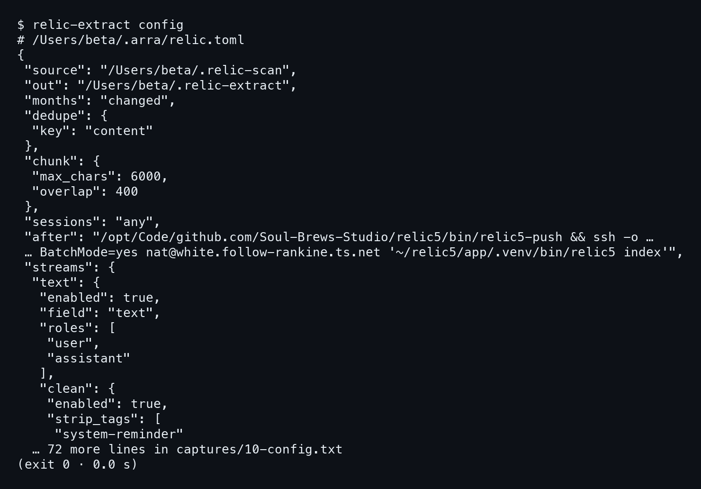
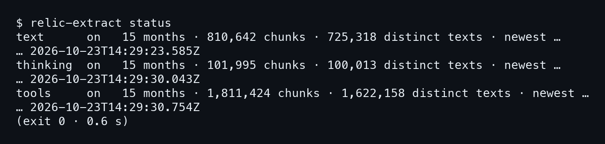
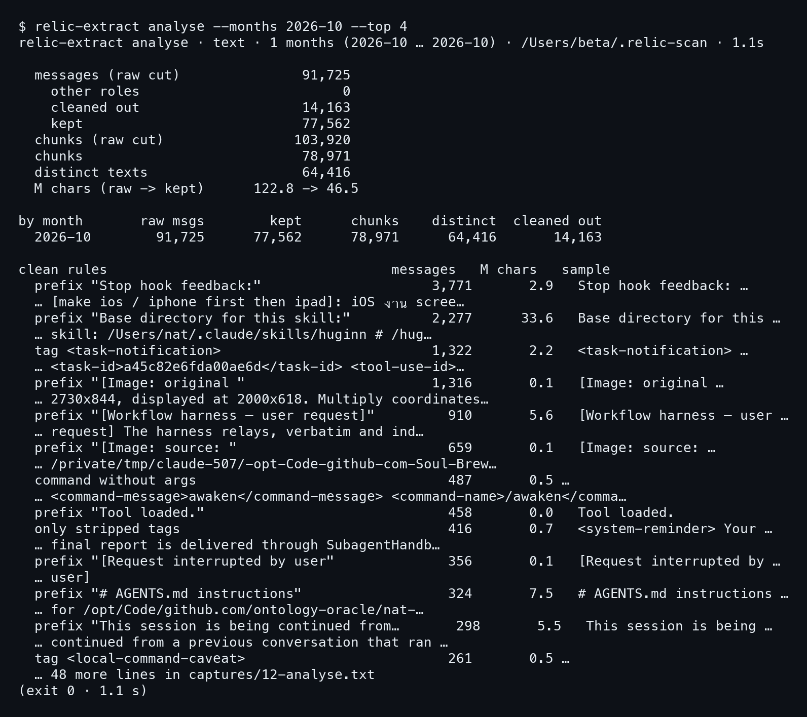
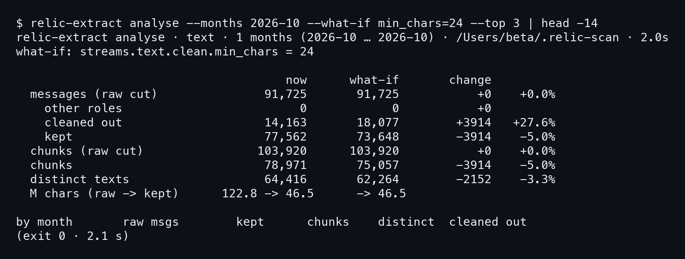
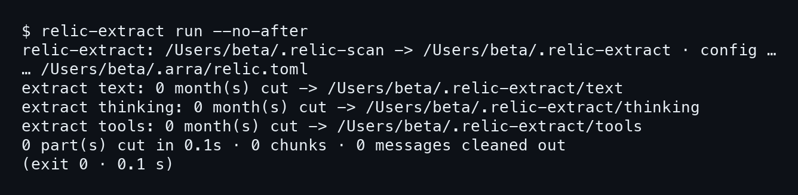
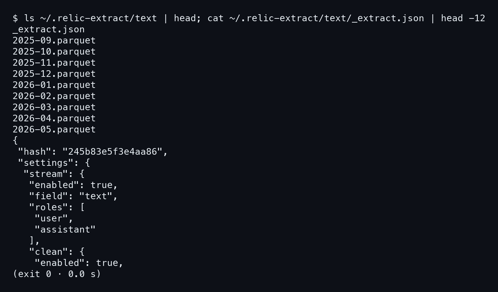
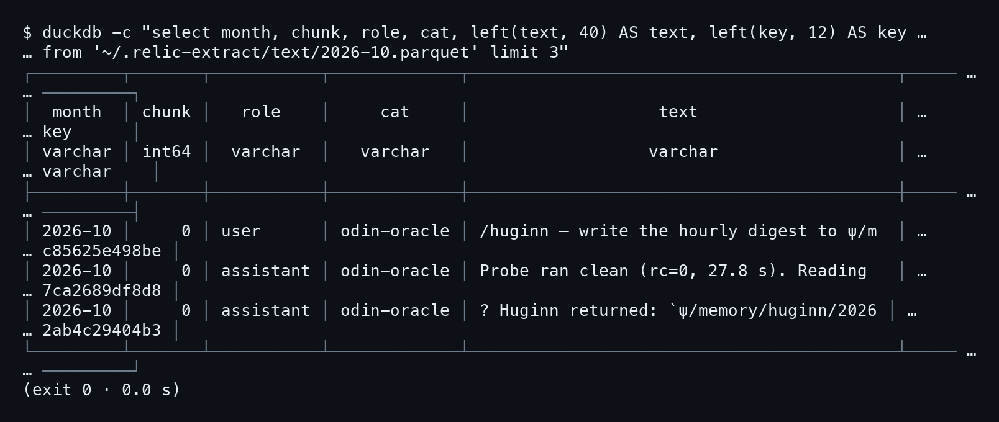
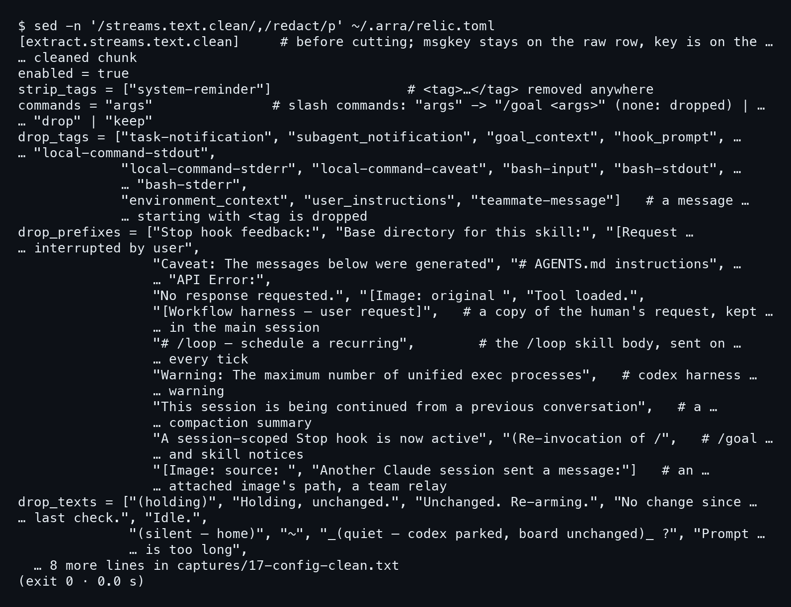

# บทที่ 2: relic-extract — ตัด ล้าง ใส่ key

บทที่แล้ว relic-scan บอกว่าเครื่องนี้มี transcript อะไรบ้าง บทนี้เป็นขั้นถัดไป relic-extract อ่านที่ scan เก็บไว้ ล้างข้อความที่ harness ยัดมาเอง แล้วตัดเป็น chunk ที่มี key ประจำตัว

## 2.1 config — ไฟล์เดียวของทั้ง chain

### ขั้นที่ 1 — ถาม relic-extract ว่าอ่าน config จากไหน

ทั้ง chain ใช้ TOML ไฟล์เดียวที่ `~/.arra/relic.toml` ไม่ต้องจำ flag พิมพ์ `config` แล้วมันจะพิมพ์ path ของไฟล์ที่ใช้อยู่ ตามด้วยค่าที่อ่านได้ทั้งหมดเป็น JSON **ค่าทุกตัวมาจากไฟล์นี้ที่เดียว**

```bash
relic-extract config
```



ดูสามบรรทัดบนก่อน `source` คือ `/Users/beta/.relic-scan` ที่ scan เขียนไว้ `out` คือ `/Users/beta/.relic-extract` ที่เราจะเขียนลง และ `months` เป็น `"changed"` แปลว่าตัดเฉพาะเดือนที่เปลี่ยน ส่วน `chunk` กำหนด `max_chars` 6000 กับ `overlap` 400 ข้อความยาวเกินก็แบ่งเป็นหลาย chunk ที่ซ้อนกัน 400 ตัวอักษร

ไล่ลงไปจะเจอ `streams` สามก้อน คือ text, thinking, tools แต่ละก้อนเปิด/ปิดได้เอง และมีกฎของตัวเอง เฉพาะ text เท่านั้นที่มีบล็อก `clean` ยาว เราจะกลับมาอ่านบล็อกนั้นในหัวข้อ 2.8 ส่วน `after` คือคำสั่งที่รันหลังตัดเสร็จ ในที่นี้ push ไป relic5 แล้ว ssh ไปสั่ง index บน white

## 2.2 status — สามสาย

### ขั้นที่ 1 — ดูว่าแต่ละสายมีกี่ chunk

`status` อ่านผลที่ตัดไว้แล้ว ไม่ได้ตัดใหม่ เลยเสร็จใน 0.6 วินาที คำสั่งเดียว ได้ทั้งสามสาย **chunk ไม่เท่ากับ distinct text** เพราะข้อความเดียวกันซ้ำได้หลายแถว

```bash
relic-extract status
```



```
text      on   15 months · 810,642 chunks · 725,318 distinct texts · …
thinking  on   15 months · 101,995 chunks · 100,013 distinct texts · …
tools     on   15 months · 1,811,424 chunks · 1,622,158 distinct texts · …
```

ทั้งสามสายมี 15 เดือน tools ใหญ่สุดที่ 1,811,424 chunk text มี 810,642 chunk แต่เหลือ 725,318 ข้อความที่ไม่ซ้ำ ตัวเลข distinct นี้แหละที่ขั้น embed ต้องคิดจริง (บทที่ 3)

## 2.3 analyse — ดูว่าอะไรจะถูกทิ้ง ก่อนเขียนอะไรลงดิสก์

### ขั้นที่ 1 — รัน analyse กับเดือนเดียว

ก่อนจะเชื่อกฎล้างข้อความ ควรเห็นก่อนว่ามันทิ้งอะไร `analyse` ตัดในหน่วยความจำแล้วรายงาน ไม่เขียนไฟล์ใด ๆ ใส่ `--months 2026-10` เพื่อเอาเดือนเดียว กับ `--top 4` เพื่อไม่ให้ยาว **analyse เป็นคำสั่งอ่านอย่างเดียว**

```bash
relic-extract analyse --months 2026-10 --top 4
```



```
  messages (raw cut)               91,725
    cleaned out                    14,163
    kept                           77,562
  M chars (raw -> kept)      122.8 -> 46.5
```

เดือน 2026-10 มี 91,725 ข้อความดิบ ล้างทิ้ง 14,163 เหลือ 77,562 ที่น่าสนใจคือตัวอักษร ดิบ 122.8 ล้านเหลือ 46.5 ล้าน ข้อความที่ทิ้งมีจำนวนน้อยแต่ยาวมาก

### ขั้นที่ 2 — อ่านตารางกฎล้าง

ตารางถัดลงมาบอกว่ากฎไหนทิ้งไปเท่าไร เรียงตามจำนวนข้อความ ข้อความที่ทิ้งคือของที่ harness สร้างเอง ไม่ใช่สิ่งที่คนพิมพ์ **ที่หนักที่สุดคือ skill body**

`Stop hook feedback:` เจอ 3,771 ข้อความ แต่รวมกัน 2.9 ล้านตัวอักษร ส่วน `Base directory for this skill:` มีแค่ 2,277 ข้อความแต่หนัก 33.6 ล้านตัวอักษร เพราะมันคือเนื้อ skill ทั้งไฟล์ที่ถูกแปะเข้าไปทุกครั้งที่เรียก ถ้าไม่ล้าง ของพวกนี้จะไปปนอยู่ในผลค้นและในการอ่านรายวัน

ท้ายรายงานยังมีข้อความที่ซ้ำมากสุด `check issues + pr` ซ้ำ 592 ครั้ง และ `/huginn — write the hourly digest …` ซ้ำ 548 ครั้ง ข้อความพวกนี้เป็น prompt จริงของคน/ตัว loop จึงไม่ถูกทิ้ง แต่ถูกนับเป็น distinct ครั้งเดียว

## 2.4 --what-if — ลองตั้งค่าก่อนแก้ไฟล์

### ขั้นที่ 1 — ลอง min_chars=24 โดยไม่แตะ TOML

อยากรู้ว่าถ้าทิ้งข้อความที่สั้นกว่า 24 ตัวอักษรจะเสียอะไร ไม่ต้องแก้ไฟล์ ใส่ `--what-if min_chars=24` แล้วมันจะรันสองรอบ คือค่าปัจจุบันกับค่าที่ลอง วางเทียบกันเป็นคอลัมน์ ผมต่อ `head -14` เพราะสนใจแค่ส่วนบน **ได้เห็นผลก่อนตัดสินใจ**

```bash
relic-extract analyse --months 2026-10 --what-if min_chars=24 \
  --top 3 | head -14
```



```
    cleaned out                    14,163       18,077        +3914   +27.6%
    kept                           77,562       73,648        -3914    -5.0%
  distinct texts                   64,416       62,264        -2152    -3.3%
```

ผลคือทิ้งเพิ่ม 3,914 ข้อความ (+27.6%) kept ลด 5.0% และ distinct texts ลด 2,152 ข้อความ ตัวอักษรหลังล้างยังเท่าเดิมที่ 46.5 ล้าน แปลว่าของที่หายเป็นข้อความสั้น ๆ ล้วน ๆ คือคำตอบสั้นที่เป็นคำสั่งจริงของคน config ปัจจุบันจึงตั้ง `min_chars = 0` ไว้ (ดูหัวข้อ 2.8)

## 2.5 run — ตัดเฉพาะที่เปลี่ยน

### ขั้นที่ 1 — สั่ง run โดยไม่ยิง after

`run` คือคำสั่งที่เขียนไฟล์จริง ใส่ `--no-after` เพื่อไม่ให้มันไป push relic5 และ ssh ไป white ตอนที่เรากำลังลองอยู่ พอ `months` เป็น `"changed"` มันจะเทียบกับ `_extract.json` ของแต่ละสาย ถ้าไม่มีอะไรเปลี่ยนก็ไม่ตัดอะไร

```bash
relic-extract run --no-after
```



```
extract text: 0 month(s) cut -> /Users/beta/.relic-extract/text
0 part(s) cut in 0.1s · 0 chunks · 0 messages cleaned out
```

ตัด 0 เดือน ใช้ 0.1 วินาที **ไม่มีอะไรเปลี่ยนก็ไม่ทำอะไร** ผลลัพธ์ที่น่าเบื่อแบบนี้คือสิ่งที่เราต้องการ เพราะ chain รันซ้ำได้บ่อยโดยไม่เสียเครื่อง ถ้า scan เจอ transcript ใหม่ในเดือนไหน เดือนนั้นเดือนเดียวจะถูกตัดใหม่

## 2.6 parts และ _extract.json — ตัวบอกว่าเสร็จแล้ว

### ขั้นที่ 1 — ดูไฟล์ที่ run ทิ้งไว้

ผลของการตัดคือโฟลเดอร์ต่อสาย ข้างในเป็น parquet หนึ่งไฟล์ต่อเดือน กับ `_extract.json` อีกหนึ่งไฟล์ ผมลิสต์ `text` กับอ่านหัวของ `_extract.json` ในคำสั่งเดียว **`_extract.json` ควรถูกเขียนเป็นไฟล์สุดท้าย** ถ้ามันอยู่ แปลว่าการตัดรอบนั้นจบครบ

```bash
ls ~/.relic-extract/text | head
cat ~/.relic-extract/text/_extract.json | head -12
```



parquet ตั้งชื่อตามเดือน เริ่มที่ `2025-09.parquet` ส่วน `_extract.json` เก็บ `hash` (`245b83e5f3e4aa86`) กับ `settings` ซึ่งคือค่าของสายนี้ รวม roles และ clean ที่ใช้ตอนตัด รอบหน้า `run` จะเทียบ hash นี้กับ config ปัจจุบัน ถ้าแก้กฎล้างเมื่อไร hash ไม่ตรง ทุกเดือนก็ถูกตัดใหม่เอง (ดู 3.4)

ข้อดีอีกอย่างคือขั้นถัดไปใช้ไฟล์นี้เป็นสัญญาณ ถ้าการตัดล้มกลางทาง `_extract.json` ของรอบนั้นก็ไม่ควรมี ก็ไม่มีใครเชื่อ parquet ที่ค้างอยู่

## 2.7 chunk หนึ่งแถว — key คือ blake2b ของข้อความ

### ขั้นที่ 1 — เปิด parquet ด้วย DuckDB

parquet อ่านด้วย DuckDB ได้ตรง ๆ ดึงเดือน 2026-10 สามแถวแรกมาดู คอลัมน์ที่สำคัญคือ `month`, `chunk` (ลำดับ chunk ในข้อความเดียวกัน), `role`, `cat` (oracle หรือ repo เจ้าของ), `text` และ `key` **`key` คือ blake2b ของข้อความที่ล้างแล้ว** ข้อความเหมือนกันได้ key เหมือนกัน

```bash
duckdb -c "select month, chunk, role, cat, left(text, 40) AS text, \
  left(key, 12) AS key \
  from '~/.relic-extract/text/2026-10.parquet' limit 3"
```



```
0 │ user │ odin-oracle │ /huginn — write the hourly … │ c85625e498be
```

แถวแรกคือ prompt `/huginn — write the hourly digest …` ที่เราเจอใน analyse ว่าซ้ำ 548 ครั้ง ทุกแถวนั้นได้ key เดียวกัน นี่คือที่มาของ "distinct texts" ใน 2.2 key ที่เห็นยาว 12 ตัวอักษร บทหน้าใช้ key นี้เป็นกุญแจของ vector cache บน gb300 ข้อความไหนมี key อยู่แล้วก็ไม่ต้อง embed ซ้ำ

## 2.8 กฎล้างใน TOML

### ขั้นที่ 1 — อ่านบล็อก clean ตัวจริง

ตารางใน 2.3 ไม่ได้มาจากโค้ดซ่อน มันคือบล็อก `[extract.streams.text.clean]` ในไฟล์เดียวกัน ตัดมาดูด้วย `sed` ช่วงตั้งแต่หัวบล็อกถึงบรรทัด `redact` **กฎทุกข้อเป็นแค่รายการใน TOML** แก้แล้วรัน `analyse` ดูผลได้ทันที

```bash
sed -n '/streams.text.clean/,/redact/p' ~/.arra/relic.toml
```



กฎแบ่งเป็นสามแบบตามที่เห็นในคอมเมนต์ แบบแรกตัด tag ออกกลางข้อความ (`strip_tags`) เช่น `<system-reminder>` แบบที่สองทิ้งทั้งข้อความที่ขึ้นต้นด้วย tag หรือข้อความที่กำหนด (`drop_tags`, `drop_prefixes`) แบบที่สามทิ้งเมื่อข้อความทั้งก้อนตรงกับข้อความที่ระบุ (`drop_texts`) เช่น `Idle.` กับ `(holding)` ซึ่งเป็นเสียงรบกวนของ loop

`redact = true` แทน key ลับ token และ webhook ด้วย `[kind:abcd…N]` ก่อนถึงดิสก์ บทหน้าส่ง chunk ไป embed บน gb300
