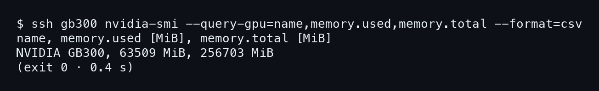
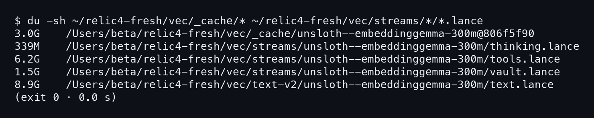
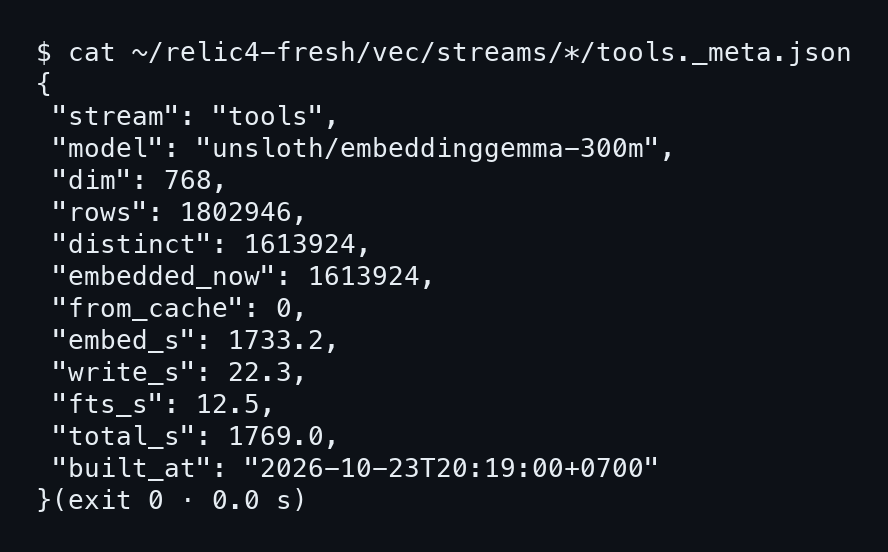
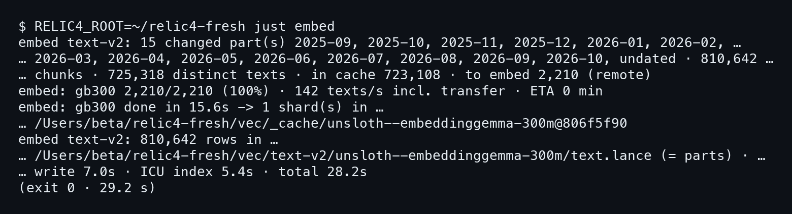

# บทที่ 3: embed บน gb300

chunk ที่ตัดเสร็จในบทที่ 2 ยังเป็นแค่ข้อความ ถ้าจะค้นด้วยความหมายได้ ต้องแปลงเป็น vector ก่อน
งานนี้ส่งไปให้เครื่อง GPU ชื่อ gb300 ทำ แล้วเอาผลกลับมาเก็บในเครื่อง

## 3.1 เครื่อง GPU

### ขั้นที่ 1 — ถาม GPU ผ่าน ssh

ก่อนส่งอะไรไป ลองถามเครื่องปลายทางก่อนว่าตื่นอยู่ไหม คำสั่งนี้ ssh เข้า gb300 แล้วให้ `nvidia-smi`
บอกชื่อการ์ดกับหน่วยความจำ ถ้าตอบกลับมาได้ แปลว่า **ssh ถึง และ GPU พร้อมรับงาน**

```bash
ssh gb300 nvidia-smi --query-gpu=name,memory.used,memory.total --format=csv
```



```
NVIDIA GB300, 63509 MiB, 256703 MiB
```

การ์ดคือ NVIDIA GB300 ใช้ memory อยู่ 63509 MiB จากทั้งหมด 256703 MiB ก็คือยังมีที่ว่างเหลือเยอะ
คำสั่งจบใน 0.4 วินาที

## 3.2 cache ของ vector กับตาราง LanceDB

### ขั้นที่ 1 — ดูว่า embed แล้วอะไรไปอยู่ตรงไหน

ผล embed ไม่ได้อยู่ที่เดียว มีสองที่ ที่แรกคือ cache ที่จำว่า key ไหนได้ vector อะไร
ที่สองคือตาราง LanceDB แยกตาม stream หนึ่ง stream ต่อหนึ่งตาราง ลอง `du` ดูขนาด

```bash
du -sh ~/relic4-fresh/vec/_cache/* \
  ~/relic4-fresh/vec/streams/*/*.lance
```



```
3.0G  …/_cache/unsloth--embeddinggemma-300m@806f5f90
339M  …/streams/…/thinking.lance
6.2G  …/streams/…/tools.lance
1.5G  …/streams/…/vault.lance
8.9G  …/text-v2/…/text.lance
```

**cache คือตารางที่ map key ของ chunk ไปหา vector ตัวเดียว** ชื่อโฟลเดอร์บอก model ไว้เลย
คือ `unsloth--embeddinggemma-300m` ตามด้วย `@806f5f90` ซึ่งเป็นรุ่นของ model

### ขั้นที่ 2 — อ่านขนาดให้เป็น

**ตารางใหญ่สุดคือ `text.lance` 8.9G** รองลงมาคือ `tools.lance` 6.2G ส่วน `vault.lance` 1.5G
และ `thinking.lance` 339M ตาราง text ถูกเก็บแยกใต้ `text-v2/` ต่างจากอีกสามตัวที่อยู่ใต้ `streams/`

cache ที่ 3.0G เล็กกว่าตารางรวมมาก เพราะ cache เก็บแค่ key กับ vector ส่วนตารางต้องเก็บข้อความ
ทุก row ไว้ด้วย และมี index สำหรับค้นตัวอักษร (ICU) อีกชั้น ตัวนี้จะกลับมาอีกทีในขั้นสุดท้ายของบท

## 3.3 _meta.json บอกว่าใช้เวลาเท่าไร

### ขั้นที่ 1 — เปิดไฟล์ meta ของ stream tools

ทุก stream ทิ้งไฟล์ `_meta.json` ไว้หลัง embed เสร็จ **ในนั้นบอกเวลาทุกขั้น** กับจำนวน row และว่าได้ vector
มาจากไหน ลอง `cat` ของ stream tools ซึ่งเป็น stream ที่ใหญ่สุด

```bash
cat ~/relic4-fresh/vec/streams/*/tools._meta.json
```



```
"rows": 1802946,
"distinct": 1613924,
"embedded_now": 1613924,
"from_cache": 0,
"embed_s": 1733.2,
"total_s": 1769.0,
```

stream นี้มี 1,802,946 row แต่ข้อความไม่ซ้ำกันมีแค่ 1,613,924 อัน เลยส่งไปแค่ที่ไม่ซ้ำ
`from_cache` เป็น 0 เพราะเป็นการ embed ครั้งแรกในโฟลเดอร์ใหม่ ทุกอันเลยต้องไปที่ GPU

### ขั้นที่ 2 — แยกเวลาออกเป็นส่วน

เวลา embed ล้วน ๆ คือ `embed_s` 1733.2 วินาที ที่เหลือเป็นงานเก็บ: เขียนตาราง `write_s` 22.3
สร้าง index ค้นข้อความ `fts_s` 12.5 รวมแล้ว `total_s` 1769.0 วินาที **เวลาเกือบทั้งหมดอยู่ที่
GPU** การเขียนกับสร้าง index รวมกันไม่ถึงนาที vector มี `dim` 768 มิติ จาก model `unsloth/embeddinggemma-300m`

stream อื่นก็ไปทางเดียวกัน text 748,619 ข้อความที่ไม่ซ้ำ ใช้ 785.2 วินาที คิดเป็น 953 ข้อความต่อ
วินาทีรวมเวลาโอนข้อมูล ส่วน vault 77,278 ข้อความ ใช้ 275.6 วินาที chain รอบแรกที่ embed
เฉพาะ text ใช้ 833 วินาที

## 3.4 รันซ้ำ

### ขั้นที่ 1 — สั่ง embed อีกรอบ

ถ้า key ทุกอันอยู่ใน cache แล้ว การรันซ้ำก็ไม่ควรต้องไปถึง GPU เกือบทั้งหมด ลองสั่งอีกครั้ง
โดยชี้ root เดิม

```bash
RELIC4_ROOT=~/relic4-fresh just embed
```



```
embed text-v2: 15 changed part(s) … · 810,642 chunks
  · 725,318 distinct texts · in cache 723,108 · to embed 2,210 (remote)
embed: gb300 done in 15.6s
embed text-v2: 810,642 rows … write 7.0s · ICU index 5.4s · total 28.2s
```

ตัวเลขไม่ได้เป็นศูนย์พอดี เพราะทั้ง 15 part ถูกตัดใหม่ (กฎเปลี่ยน hash จึงต่าง) ข้อความที่ไม่ซ้ำลดจาก
748,619 เหลือ 725,318 ในนั้น 723,108 อยู่ใน cache แล้ว **เหลือแค่ 2,210 ที่ต้องส่งไป gb300** ซึ่งจบใน 15.6 วินาที

### ขั้นที่ 2 — เทียบกับรอบแรก

รอบแรกของ text ใช้ 785.2 วินาที ส่วน**รอบนี้รวมทั้งหมด 28.2 วินาที** (คำสั่งจบใน 29.2 วินาที)
ในนั้นเป็นการเขียนตารางใหม่ 810,642 row ใช้ 7.0 วินาที และสร้าง ICU index ใหม่ 5.4 วินาที
ความเร็ว 142 ข้อความต่อวินาทีต่ำกว่ารอบแรก เพราะงานเล็กจนค่าเริ่มต้นกับการโอนข้อมูลกินสัดส่วนมาก

จาก 13 นาทีเหลือครึ่งนาที เพราะ key เดิมไม่ถูก embed ซ้ำ

ตอนนี้ทุก chunk มี vector แล้ว บทต่อไปจะเอามาค้นจริง และเทียบกับ relic3 ว่าเจออะไรที่อีกฝั่งไม่เจอ
