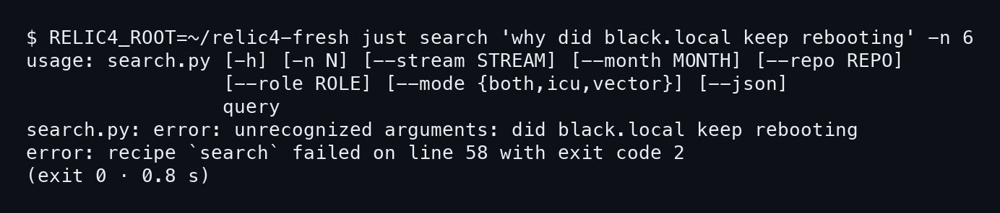
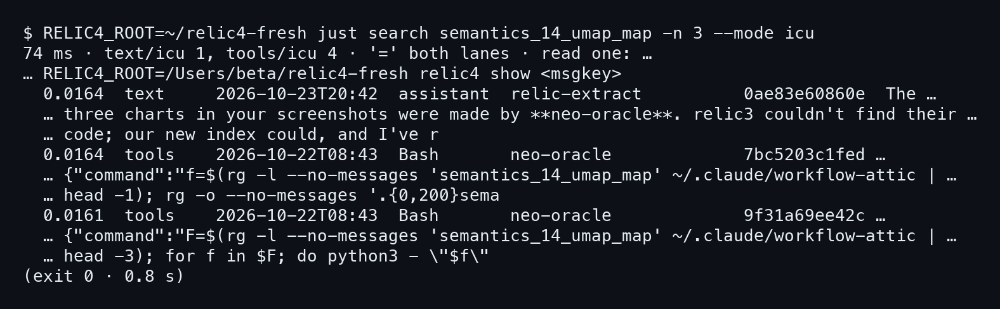
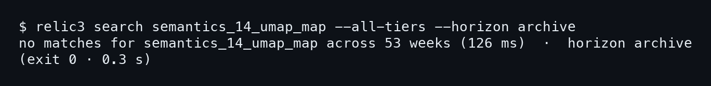
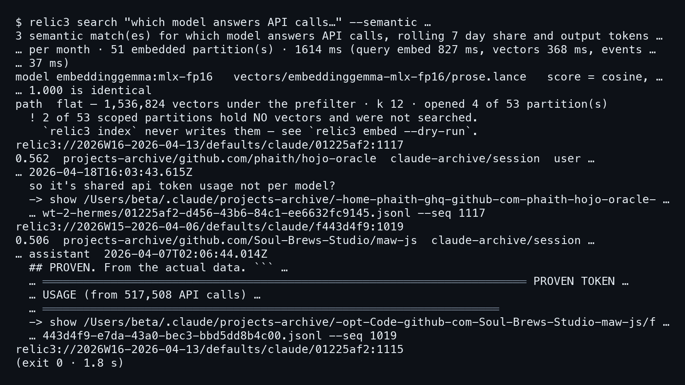

# บทที่ 4: ค้น — ของเรากับ relic3

บทนี้ค้นของที่ embed ไว้ในบทก่อน แล้วเอาไปเทียบกับ relic3 ที่ค้น session history เหมือนกัน เทียบจากคำสั่งที่รันจริง ไม่ใช่จากความเชื่อ ตัวแรกในบทนี้พังด้วย ซึ่งเก็บไว้เพราะสอนดี

## 4.1 คำถามเดียว ค้นสี่ stream พร้อมกัน

เครื่องมือค้นของเราอ่านสี่ stream ในครั้งเดียว คือ text, thinking, tools (ตัว tool call) และ vault (โน้ต) แล้วค้นสองแบบ แบบ ICU เทียบคำ กับแบบ vector เทียบความหมาย ผลสองสายถูกรวมด้วย reciprocal rank คือ **รวมกันที่ลำดับ ไม่ใช่ที่คะแนนดิบ** เพราะคะแนนสองสายคนละสเกล

### ขั้นที่ 1 — ถามเป็นประโยคผ่าน just

ลองถามเป็นประโยคเต็มก่อน ผ่าน recipe `search` โดยชี้ `RELIC4_ROOT` ไปที่ index ที่เพิ่ง embed

```bash
RELIC4_ROOT=~/relic4-fresh just search \
  'why did black.local keep rebooting' -n 6
```



มันไม่ผ่าน ผลคือ error แทนรายการ hit

```
search.py: error: unrecognized arguments: did black.local keep rebooting
error: recipe `search` failed on line 58 with exit code 2
```

สาเหตุอยู่ที่ recipe ส่งคำที่ครอบด้วย quote ต่อให้ `search.py` ทีละคำ ตัวมันรับ query เป็น argument ตัวเดียว คำที่สองเป็นต้นไปเลยเกิน ผมไม่ได้ลองหาทางอ้อมในรอบนี้ ขั้นต่อไปใช้ query คำเดียว ซึ่งผ่านแน่ เพราะมีหลักฐานในภาพถัดไป

## 4.2 ชื่อไฟล์ตรงตัว ของเราเจอ

ชื่อไฟล์เป็นงานของสาย ICU เพราะต้องเทียบคำตรงตัว ไม่ต้องใช้ความหมาย ใช้ `--mode icu` เพื่อปิดสาย vector

### ขั้นที่ 1 — ค้นชื่อ semantics_14_umap_map

พิมพ์ชื่อไฟล์เป็นคำเดียว จำกัดสามรายการ

```bash
RELIC4_ROOT=~/relic4-fresh just search semantics_14_umap_map \
  -n 3 --mode icu
```



บรรทัดแรกของผลบอกว่าค้นไปเท่าไรและเจอที่ไหน

```
74 ms · text/icu 1, tools/icu 4 · '=' both lanes · read one: …
```

**เจอสามแถวใน 74 ms** แถวแรกมาจาก stream text เป็นคำตอบของ assistant ของวันนี้ (2026-10-23 20:42) ที่พูดถึงชื่อนี้ ส่วนอีกสองแถวมาจาก stream tools วันที่ 2026-10-22 เป็นคำสั่ง Bash ของ neo-oracle ที่เอาชื่อนี้ไป `rg` คะแนนสามแถวคือ 0.0164, 0.0164 และ 0.0161 เป็นคะแนนจากลำดับ ไม่ใช่ cosine

### ขั้นที่ 2 — อ่านต่อด้วย show

ท้ายบรรทัดแรกบอกวิธีอ่านแถวเต็ม คือ `relic4 show <msgkey>` ใส่ key 12 หลักของแถวที่สนใจ **ที่เจอได้เพราะ tool call ถูก index เป็นของมันเอง** ไม่ได้ปล่อยทิ้งในกอง transcript

## 4.3 relic3 ถามชื่อเดียวกัน ไม่เจอ

relic3 เป็นเครื่องค้นอีกตัวบนเครื่องเดียวกัน ถามชื่อไฟล์ชื่อเดิม และเปิดทุก tier กับ horizon archive ให้กว้างที่สุด

### ขั้นที่ 1 — ค้นชื่อเดิมด้วย relic3

```bash
relic3 search semantics_14_umap_map --all-tiers --horizon archive
```



**ศูนย์ แม้กวาดครบ 53 สัปดาห์ใน 126 ms** เทียบกับ 3 hit ของเรา สาเหตุยังไม่ได้ทดสอบ

## 4.4 relic3 --semantic กับคำถาม

ทีนี้ถามแบบที่ relic3 ถนัด คือคำถามเป็นประโยค ใช้ `--semantic` ให้เทียบความหมาย

### ขั้นที่ 1 — ถามว่า model ไหนตอบ API call

```bash
relic3 search "which model answers API calls…" --semantic …
```



แถวแรก 0.562 จาก hojo-oracle แถวสอง 0.506 จาก maw-js คำร่วมน้อยแต่ตรงความหมาย **relic3 ค้น 1,536,824 vector ใน 1614 ms และเตือนเองว่า 2 จาก 53 partition ไม่ได้ค้น** บทหน้าแบ่ง prompt เป็นหัวข้อ
