# บทที่ 5: จากตัวเลขเป็นหน้า

สี่บทแรกเราได้ chunk กับ vector ครบแล้ว แต่ตัวเลข 5 ล้านแถวยังอ่านไม่ได้ บทนี้เอาของที่ฝังไว้มาตอบคำถามทีละข้อ ว่าเรามักถามเรื่องอะไร งานที่สั่งไปออกมาเป็น commit ไหม oracle แต่ละตัวเกิดมาเพื่ออะไรและอยู่นานแค่ไหน แล้ว vault ของมันรู้ไหมว่าโดนถามอะไร คำตอบทั้งหมดไปลงหน้าเดียว

เกือบทุกคำสั่งในบทนี้เป็น recipe ของ `just` ใน repo relic-extract และทุกตัวเลขมาจากการรันจริงวันที่ 2026-10-23

## 5.1 หัวข้อ — k-means บน vector ของ prompt

### ขั้นที่ 1 — จัดกลุ่ม prompt ด้วย just topics

พิมพ์ `just topics` คำสั่งนี้ดึง vector ของ prompt ทุกข้อจาก cache ที่ gb300 ฝังไว้ในบท 3 แล้วรัน k-means ที่ k=36 บนเครื่อง **ไม่มีการเรียก model เลย ใช้ vector ที่มีอยู่แล้วล้วน ๆ**

```bash
just topics
```

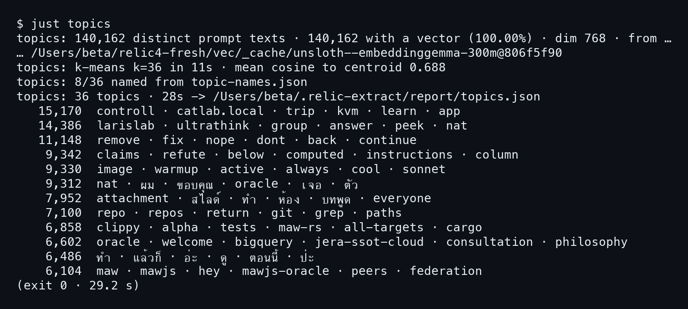

prompt ที่ไม่ซ้ำกันมี 140,162 ข้อ และทุกข้อมี vector ครบ 100.00% (dim 768) k-means ใช้เวลา 11 วินาที ค่า cosine เฉลี่ยถึง centroid อยู่ที่ 0.688 ทั้งคำสั่งจบใน 28 วินาที แล้วเขียน `topics.json`

### ขั้นที่ 2 — อ่านรายการคำ แล้วตั้งชื่อเอง

ใต้หัวมีรายการ 36 กลุ่ม แต่ละบรรทัดคือจำนวน prompt กับหกคำเด่นของกลุ่ม ระบบตั้งชื่อให้เองไม่ได้ ได้แต่คำเด่น ชื่อจริงต้องมีคนอ่านแล้วตั้ง

กลุ่มใหญ่สุดมี 15,170 prompt อ่านจากคำเด่นรู้ทันทีว่าเป็นงานเครื่องและ kvm ส่วนกลุ่ม cargo กับ clippy คือรอบแก้ lint ของ maw-rs บรรทัดแสดงผลที่ `topics:` บอกว่า **มีชื่อที่ตั้งไว้ใน `topic-names.json` แล้วแค่ 8 จาก 36 กลุ่ม** ที่เหลือหน้าเว็บใช้คำเด่นแทนจนกว่าจะมีคนมาตั้งชื่อให้

## 5.2 งานที่สั่งไป ลงเป็น commit ไหม

### ขั้นที่ 1 — เทียบ prompt กับ commit กับ note ด้วย just work

พิมพ์ `just work` แล้วตัดเอา 12 บรรทัดท้าย คำสั่งนี้ไล่ 40 repository เอาจำนวน prompt ที่พิมพ์ในโปรเจกต์นั้นมาวางข้าง commit ไฟล์ md และ note ใน vault ส่วนคอลัมน์ `per100` คือ **commit ต่อ prompt 100 ข้อ** ยิ่งสูงยิ่งแปลว่าสั่งน้อยแต่ลงงานเยอะ

```bash
just work | tail -12
```

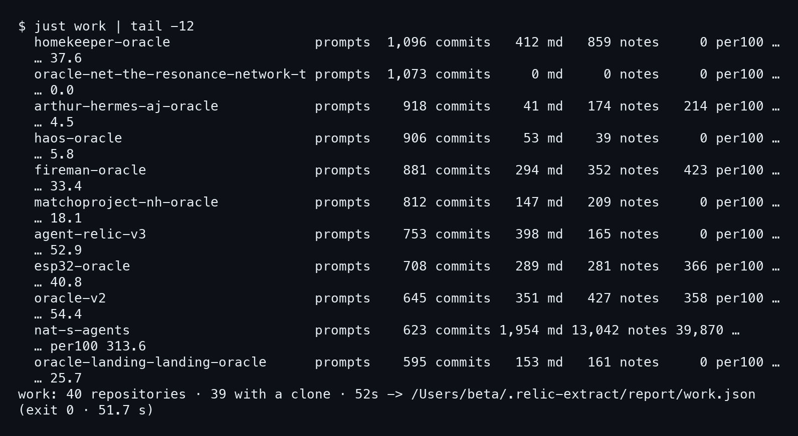

บรรทัดสุดท้ายสรุปว่าเจอ `40 repositories · 39 with a clone` คือมี repo หนึ่งที่ clone ไม่อยู่ในเครื่อง เลยไม่มี commit ให้นับ ใช้เวลา 52 วินาที

### ขั้นที่ 2 — อ่านสามแถวที่ต่างกันสุด

เลือกมาสามแถวจากท้ายตาราง

```
oracle-net-the-resonance-network-t prompts 1,073 commits 0 … per100 0.0
oracle-v2        prompts   645 commits   351 … notes 358 per100  54.4
nat-s-agents     prompts   623 commits 1,954 … notes 39,870 per100 313.6
```

oracle-net มี prompt 1,073 ข้อแต่ commit เป็น 0 ส่วน nat-s-agents พิมพ์แค่ 623 ข้อ แต่มี commit 1,954 และ note ถึง 39,870 ได้ per100 = 313.6 **prompt จำนวนใกล้กันให้ commit ต่อ 100 prompt ได้ตั้งแต่ 0 ถึง 313** เลยอย่าเอาจำนวน prompt ไปวัดว่าทำงานเยอะ ภาพของข้อนี้อยู่ใน S5 ท้ายบท

## 5.3 oracle เกิดเมื่อไหร่ อยู่นานแค่ไหน

### ขั้นที่ 1 — นับ oracle ตามอายุ ด้วย just oracles

พิมพ์ `just oracles` แล้วตัดเจ็ดบรรทัดท้าย บรรทัดแรกบอกยอดรวม ที่เหลือแบ่ง oracle เป็นห้าช่วงอายุ **อายุคือจำนวนวันตั้งแต่ prompt แรกถึง prompt สุดท้ายของ oracle นั้น**

```bash
just oracles | tail -7
```

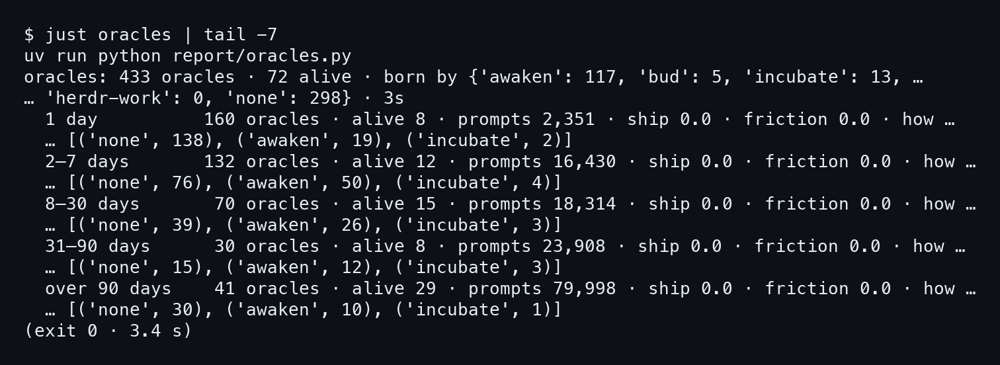

```
oracles: 433 oracles · 72 alive · born by {'awaken': 117, 'bud': 5,
  'incubate': 13, 'herdr-work': 0, 'none': 298} · 3s
```

มี 433 oracle ยังอยู่ 72 ตัว เกิดด้วย `awaken` 117 ตัว `incubate` 13 ตัว `bud` 5 ตัว และอีก 298 ตัวตามหาวิธีเกิดไม่เจอ (`none`)

### ขั้นที่ 2 — ดูว่าอายุมากน้อยต่างกันอย่างไร

อ่านทีละแถว

```
1 day          160 oracles · alive 8  · prompts 2,351
over 90 days    41 oracles · alive 29 · prompts 79,998
```

oracle ที่อยู่แค่วันเดียวมี 160 ตัว ยังเหลือ 8 ตัว และรวมกันได้แค่ 2,351 prompt ส่วนพวกอยู่เกิน 90 วันมีแค่ 41 ตัว แต่ 29 ตัวยังอยู่ และถือ prompt เกือบ 80,000 ข้อ **ส่วนใหญ่ของงานมาจาก oracle กลุ่มเล็กที่อยู่ยาว** แถว ship กับ friction ในตารางเป็น 0.0 ทุกแถว เล่มนี้เลยไม่ใช้สองคอลัมน์นั้น ภาพในหน้าเว็บอยู่ที่ S3

## 5.4 vault รู้ไหมว่าเราถามอะไร

### ขั้นที่ 1 — วัด vault เทียบกับ prompt ของ oracle เดียวกัน

พิมพ์ `just memory` โดยชี้ `RELIC4_ROOT` ไปที่ relic4-fresh คำสั่งนี้เอา note ใน ψ vault ของแต่ละ oracle ไปวางใน vector space เดียวกับ prompt แล้วดูว่า **prompt ของ oracle ตัวนั้นใกล้ note ของตัวเองกว่า note ของ oracle อื่นไหม**

```bash
RELIC4_ROOT=~/relic4-fresh just memory | head -10
```

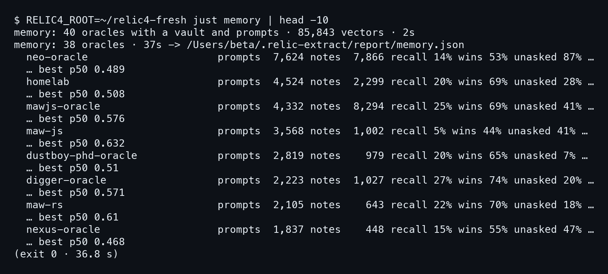

หัว output บอกว่ามี 40 oracle ที่มีทั้ง vault และ prompt รวม 85,843 vector และได้ผลออกมา 38 ตัวใน 37 วินาที

### ขั้นที่ 2 — อ่านสี่คอลัมน์

ผมไม่ใช้ cosine ตายตัวเป็นเส้นตัดสิน เพราะ prompt สั้นกับ note ยาวแทบไม่เคยใกล้กันเกิน 0.7 จึงเทียบกับ note ของ oracle อื่นแทน

- `recall` คือสัดส่วน prompt ที่ note ของตัวเองดีกว่าเปอร์เซ็นไทล์ที่ 90 ของ oracle อื่นชัดเจน
- `wins` คือสัดส่วนที่ vault ตัวเองชนะ vault ของคนอื่นเลย
- `unasked` คือสัดส่วน note ที่ไม่ใกล้ prompt ของตัวเองกว่าที่ใกล้ prompt ของคนอื่น

```
digger-oracle  prompts 2,223 notes 1,027 recall 27% wins 74% unasked 20%
neo-oracle     prompts 7,624 notes 7,866 recall 14% wins 53% unasked 87%
```

digger-oracle ชนะ 74% และมี note ที่ไม่มีใครถามแค่ 20% ส่วน neo-oracle มี note เกือบเท่ากับ prompt แต่ 87% ของ note ใกล้ prompt ของ oracle อื่นมากกว่าของตัวเอง **จำนวน note เยอะไม่ได้แปลว่า vault ตรงกับงาน**

## 5.5 สร้างหน้า สามมุมมองจากคำสั่งเดียว

### ขั้นที่ 1 — build ด้วย just report

พอตัวเลขอยู่ใน `~/.relic-extract/report/` ครบ ก็ประกอบเป็น HTML ไฟล์เดียวได้ สั่ง build ฉบับเต็มกับฉบับ public ต่อกัน

```bash
just report && just report-public
```

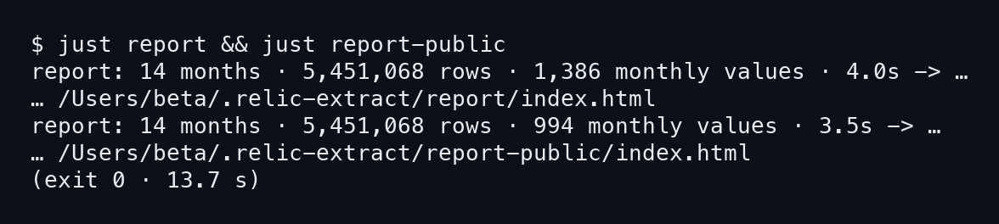

```
report: 14 months · 5,451,068 rows · 1,386 monthly values · 4.0s
report: 14 months · 5,451,068 rows ·   994 monthly values · 3.5s
```

สองฉบับมี 14 เดือนและ 5,451,068 แถวเท่ากัน ต่างกันที่ฉบับ public เหลือค่ารายเดือน 994 ค่า จาก 1,386 ของฉบับเต็ม **ฉบับ public มีค่ารายเดือนน้อยกว่า** เหตุผลที่ตัดไม่ได้อยู่ในผลที่จับมา ทั้งสองคำสั่งรวมกันใช้ไม่ถึง 14 วินาที

### ขั้นที่ 2 — มุมมองที่สามคือ share

มุมมองที่สามชื่อ `report-share` สร้างตอน `just publish` ในบท 7 ตัวตรวจในหัวข้อถัดไปเลยรวมครบทั้งสาม คือ report, report-share และ report-public

## 5.6 ตรวจทุกมุมมองด้วย jsdom

### ขั้นที่ 1 — รัน check.js

สร้างเสร็จยังไม่พอ ต้อง **เปิดหน้าจริงใน jsdom แล้วนับว่าของขึ้นครบ** รันครั้งเดียวได้ทุกมุมมอง ทั้งสองภาษา

```bash
node check.js
```

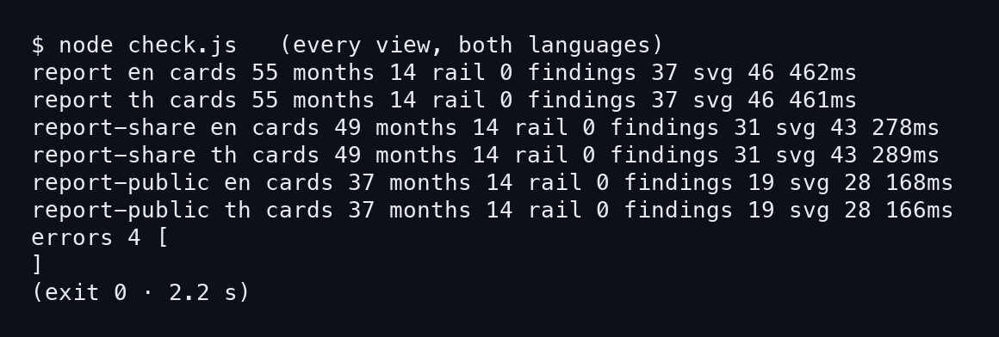

output มีหกบรรทัด สามมุมมอง คูณ `en` กับ `th`

```
report        th cards 55 months 14 rail 0 findings 37 svg 46 461ms
report-share  th cards 49 months 14 rail 0 findings 31 svg 43 289ms
report-public th cards 37 months 14 rail 0 findings 19 svg 28 166ms
errors 4 [
]
```

ทุกมุมมองมี 14 เดือน ฉบับเต็มมี 55 card ฉบับ share 49 และฉบับ public 37 จำนวน card ของภาษาอังกฤษกับไทยตรงกัน

### ขั้นที่ 2 — อ่านบรรทัด errors

บรรทัดสุดท้ายเขียนว่า `errors 4` และวงเล็บข้างล่างว่างเปล่า capture นี้จึงบอกได้แค่จำนวน ไม่บอกว่าเป็นข้อความอะไร **อย่าเขียนสาเหตุที่ output ไม่ได้พิมพ์ออกมา** ถ้าจะเอาเลขนี้เป็นศูนย์ ต้องเปิดรายละเอียดของ error ออกมาอ่านก่อน

## 5.7 หน้าจริง

### ขั้นที่ 1 — ภาพรวม

เปิดหน้าไทยแล้ว **เจอภาพรวมก่อน** ภาพนี้คือผลของ `just report` ที่เห็นข้างบน

```
report: 14 months · 5,451,068 rows
```

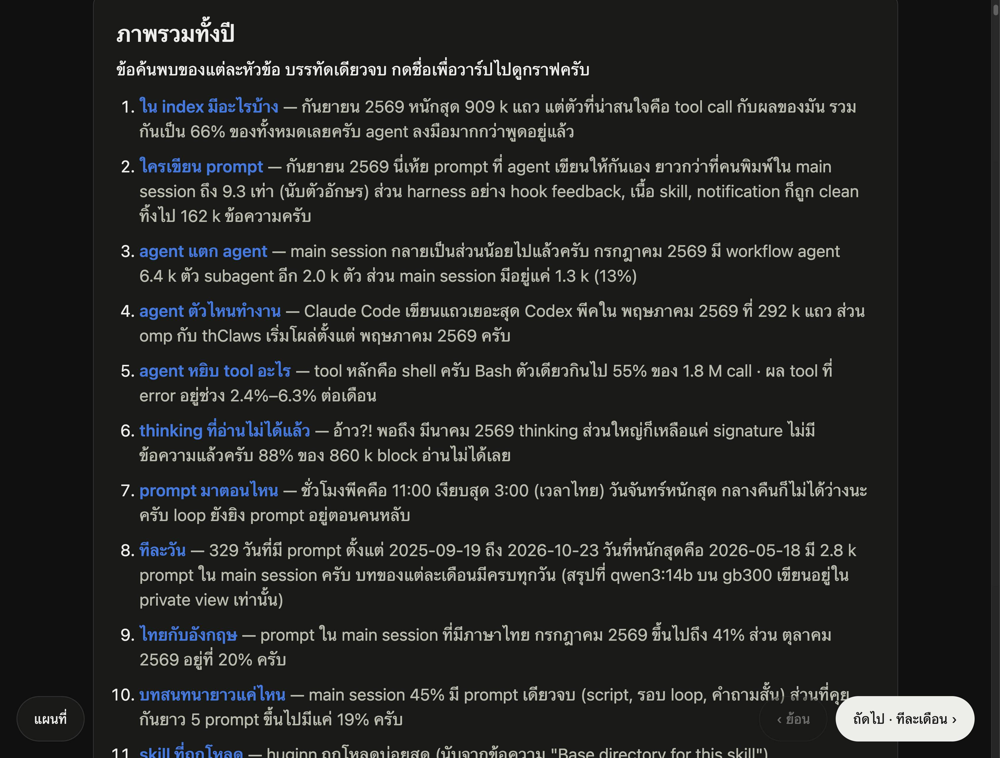

### ขั้นที่ 2 — แผนที่ความหมาย

ส่วน **semantic map** คือผลของ k-means ในหัวข้อ 5.1 ที่ย้ายมาอยู่บนแผนที่

```
topics: k-means k=36 in 11s · mean cosine to centroid 0.688
```

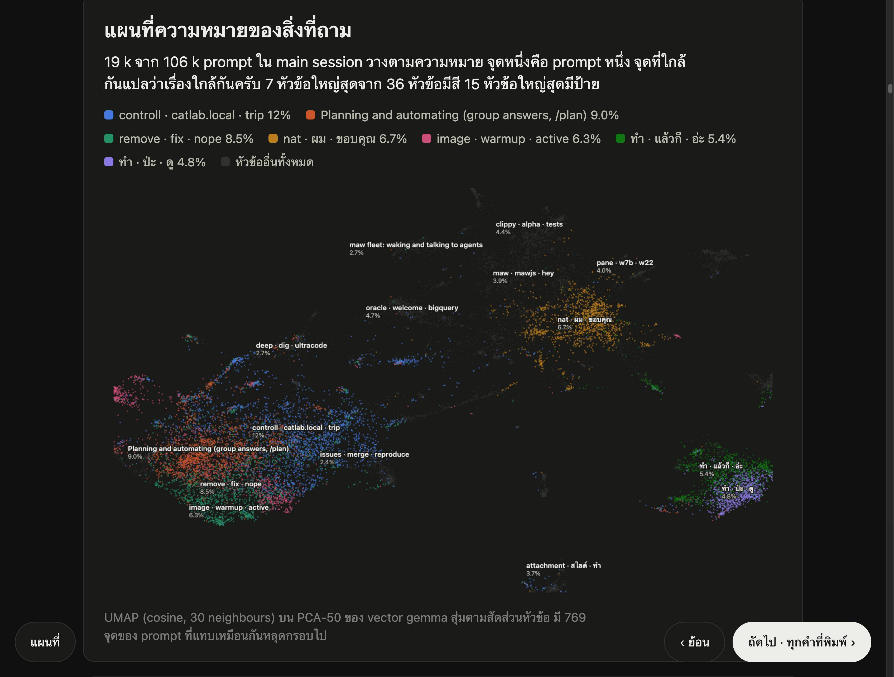

### ขั้นที่ 3 — oracle เกิดอย่างไร

ส่วนนี้ **เอาตารางอายุ**กับวิธีเกิดจาก 5.3 มาเป็นรูป

```
oracles: 433 oracles · 72 alive
```

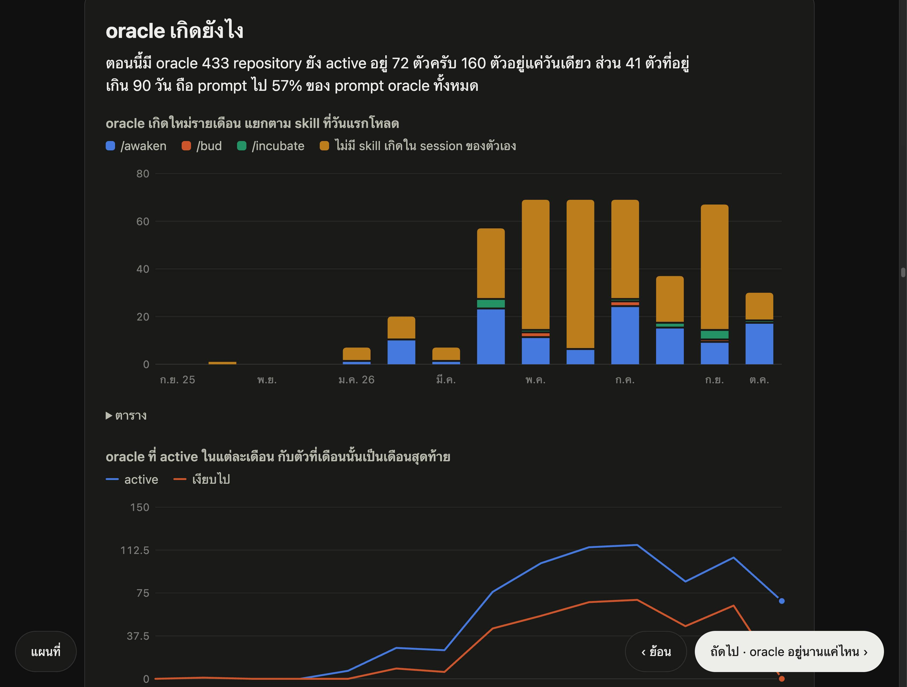

### ขั้นที่ 4 — ทีละวัน

ส่วน **day by day** เป็นใจกลางของรายงาน ทุกวันหนึ่งช่อง

```
report: 14 months · 5,451,068 rows
```

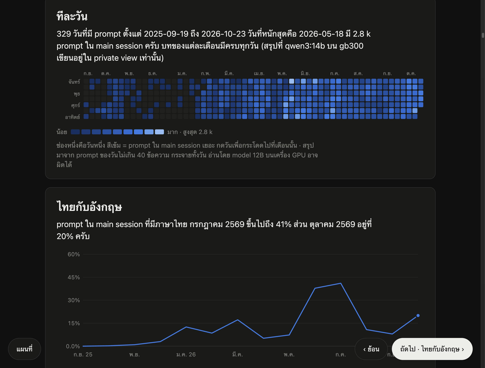

### ขั้นที่ 5 — งานลงไหม

ส่วนสุดท้าย **คือตาราง** prompt เทียบ commit เทียบ note ของ 5.2

```
work: 40 repositories · 39 with a clone
```

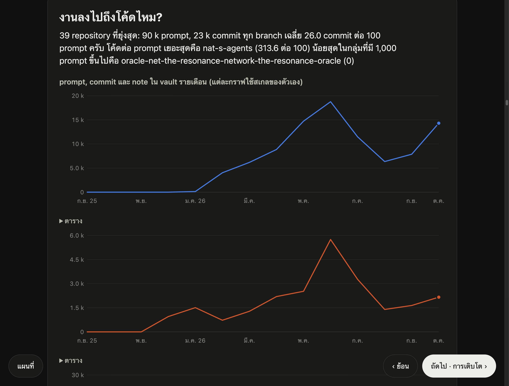

คำอ่านรายวันมาจาก model บน gb300 บทหน้าเทียบ model สี่ตัวว่าตัวไหนอ่านได้ตรงที่สุด
