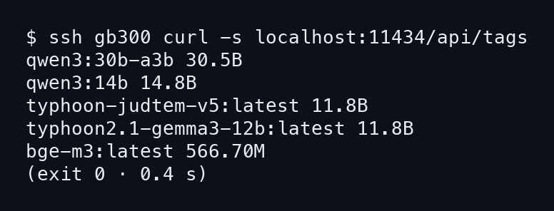
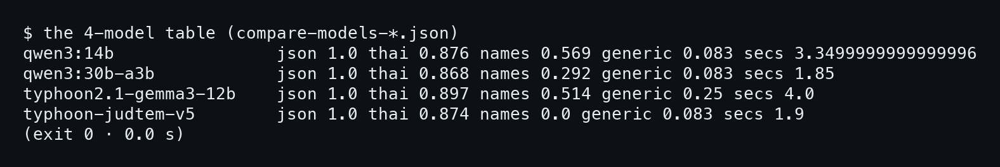
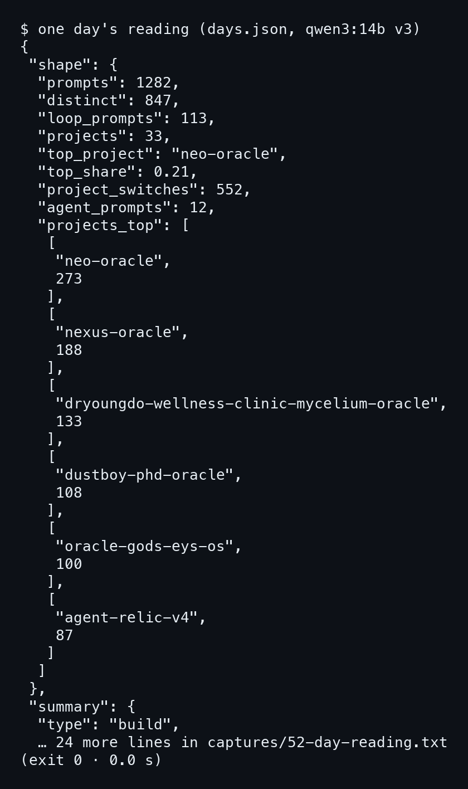
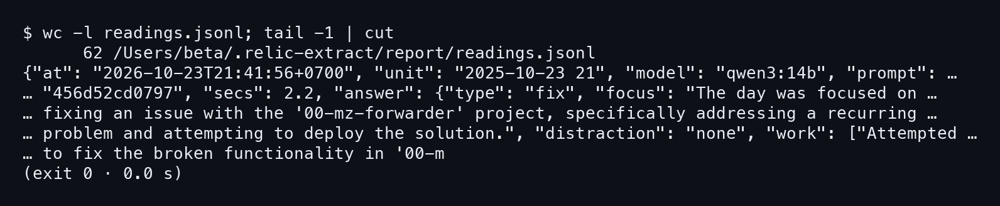

# บทที่ 6: อ่านทีละวันด้วย model บน gb300

บทที่แล้วเราได้ตัวเลขของแต่ละวันมาครบ ทั้ง prompt กี่อัน กี่โปรเจกต์ สลับกันกี่ครั้ง แต่ตัวเลขบอกไม่ได้ว่า "วันนั้นทำอะไร" ส่วนนี้ให้ model บน gb300 อ่านแทน ทีละวัน แล้วเขียนสรุปกลับมาเป็น JSON

## 6.1 gb300 มี model อะไรบ้าง

### ขั้นที่ 1 — ถาม ollama ว่าเครื่องถืออะไรอยู่

ก่อนเลือก model ก็ต้องรู้ก่อนว่ามีอะไรให้เลือก ollama บน gb300 ฟังที่พอร์ต 11434 สั่ง `/api/tags` ผ่าน ssh ได้เลย

```bash
ssh gb300 curl -s localhost:11434/api/tags
```



มี 5 ตัว: `qwen3:30b-a3b`, `qwen3:14b`, `typhoon-judtem-v5`, `typhoon2.1-gemma3-12b` และ `bge-m3` ตัวสุดท้ายเป็น embedding ที่บทที่ 3 ใช้อยู่แล้ว เหลือ 4 ตัวที่เขียนข้อความได้ **สี่ตัวนี้คือผู้เข้าแข่งขัน** ตัวหนึ่งขนาด 30.5B, ตัวหนึ่งเป็น 14.8B ธรรมดา อีกสองตัวเป็นสาย typhoon ที่เน้นภาษาไทยขนาด 11.8B

## 6.2 สี่ model อ่าน 12 วันเดียวกัน แล้วให้คะแนน

### ขั้นที่ 1 — ใช้ prompt เดียว วันเดียวกัน ทุกตัว

เราเลือก 12 วันที่งานแน่นที่สุดของแต่ละเดือน ส่ง prompt เดียวกันให้ทั้งสี่ตัว แล้ว**วัดห้าอย่าง** คือตอบเป็น JSON ได้ไหม (`json`) สัดส่วนภาษาไทย (`thai`) ชื่อโปรเจกต์ที่พูดถึงตรงกับของจริงแค่ไหน (`names`) วลีกว้าง ๆ แบบ "หลายโปรเจกต์" (`generic`) และเวลาต่อวัน (`secs`) ตารางอยู่ในไฟล์ `compare-models-*.json` ที่สคริปต์เขียนไว้

```
$ the 4-model table (compare-models-*.json)
```



บรรทัดที่เราสนใจสองบรรทัดแรก:

```
qwen3:14b              json 1.0 thai 0.876 names 0.569 generic 0.083 …
typhoon-judtem-v5      json 1.0 thai 0.874 names 0.0 generic 0.083 …
```

### ขั้นที่ 2 — อ่านตารางให้ถูกด้าน

**json กับ thai ไม่แยกใครออก** ทั้งสี่ตัวตอบ JSON ได้ครบ (1.0) และสัดส่วนภาษาไทยอยู่แถว 0.87-0.90 เท่ากันหมด ที่แยกกันคือ `names` กับ `generic` qwen3:14b ได้ names 0.569 (ราว 0.54 เมื่อ normalise ชื่อ) ส่วน generic 0.08 ใช้เวลา 3.3 วินาทีต่อวัน

typhoon2.1-gemma3-12b ได้ names ราว 0.54 เท่ากัน แต่ generic 0.25 คือเขียนวลีกว้าง ๆ มากกว่าสามเท่า และช้ากว่าที่ 4.0 วินาที qwen3:30b-a3b เร็วสุดที่ 1.9 วินาที แต่ names เหลือ 0.29 คือจำชื่อโปรเจกต์ได้ไม่ถึงครึ่ง

### ขั้นที่ 3 — ตัวที่ล้มคือ typhoon-judtem-v5

typhoon-judtem-v5 ได้ names 0.00 เพราะมัน**แต่งชื่อขึ้นมาเอง** ในบทสรุปมีคำว่า "ลูกค้า" (customer) โผล่มา ทั้งที่ข้อมูลไม่มีลูกค้าสักคน json กับ thai ผ่านหมด ถ้าดูแค่สองคอลัมน์นั้นก็จะไม่เห็นเลย นี่คือเหตุผลที่ต้องวัด names แยก

> เราเลือก qwen3:14b: ชื่อโปรเจกต์ถูกพอ ๆ กับตัวที่ดีที่สุด วลีกว้างอยู่ในกลุ่มต่ำสุด และไม่ช้า

## 6.3 วันหนึ่ง ตามที่ qwen3:14b อ่าน

### ขั้นที่ 1 — เปิด days.json ดูวันหนึ่ง

ผลของแต่ละวันเก็บใน `days.json` สองก้อน ก้อน `shape` คือตัวเลขที่นับเอง ไม่ผ่าน model ก้อน `summary` คือที่ model เขียน (prompt v3)

```
$ one day's reading (days.json, qwen3:14b v3)
```



ก้อน shape ของวันหนึ่ง:

1,282 prompt กระจายไป 33 โปรเจกต์ neo-oracle ได้มากสุด 273 อัน หรือ 21% สลับโปรเจกต์ 552 ครั้ง ตัวเลขพวกนี้ **นับเอง ไม่ผ่าน model**

### ขั้นที่ 2 — อ่านก้อน summary

`summary` มีฟิลด์ `type`, `focus`, `distraction`, `work` (list), `agents`, `pattern` แล้วก็ `en` กับ `th` สองภาษา วันนั้น model ตอบว่า type เป็น `build` focus คือสร้างและปรับฟีเจอร์ของ neo-oracle กับ nexus-oracle ส่วน distraction คือสลับโปรเจกต์บ่อยและต้องตอบข้อความ mid-turn จาก agent

สองหัวข้อแรกใน `work` ตรงกับสองอันดับแรกของ `projects_top`: neo-oracle กับ nexus-oracle **ชื่อที่ model เขียนตรวจย้อนกลับไปหา shape ได้** ตรงนี้ทำให้ไว้ใจได้ระดับหนึ่ง

### ขั้นที่ 3 — ข้อจำกัดที่ต้องบอกตรง ๆ

ช่อง `type` ยังอ่อน prompt v2 ตอบ "mixed" 275 วัน พอเขียน v3 ใหม่ เหลือ "mixed" แค่ 12 วัน แต่ไปติด "build" แทน 260 วัน **type ยังบอกอะไรไม่ได้มาก** เพราะเกือบทุกวันกลายเป็น build ให้อ่านช่อง focus กับ work แทน

ส่วนที่ v3 ทำได้ดีขึ้นคือคำไทยที่ฟังเหมือน AI เขียน ลดจาก 36 วันเหลือ 19 วัน การอ่านทั้งหมด 329 วัน ให้ qwen3:14b อ่าน 326 วัน ใช้เวลา 1,104 วินาที

## 6.4 ทุกคำตอบถูกเก็บ: readings.jsonl

### ขั้นที่ 1 — เขียนต่อท้ายไฟล์ ไม่เขียนทับ

prompt จะเปลี่ยนอีกแน่ (v1 เป็น v2 เป็น v3) ถ้าเขียนทับ `days.json` ทุกครั้ง คำตอบเก่าก็หายและเทียบกันไม่ได้ เลยมีไฟล์ `readings.jsonl` ที่ทุกครั้งที่ model ตอบ **เพิ่มหนึ่งบรรทัด ไม่แก้บรรทัดเก่า** (ตอนนี้มี 62 บรรทัด บรรทัดล่าสุดเป็นหน่วยรายชั่วโมง ไม่ใช่การอ่าน 329 วัน)

```bash
wc -l readings.jsonl; tail -1 | cut
```



prompt ใหม่ได้ hash ใหม่ คำตอบเก่ายังอยู่ บทต่อไป publish ขึ้นเว็บ
