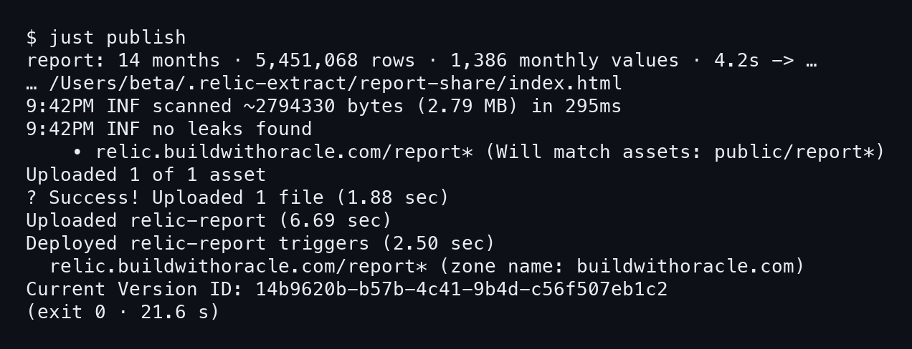
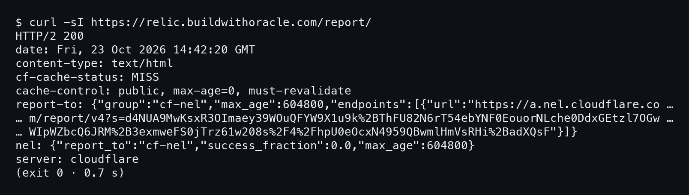
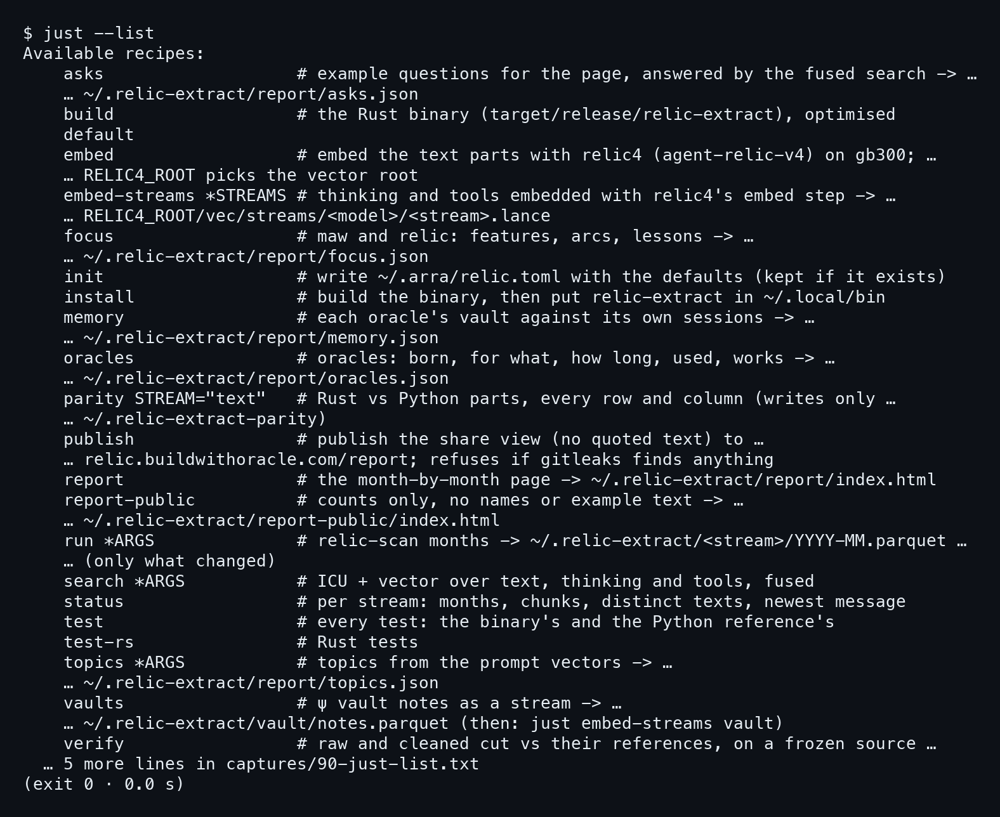

# บทที่ 7: publish

หน้ารายงานที่สร้างจากบทก่อนยังอยู่แค่ในเครื่อง m5 บทนี้เอามันขึ้นเว็บ
โดยมีเงื่อนไขข้อเดียว คือ gitleaks ต้องไม่เจออะไรรั่ว ไม่งั้นไม่ deploy

## 7.1 just publish — สร้าง share view, ตรวจ gitleaks, deploy

### ขั้นที่ 1 — สั่ง just publish ครั้งเดียวจบ

recipe `publish` ทำสามอย่างต่อกัน สร้าง share view ก่อน แล้วให้ gitleaks
สแกน แล้วค่อยส่งขึ้น Cloudflare Worker ถ้าขั้นไหนล้ม ขั้นถัดไปก็ไม่ทำ
**share view มีตัวเลขทุกตัว แต่ไม่มีข้อความที่ยกมาเลย**
จึงเอาขึ้นเว็บได้

```bash
just publish
```



บรรทัดแรกบอกว่า build เสร็จใน 4.2 วินาที จาก 14 เดือน
5,451,068 แถว และ 1,386 ค่ารายเดือน เขียนลงไฟล์
`~/.relic-extract/report-share/index.html`

```
report: 14 months · 5,451,068 rows · 1,386 monthly values · 4.2s -> …
scanned ~2794330 bytes (2.79 MB) in 295ms
no leaks found
```

### ขั้นที่ 2 — อ่านผล gitleaks ให้เป็น

gitleaks สแกนไฟล์ที่กำลังจะส่ง ขนาดประมาณ 2.79 MB ใช้ 295ms
แล้วพิมพ์ `no leaks found` นี่คือประตูของจริง **ถ้าเจอ leak recipe จะหยุดก่อนถึง wrangler**
ไฟล์จึงไม่ออกจากเครื่อง (ถ้าอยากเห็นมันหยุด ต้องมี secret
อยู่ในหน้าจริง ๆ ซึ่งรอบนี้ไม่มี เลยไม่ได้ทดสอบ)

### ขั้นที่ 3 — wrangler ส่งขึ้น Worker

ส่วนท้ายของ output มาจาก wrangler ตัว Worker ชื่อ `relic-report` เป็น
static assets ล้วน ไม่มีโค้ดฝั่ง server และผูกกับ route
`relic.buildwithoracle.com/report*` ในโซน `buildwithoracle.com`

```
Uploaded 1 of 1 asset
Uploaded relic-report (6.69 sec)
Deployed relic-report triggers (2.50 sec)
Current Version ID: 14b9620b-b57b-4c41-9b4d-c56f507eb1c2
(exit 0 · 21.6 s)
```

ทั้งหมดใช้ 21.6 วินาที exit 0 ได้ Version ID มาหนึ่งตัว ไว้อ้างถึงรอบ
deploy นี้ทีหลัง

## 7.2 หน้าจริงตอบกลับ

### ขั้นที่ 1 — ถามหัว HTTP ด้วย curl -I

deploy ว่าสำเร็จแล้วก็ยังไม่ควรเชื่อ ให้ยิงถามหน้าจริงอีกที `-sI` ขอเฉพาะ
header ไม่ดึงเนื้อหา

```bash
curl -sI https://relic.buildwithoracle.com/report/
```



**บรรทัดแรก `HTTP/2 200` คือคำตอบว่าหน้าขึ้นแล้ว** ใช้เวลา 0.7 วินาที
ส่วนที่เหลืออ่านได้สามเรื่อง

`server: cloudflare` ยืนยันว่าตอบจาก Cloudflare จริง `content-type`
เป็น `text/html` ตรงกับไฟล์ `index.html` ที่ส่งไป ส่วน `cache-control`
เป็น `max-age=0, must-revalidate` แปลว่า browser ต้องถามใหม่ทุกครั้ง
deploy รอบหน้าจึงเห็นทันที ไม่ติด cache ค้าง และ `cf-cache-status: MISS`
ในรอบนี้ก็บอกว่าคำขอนี้ไม่ได้ตอบจาก cache

## 7.3 ทุก recipe ใน justfile

### ขั้นที่ 1 — just --list คือแผนที่ของ recipe

บางขั้นของสายนี้เป็น recipe ใน justfile รายชื่อพร้อมคำอธิบาย
บรรทัดเดียวอยู่ในคำสั่งเดียว **อ่านรายการนี้แล้วเห็นว่า recipe ไหนครอบส่วนไหนของสาย**

```bash
just --list
```



บทสุดท้ายคือของที่พังจริงทั้งวัน และกฎที่ได้
