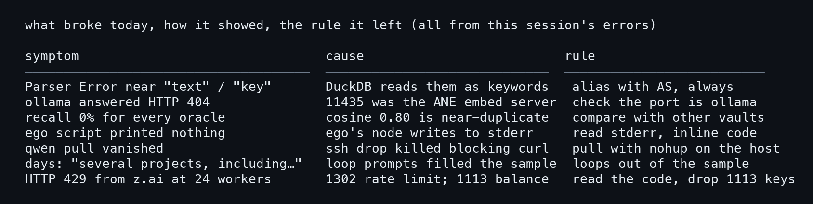
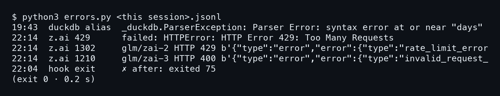
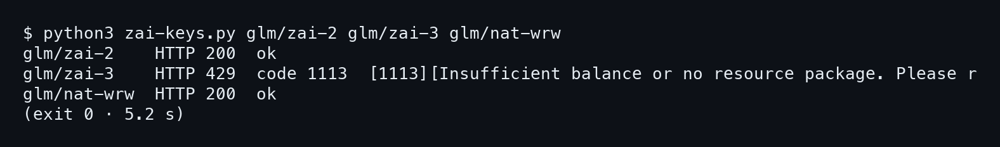
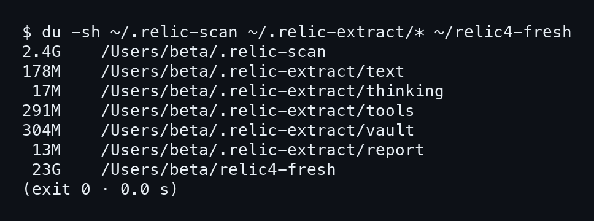
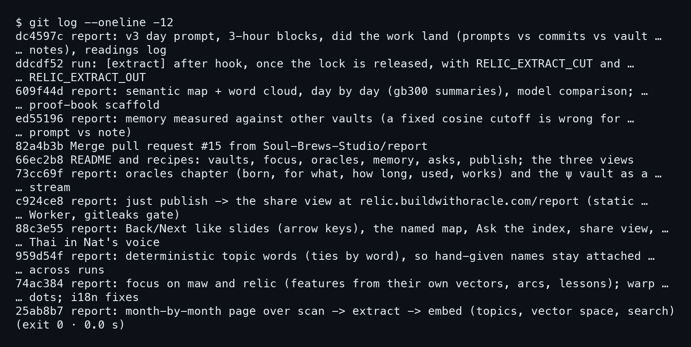

# บทที่ 8: สิ่งที่พัง และกฎที่ได้

วันเดียวที่รันทุกอย่างจริง มีเจ็ดอย่างที่พัง บทนี้เก็บทีละอย่างในรูปเดียวกัน
คือ เกิดอะไร · รู้ได้ยังไง · สาเหตุ · แก้ยังไง · กฎที่เหลือไว้ ของพวกนี้มาจาก
error ของ session นี้เอง ไม่ได้แต่งขึ้นเพื่อให้บทดูครบ

## 8.1 ตารางเจ็ดข้อ

### ขั้นที่ 1 — ดูการ์ดทั้งใบก่อน

เปิดการ์ด D2 แล้วอ่านสามคอลัมน์จากซ้ายไปขวา อาการ → สาเหตุ → กฎ
**ทุกแถวจบด้วยกฎหนึ่งบรรทัดที่เอาไปใช้ซ้ำได้** ส่วนที่เหลือของบทคือขยายแต่ละแถว



การ์ดบอกว่าเจ็ดอาการมีสาเหตุไม่ซ้ำกันเลย ไม่มีบั๊กเดียวที่ทำให้ทั้งวันล้ม

## 8.2 เจ็ดข้อ ทีละข้อ

### ขั้นที่ 1 — ดึง error จริงกลับมาจาก transcript

error พวกนี้ไม่ต้องจำ อ่านกลับจาก transcript ของ session เองได้ `errors.py`
ไล่เฉพาะ tool result แล้วพิมพ์ครั้งแรกที่ข้อความ error แต่ละแบบโผล่ (เวลาไทย)
**หลักฐานของบทนี้คือ transcript ไม่ใช่ความจำ**

```bash
python3 errors.py <this session>.jsonl
```



สามบรรทัดตรงกับการ์ด (DuckDB, 429, 1302) บรรทัด 1210 คือ glm-5.3 ปฏิเสธการปิด thinking และ hook exit 75 คือคำสั่ง `after` ของ relic5
ที่ตอบ 75 จน relic5 เปลี่ยนเป็น `index --wait` แถวอื่น (port 11435, cosine, ego) ไม่ทิ้ง error ไว้ อาการของมันคือผลผิดหรือความเงียบ

### ขั้นที่ 2 — DuckDB อ่าน text กับ key เป็น keyword

อาการคือ `Parser Error` near `"days"` ในภาพ และ `text` กับ `key` ก็แบบเดียวกัน สาเหตุ DuckDB
ถือคำพวกนี้เป็น keyword **ใส่ alias ด้วย AS เสมอ** ไม่ต้องเดาว่าคำไหนสงวน

### ขั้นที่ 3 — port 11435 ไม่ใช่ ollama

ollama ตอบ HTTP 404 สาเหตุคือ 11435 เป็น ANE embed server ไม่ใช่ ollama
พอเข้าใจผิดว่าเป็นของเดียวกัน request ก็ไปผิดที่ แก้โดยเช็กก่อนว่า port
ที่ยิงคือ ollama จริง **กฎคือเช็ก port ก่อนโทษ model**

### ขั้นที่ 4 — cosine 0.80 ตายตัวให้ recall 0%

recall ออก 0% ทุก oracle สาเหตุ cosine 0.80 คือเกณฑ์ของข้อความที่เกือบซ้ำกัน
แต่ prompt กับโน้ตใน vault ไม่เคยใกล้กันขนาดนั้น แก้โดยวัดเทียบกับ vault อื่น
**กฎคือเกณฑ์ตายตัวใช้ไม่ได้ ต้องมีตัวเทียบ** commit `ed55196` คือตัวที่แก้

### ขั้นที่ 5 — script ของ ego ไม่พิมพ์อะไรเลย

script รันจบแต่หน้าจอว่าง สาเหตุคือ node ของ ego เขียนลง stderr ไม่ใช่ stdout
ใน FACTS ระบุว่า script ที่ import node:fs ก็ไม่พิมพ์อะไร
**กฎคืออ่าน stderr และใช้ inline code**

### ขั้นที่ 6 — pull ของ qwen หายกลางทาง

ssh หลุด แล้ว curl แบบ blocking ที่ผูกกับ session ก็ตายตาม model ที่ pull
ค้างหายไป แก้โดยสั่ง pull ด้วย nohup บน host เอง
**กฎคือของที่ช้ากว่า connection ต้องรันบนเครื่องปลายทาง** ไม่ผ่านท่อ ssh

### ขั้นที่ 7 — "several projects, including…"

ผลอ่านรายวันรุ่นแรกขึ้นต้นว่า "several projects, including…" ซ้ำเป็นแพตเทิร์น
สาเหตุคือ prompt จากลูป (loop) เข้ามาเต็มตัวอย่างที่ส่งให้ model
แก้โดยเอาลูปออกจากตัวอย่าง แล้วทั้ง v3 ทำให้คำ AI-tell ภาษาไทยเหลือ 19 วัน จาก 36
**กฎคือตัวอย่างที่ป้อนต้องไม่มีของที่วนซ้ำ** commit `dc4597c` ส่ง prompt v3

### ขั้นที่ 8 — z.ai ตอบ HTTP 429 และ key หนึ่งเงินหมด

ยิง 24 worker พร้อมกัน แล้วได้ HTTP 429 รหัส 1302 คือ rate limit แก้โดย
รอตาม retry-after หมุน key แล้วรันใหม่ด้วย 4 worker แต่พอเช็ก key ทีละตัว ก็เจออีกเรื่อง

```bash
python3 zai-keys.py glm/zai-2 glm/zai-3 glm/nat-wrw
```



`glm/zai-3` ตอบ 429 เหมือนกัน แต่รหัสเป็น 1113 คือ balance หมด รอเท่าไรก็ไม่หาย
`readings.py` เลยถอด key ที่ตอบ 1113 ออกจากวงทันที **กฎคือ 429 ตัวเดียวกัน
อาจเป็นสองเรื่อง อ่านรหัสข้างในก่อน retry**

## 8.3 สิ่งที่ chain ทิ้งไว้บนดิสก์

### ขั้นที่ 1 — วัดขนาดด้วย du

จบวันแล้วให้วัดว่าทั้งหมดหนักแค่ไหน คำสั่งเดียว ชี้ทุก directory ของ chain

```bash
du -sh ~/.relic-scan ~/.relic-extract/* ~/relic4-fresh
```

ตัวเลขที่ควรดู:

```
2.4G	/Users/beta/.relic-scan
178M	/Users/beta/.relic-extract/text
291M	/Users/beta/.relic-extract/tools
 23G	/Users/beta/relic4-fresh
```



**ข้อความที่ clean แล้วเล็กกว่า index ต้นทางมาก** แต่ vector ที่ embed แล้ว
(relic4-fresh) ใหญ่กว่าทุกอย่างรวมกัน thinking 17M, vault 304M และ report 13M
เล็กพอจะเก็บไว้ข้างกันได้

## 8.4 ที่ยังอ่อน และที่รันต่อ

ยังอ่อนอยู่จุดหนึ่ง คือ field type: v2 → v3 ทำให้ "mixed" จาก 275 เหลือ
12 วัน แต่พอเปลี่ยนก็กลายเป็น "build" 260 วัน แปลว่าการจัดประเภทยังไม่แม่น

ที่รันต่ออยู่ คือ lane ที่สองบน z.ai ราว 30-70 วินาทีต่อหน้าต่างเมื่อเปิด thinking

## 8.5 commit ที่แบกการแก้

### ขั้นที่ 1 — อ่าน git log

ดู 12 commit ล่าสุดว่าการแก้ข้างบนลงที่ไหนบ้าง

```bash
git log --oneline -12
```



**มีสอง commit ที่ตรงกับตารางตรง ๆ** คือ `ed55196` (memory วัดเทียบ vault อื่น
เพราะ cutoff ตายตัวผิด) กับ `dc4597c` (prompt วันแบบ v3) ส่วน `ddcdf52`
ย้าย hook [extract] ไปรันหลังปล่อย lock ที่เหลือคือฟีเจอร์ของ report
