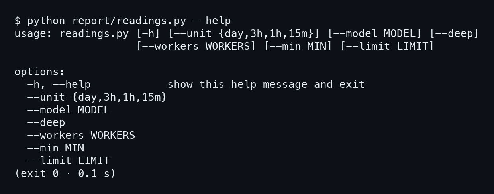
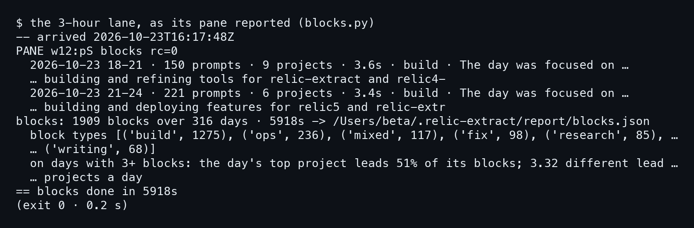
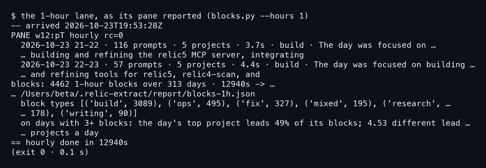
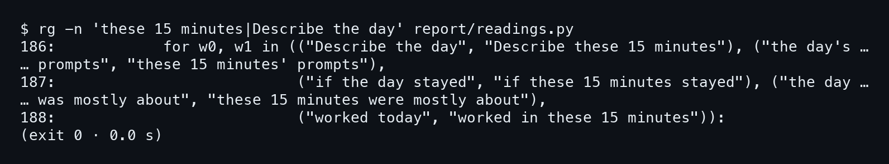
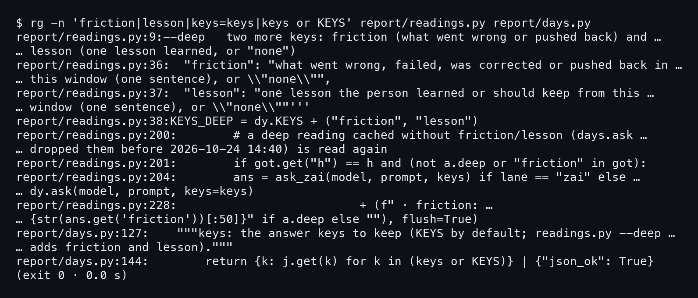
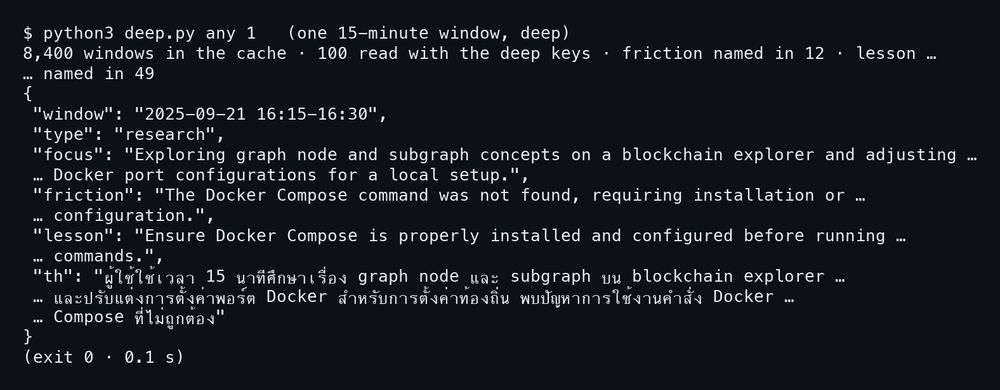
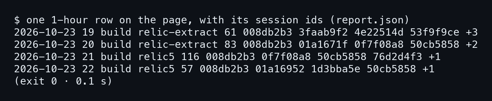
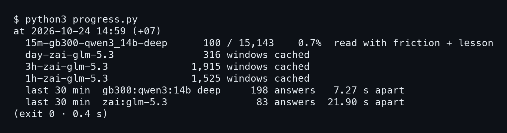
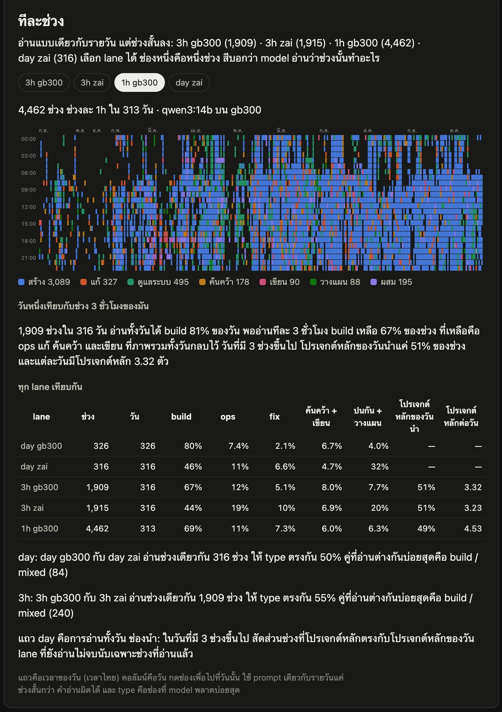

# บทที่ 9: อ่านทีละช่วง — 3 ชั่วโมง 1 ชั่วโมง 15 นาที

บทที่ 6 อ่านทีละวัน แล้วเจอข้อจำกัดเดียว คือวันหนึ่งหยาบเกินไป วันที่ model ตอบว่า "build" อาจมี ops, fix, research ซ่อนอยู่ข้างใน บทนี้เอา prompt ชุดเดิมไปรันบนช่วงที่สั้นลง แล้วดูว่าภาพเปลี่ยนไปแค่ไหน

## 9.1 readings.py — script เดียว สี่ขนาดช่วง

readings.py เป็นตัวอ่านตัวเดียวที่เลือกขนาดช่วงได้ ตั้งแต่ day, 3h, 1h ไปจนถึง 15m และเลือก model ได้ว่าจะอ่านบน gb300 หรือส่งไป z.ai ส่วน `--deep` เพิ่มคำตอบอีกสองข้อ

### ขั้นที่ 1 — ดู option ทั้งหมดด้วย --help

เริ่มจากถาม script ว่ารับอะไรบ้าง ไม่ต้องรันอะไรจริง

```bash
python report/readings.py --help
```



อ่านเฉพาะบรรทัดแรกของ option ก็พอ `--unit {day,3h,1h,15m}` คือ **ขนาดช่วงที่จะอ่าน** ส่วน `--model` เลือก model และ `--deep` เปิดคำตอบเพิ่ม `--workers` กำหนดจำนวนคำขอพร้อมกัน ส่วน `--min` คือจำนวน prompt ขั้นต่ำของช่วงที่จะอ่าน และ `--limit` จำกัดจำนวนช่วงตอนทดลอง (ดูใน report/readings.py)

## 9.2 ช่วง 3 ชั่วโมงกับช่วง 1 ชั่วโมง

สองช่วงนี้รันด้วย blocks.py ซึ่งใช้ prompt เดียวกับ day reading ทุกอย่าง ต่างกันแค่ตัดเวลาเป็นก้อนสั้นลง สองตัวอย่างข้างล่างเป็นรายงานที่ pane ส่งกลับมาใน session นี้ ไม่ได้รันซ้ำตอนเขียนบท

### ขั้นที่ 1 — อ่านรายงานของ lane 3 ชั่วโมง

blocks.py จบด้วยบรรทัดสรุป นับจำนวนก้อน ชนิด และสัดส่วนที่ project อันดับหนึ่งของวันเป็นหัวหน้าก้อน

```
blocks: 1909 blocks over 316 days · 5918s -> …/report/blocks.json
  on days with 3+ blocks: the day's top project leads 51% of its blocks;
  3.32 different lead projects a day
```



as the pane reported: 1,909 ก้อน บน 316 วัน ใช้ 5,918 วินาที ชนิดส่วนใหญ่ยังเป็น build 1,275 แต่ ops 236, fix 98, research 85 โผล่ขึ้นมาแล้ว **วันที่เคยเป็น "build" ทั้งวัน แตกเป็นหลายงาน** ค่าเฉลี่ย 3.32 คือในวันหนึ่งมี project นำไม่ซ้ำกันกี่ตัว

### ขั้นที่ 2 — เทียบกับ lane 1 ชั่วโมง

ตัดให้ละเอียดอีกขั้นด้วย `--hours 1` ผลที่ pane รายงานกลับมาเป็นดังนี้

```
blocks: 4462 1-hour blocks over 313 days · 12940s -> …/blocks-1h.json
  on days with 3+ blocks: the day's top project leads 49% of its blocks;
  4.53 different lead projects a day
```



ก้อนเพิ่มเป็น 4,462 ชนิด build ลดเหลือ 3,089 ส่วน ops 495, fix 327, mixed 195, research 178, writing 90 **ช่วงสั้นลง ผลก็ละเอียดขึ้น** project อันดับหนึ่งของวันนำเหลือ 49% และ project นำต่อวันเพิ่มเป็น 4.53 ตัว

## 9.3 "The day was focused on…" หลุดเข้ามาใน reading ช่วงสั้น

ดูบรรทัดตัวอย่างในรายงานสองขั้นที่แล้วดีๆ ทุกแถวขึ้นต้นด้วย "The day was focused on…" ทั้งที่ช่วงนั้นยาวแค่ 3 ชั่วโมงหรือ 1 ชั่วโมง เพราะ prompt ของ day reading เขียนคำว่า "day" ไว้ในตัวสั่ง model ก็ตอบตามคำนั้น

### ขั้นที่ 1 — ค้นว่า readings.py แก้คำตรงไหน

สำหรับ lane 15 นาที readings.py แก้ prompt ก่อนส่ง เปลี่ยนคำว่า day เป็น "these 15 minutes" ทีละวลี ลองค้นด้วย rg

```bash
rg -n 'these 15 minutes|Describe the day' report/readings.py
```



บรรทัด 186 ถึง 188 เป็นตารางคู่คำ ("Describe the day" → "Describe these 15 minutes", "worked today" → "worked in these 15 minutes") **ตัวสั่งต้องพูดถึงช่วงที่ model เห็นจริง** ไม่งั้นมันเล่าเรื่องทั้งวันจากข้อมูล 15 นาที แถวของ lane 3 ชั่วโมงกับ 1 ชั่วโมงใน capture 101 กับ 102 ยังมีวลีนี้อยู่ ตารางคำแก้ใช้กับ lane 15 นาทีเท่านั้น

## 9.4 --deep — friction กับ lesson

อ่านช่วงละ 15 นาทีได้ type กับ focus แล้ว ต่อไปคือถามเพิ่มว่าช่วงนั้นติดอะไร และได้บทเรียนอะไร

### ขั้นที่ 1 — หาคีย์เพิ่มใน readings.py

ค้นคำว่า friction กับ lesson ใน report/readings.py และ report/days.py จะเห็นทั้งนิยามคีย์และจุดที่ใช้

```bash
rg -n 'friction|lesson|keys=keys|keys or KEYS' \
   report/readings.py report/days.py
```



`KEYS_DEEP = dy.KEYS + ("friction", "lesson")` ที่บรรทัด 38 คือหัวใจ **--deep เพิ่มสองคีย์ต่อท้ายคีย์ของ day reading** friction คือสิ่งที่พังหรือโดนดึงกลับ lesson คือบทเรียนหนึ่งประโยค หรือคำว่า "none"

### ขั้นที่ 2 — บั๊กที่ทำให้คำตอบหาย

บรรทัด 144 ของ days.py คืนเฉพาะ `keys or KEYS` ตอนแรก gb300 เรียกผ่าน `days.ask()` โดยไม่ส่ง keys ไป จึงเก็บแค่คีย์ของ day ทำให้ 8,400 ช่วงที่ลึกแล้วถูกบันทึกโดยไม่มี friction กับ lesson ตอนนี้บรรทัด 201 ของ readings.py อ่านซ้ำช่วงที่ cache ไว้โดยไม่มี friction รายละเอียดว่าเจอได้อย่างไรอยู่ในบทที่ 12

## 9.5 ช่วง 15 นาทีหนึ่งช่วงที่อ่านแบบ deep

พอได้คีย์ครบ ลองดูช่วงเดียวให้เห็นว่าคำตอบหน้าตาเป็นอย่างไร ใช้ deep.py สุ่มหนึ่งช่วงจาก cache

### ขั้นที่ 1 — ดูคำตอบเต็มของหนึ่งช่วง

```bash
python3 deep.py any 1
```



บรรทัดแรกบอกสถานะ cache ก่อน

```
8,400 windows in the cache · 100 read with the deep keys ·
friction named in 12 · lesson named in 49
```

ในร้อยช่วงที่อ่านแบบ deep มี friction ที่ระบุจริงเพียง 12 ช่วง และ lesson 49 ช่วง ที่เหลือ model ตอบ "none" ช่วงตัวอย่างคือ 2025-09-21 16:15-16:30 type research ติดที่หา Docker Compose ไม่เจอ ส่วนบทเรียนคือต้องติดตั้งให้เรียบร้อยก่อนรันคำสั่ง ส่วน `th` เป็นคำแปลไทยที่หน้าเพจใช้แสดง **friction ส่วนใหญ่เป็นว่าง** อาจเพราะ 15 นาทีส่วนมากไม่มีอะไรพังจริง หรือ model มองไม่เห็นก็ได้ ตอนนี้ยังแยกไม่ออก

## 9.6 ทุกช่วงพากลับไปหา session ได้

Nat ถามเรื่อง session id ของทุกผลลัพธ์ (ในคำถามของเขาคือ `every our result do we know the seesion id?`) คำตอบคือรู้ ทุกแถวของช่วงบนหน้ามี session id แนบอยู่ด้วย เพื่อให้กดตามกลับไปอ่าน transcript ต้นทางได้

### ขั้นที่ 1 — ดูแถวหนึ่งชั่วโมงใน report.json

```
2026-10-23 21 build relic5 116 008db2b3 0f7f08a8 50cb5858 76d2d4f3 +1
```



แต่ละแถวเรียงเป็น วัน ชั่วโมง ชนิด project จำนวน prompt แล้วตามด้วย session id แปดตัวอักษร สี่ตัวแรก และ `+1` บอกว่ายังมีอีกหนึ่ง session ที่ไม่ได้พิมพ์ จะเห็นว่า 008db2b3 โผล่ในทั้งสี่ชั่วโมง นั่นคือ session ของ relic-extract ที่เขียนเล่มนี้เอง **หนึ่งช่วงเวลาอาจมีหลาย session และหนึ่ง session ข้ามหลายช่วง** session id นี้แสดงเฉพาะ view ส่วนตัว ไม่ได้ขึ้นใน share view

## 9.7 ไปถึงไหนแล้ว และตารางสีบนหน้า

lane ยาวๆ ต้องมีตัวบอกความคืบหน้า progress.py อ่านจาก cache แล้วสรุปให้ว่าแต่ละ lane อ่านไปกี่ช่วง

### ขั้นที่ 1 — รัน progress.py

```bash
python3 progress.py
```



ตอน 14:59 (+07) lane 15 นาที deep อ่านได้ 100 จาก 15,143 ช่วง หรือ 0.7% ส่วน z.ai มี day 316 ช่วง, 3h 1,915 ช่วง, 1h 1,525 ช่วงใน cache ระยะห่าง 7.27 วินาทีของ gb300 นับรวมช่วงที่ lane หยุดแล้วเริ่มใหม่ (queue เริ่ม 14:54 ใน capture 108 และช่วงหยุดใน capture 132) **ตัวคำตอบเองใช้ราว 2.4 วินาที (median ใน capture 113 บทที่ 10)** ส่วน z.ai ห่าง 21.90 วินาที เพราะใช้ thinking แต่เปิด 4 worker พร้อมกัน

### ขั้นที่ 2 — ดูตารางสีของ lane 1 ชั่วโมง

ส่วน "ทีละช่วง" บนหน้าส่วนตัว วางวันเป็นคอลัมน์ ชั่วโมงเป็นแถว แล้วระบายสีตามชนิด ภาพนี้เลือก **lane 1 ชั่วโมงของ gb300** ตัวเลขชนิดตรงกับ capture 102



legend ใต้ตารางตรงกับ capture 102 ในทุกชนิดที่ capture มี ย่อหน้าใต้ตารางเทียบวันกับ block 3 ชั่วโมงด้วยตัวเลข 51% และ 3.32 ชุดเดียวกับที่ blocks.py พิมพ์ใน 9.2
