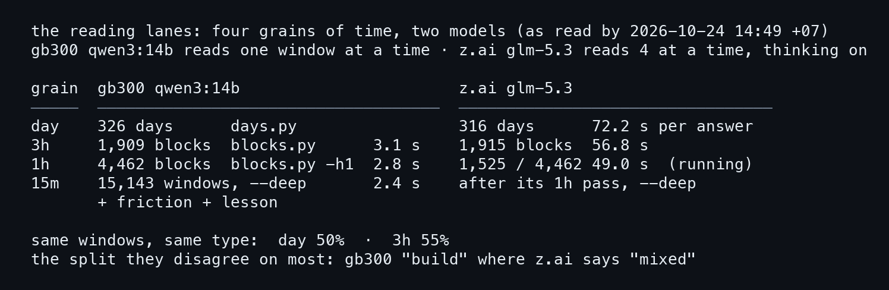
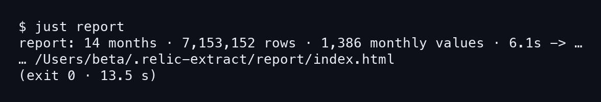
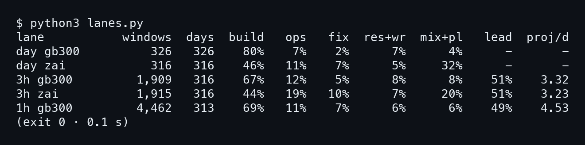
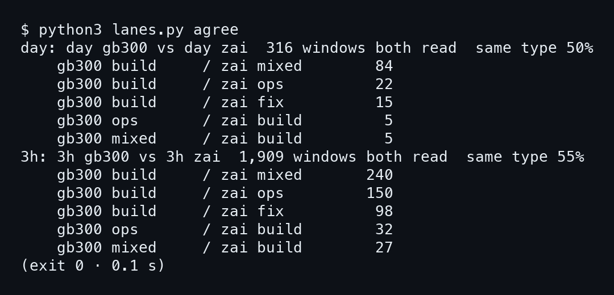
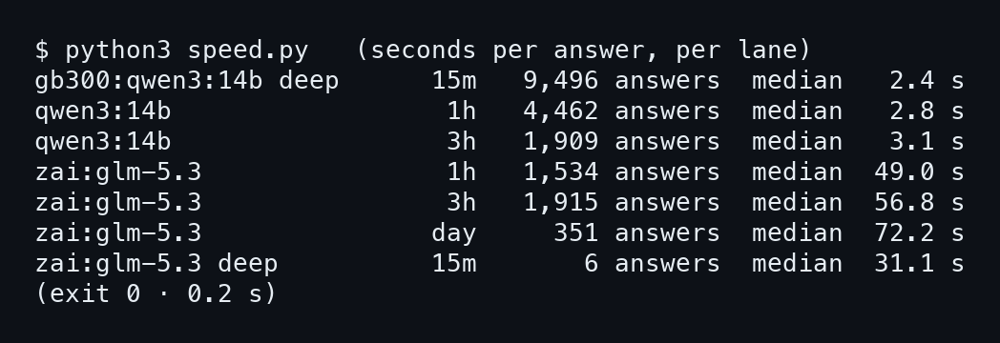
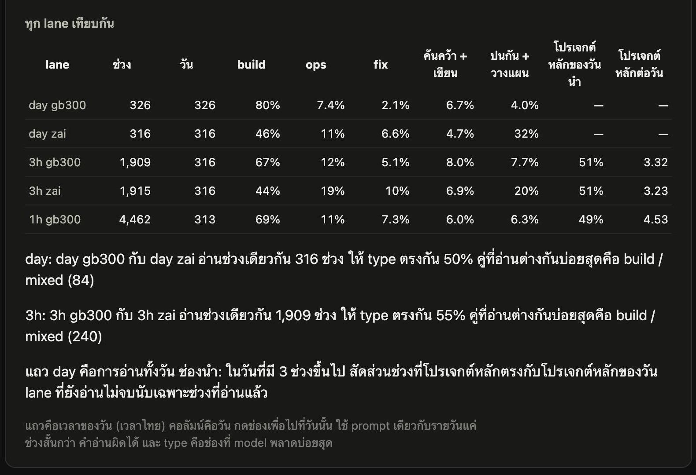

# บทที่ 10: สองโมเดล อ่านช่วงเดียวกัน

บทที่ 9 อ่านทีละช่วงด้วย gb300 เป็นหลัก บทนี้เอา z.ai glm-5.3 มาอ่านช่วงเดียวกันอีกรอบ แล้ววางเทียบกัน ว่าชนิดของงานที่แต่ละโมเดลตอบเหมือนกันแค่ไหน และเร็วช้าต่างกันเท่าไร

lane ที่อ่านมาทั้งหมด (ก่อน relic4-scan รวมทุก .claude home ในบทที่ 12 ตอนนี้กำลังอ่านใหม่) เป็นแบบนี้

## 10.1 lane ทั้งหมด

### ขั้นที่ 1 — ดูว่าใครอ่านช่วงไหน

ก่อนเข้าตัวเลข ดูแผนภาพนี้ก่อน มันบอกว่า **แต่ละ grain มีโมเดลไหนอ่านไปแล้วกี่ช่วง** gb300 qwen3:14b อ่านทีละช่วง ส่วน z.ai glm-5.3 อ่านพร้อมกัน 4 ช่วง และเปิด thinking



แผนภาพมีสองบรรทัดท้ายที่ prose ยังไม่ได้พูด คือสองโมเดลตอบชนิดเดียวกันแค่ day 50% กับ 3h 55% และจุดที่เห็นต่างกันมากสุดคือ gb300 บอก "build" ตรงที่ z.ai บอก "mixed" ทั้งสองเรื่องอยู่ในหัวข้อ 10.5

## 10.2 build หน้าด้วยทุก lane

### ขั้นที่ 1 — สร้างหน้ารายงานใหม่

พอ cache ของแต่ละ lane มีคำตอบแล้ว ก็สั่ง build รายงานใหม่ได้เลย **just report อ่านทุก lane เท่าที่มีอยู่ตอนนั้น** lane ที่ยังไม่จบก็เข้าหน้าเท่าที่อ่านแล้ว

```bash
just report
```



```
report: 14 months · 7,153,152 rows · 1,386 monthly values · 6.1s
```

14 เดือน 1,386 ค่ารายเดือน ใช้เวลา build 6.1 วินาที (ทั้งคำสั่ง 13.5 วินาที) ไฟล์ออกที่ `~/.relic-extract/report/index.html`

## 10.3 ตารางเทียบ lane

### ขั้นที่ 1 — พิมพ์ตารางด้วย lanes.py

หน้าเดียวกันมีตาราง "ทุก lane เทียบกัน" และ lanes.py พิมพ์ตารางเดียวกันนี้ออกเทอร์มินัล **ตารางแจกชนิดงานของแต่ละ lane เป็นเปอร์เซ็นต์** บวกอีกสองคอลัมน์ คือ lead (วันที่ project อันดับหนึ่งของวันนำอยู่ในช่วงนั้นกี่เปอร์เซ็นต์) กับ proj/d (กี่ project ต่อวัน)

```bash
python3 lanes.py
```



อ่านตามแถว day ก่อน gb300 ตอบ build 80% ของวัน z.ai ตอบแค่ 46% แล้วไปลง mixed+plan 32% (gb300 มี 4%) พอช่วงสั้นลงเหลือ 3h gb300 ลดลงเหลือ 67% ส่วน z.ai 44% แล้ว 1h ของ gb300 กลับขึ้นมาเป็น 69% (z.ai ยังไม่มีแถว 1h) ใน day กับ 3h gb300 ตอบ build มากกว่า z.ai ทั้งคู่

ส่วน lead ของ 3h ทั้งสอง lane ได้ 51% เท่ากัน และ 1h ของ gb300 ลงมาที่ 49% ที่ 4.53 project ต่อวัน ช่วงยิ่งสั้น project ยิ่งเปลี่ยนบ่อย

## 10.4 กติกาเดียวของคำว่า "นำ"

### ขั้นที่ 1 — ทำไมตัวเลขเคยไม่ตรงกัน

ตัวเลข "project อันดับหนึ่งของวันนำช่วงไหนกี่เปอร์เซ็นต์" เคยมีสองความหมาย ตารางเอาทุกช่วงมารวมกันก่อนหาร ได้ 3h 50% กับ 3.06 project ต่อวัน ส่วนย่อหน้าบนหน้า (blocks.py) เฉลี่ยทีละวัน ได้ 51% กับ 3.32 สองที่พิมพ์เลขต่างกันทั้งที่อ่านข้อมูลชุดเดียว

commit f8ed5bf ทำให้เหลือกติกาเดียวทุกที่ **เอาเฉพาะวันที่มี 3 ช่วงขึ้นไป เฉลี่ยสัดส่วนของแต่ละวัน และไม่นับช่วงที่ไม่มี project เหลือ** ตาราง ย่อหน้า และ blocks.py ใช้กติกานี้หมด เลยได้ 51% / 3.32 ตรงกัน

## 10.5 ช่วงเดียวกัน สองโมเดล

### ขั้นที่ 1 — นับว่าตอบชนิดตรงกันกี่ครั้ง

ช่วงเดียวกัน prompt เดียวกัน ถามว่าสองโมเดลตอบชนิดเหมือนกันไหม **agree นับคู่ที่อ่านครบทั้งสอง lane แล้วบอกว่าตรงกันกี่เปอร์เซ็นต์ กับคู่ที่เห็นต่างกันมากสุด**

```bash
python3 lanes.py agree
```



```
day: day gb300 vs day zai  316 windows both read  same type 50%
    gb300 build     / zai mixed        84
3h: 3h gb300 vs 3h zai  1,909 windows both read  same type 55%
    gb300 build     / zai mixed       240
```

ครึ่งเดียวที่ตรงกัน และความเห็นต่างที่ใหญ่สุดอยู่ทางเดียวเสมอ gb300 บอก build ตรงที่ z.ai บอก mixed (84 วัน, 240 ช่วง 3h) ถัดมาคือ build / ops (22 และ 150) กับ build / fix (15 และ 98) ทางกลับกันมีน้อย gb300 ops แต่ z.ai build 5 วัน และ 32 ช่วง

เรื่องนี้บอกอะไรเรื่อง field ชนิด เล่มแรกเตือนไว้แล้วว่า **field ชนิดอ่อน** ตอนนี้มีหลักฐานว่าอ่อนแค่ไหน ถ้าสองโมเดลที่อ่านข้อความเดียวกันยังเห็นตรงกันครึ่งเดียว ตัวเลข "build 80%" ของ gb300 ก็อย่าอ่านเป็นความจริงของงาน capture บอกแค่ว่าสองโมเดลเห็นต่างกัน ไม่ได้บอกว่าฝั่งไหนถูก เลขชนิดจึงเทียบข้าม lane ไม่ได้

## 10.6 วินาทีต่อคำตอบ

### ขั้นที่ 1 — วัดความเร็วของแต่ละ lane

ความต่างอีกเรื่องคือเวลา **speed.py ให้ค่ากลาง (median) ของวินาทีต่อคำตอบ แยกตาม lane กับ grain** อ่านจาก readings.jsonl

```bash
python3 speed.py
```



```
qwen3:14b                  3h   1,909 answers  median   3.1 s
qwen3:14b                  1h   4,462 answers  median   2.8 s
gb300:qwen3:14b deep      15m   9,496 answers  median   2.4 s
zai:glm-5.3                1h   1,534 answers  median  49.0 s
zai:glm-5.3                3h   1,915 answers  median  56.8 s
zai:glm-5.3               day     351 answers  median  72.2 s
```

gb300 ตอบ 2.4 ถึง 3.1 วินาที ทีละช่วง z.ai ตอบ 49.0 ถึง 72.2 วินาที และยังอ่านพร้อมกัน 4 ช่วง (เล่มแรกเคยเปิด 24 ตัวแล้วโดน HTTP 429) พอช่วงสั้นลง ทั้งสองฝั่งเร็วขึ้น แต่ z.ai ยังช้ากว่า gb300 สิบกว่าเท่า สาเหตุที่น่าจะใช่คือ thinking ที่เปิดอยู่

## 10.7 ตารางบนหน้า

### ขั้นที่ 1 — ดูตารางเดียวกันบนหน้า

หน้าส่วนตัวบน 127.0.0.1 มีตาราง "ทุก lane เทียบกัน" ตัวเลขเดียวกับหัวข้อ 10.3 และบรรทัดสรุปสองบรรทัดว่าสองโมเดลตรงกัน day 50% (build / mixed 84) และ 3h 55% (build / mixed 240) **ผู้อ่านหน้าไม่ต้องรัน lanes.py เลย** เพราะเลขที่หน้ากับเลขในเทอร์มินัลมาจากกติกาเดียวกันแล้ว

```
    gb300 build     / zai mixed        84
    gb300 build     / zai mixed       240
```



ตัวเลขทั้งหมดนี้ยังขึ้นกับ index เก่า ตอนที่ relic4-scan รวมทุก .claude home เข้ามา จำนวนช่วงก็เพิ่ม บทหน้าเล่าว่าเกิดอะไรขึ้นกับงานยาวที่ต้องรอดข้ามคืน และทำไม lane ต้องถูกเข้าคิวอ่านใหม่
