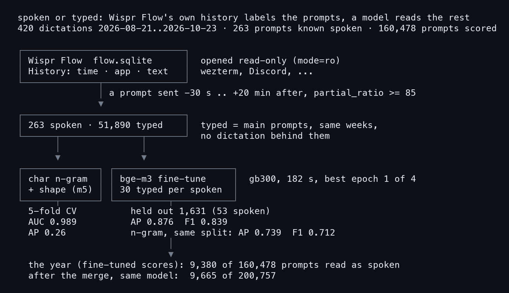
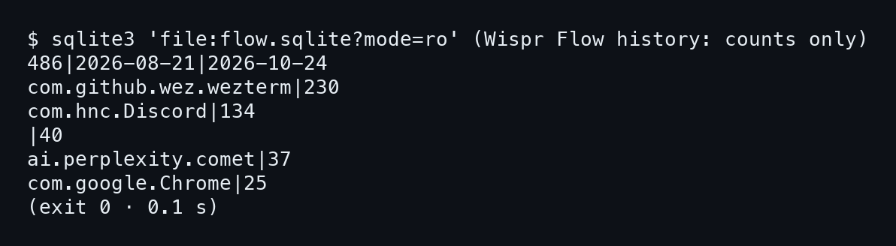
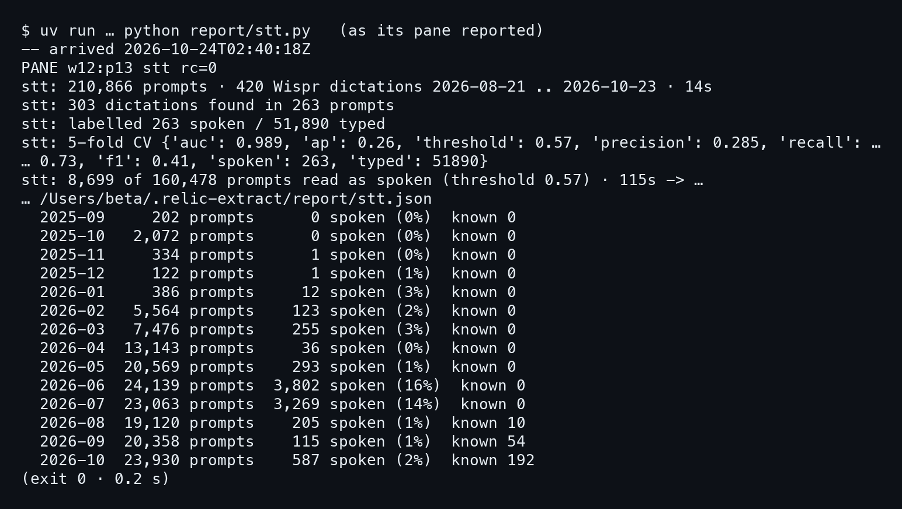
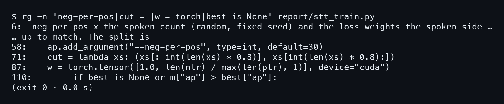
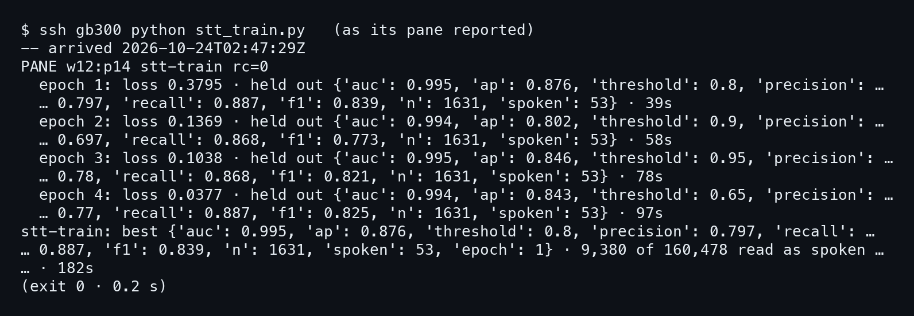
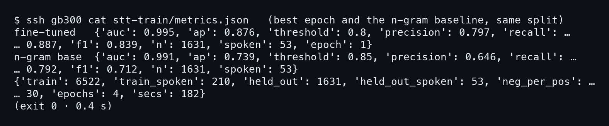
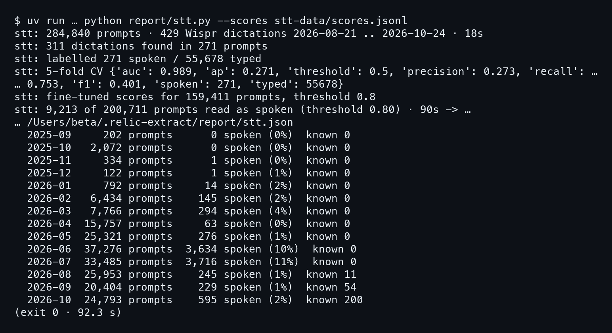
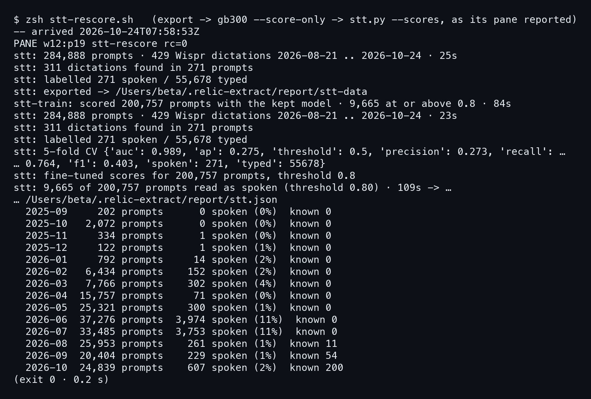
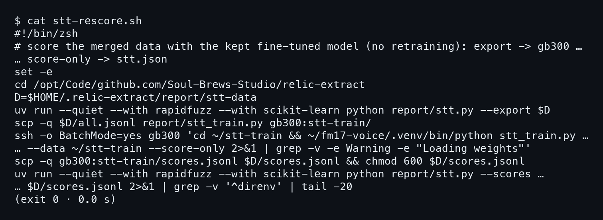
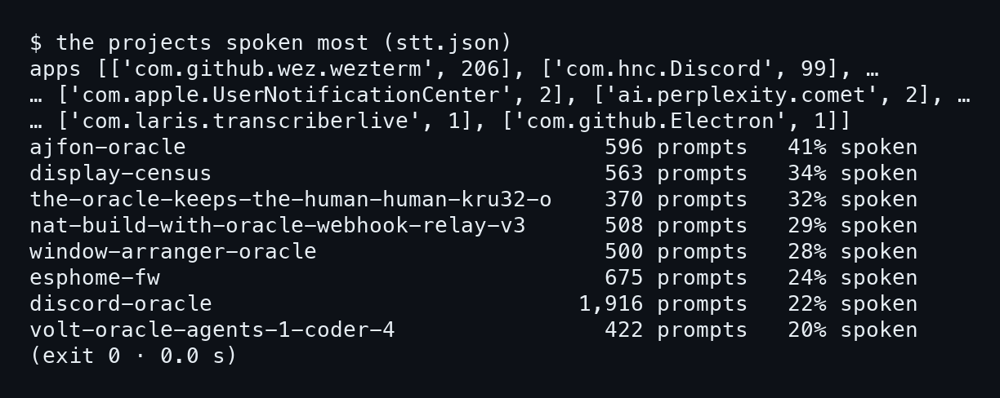

# บทที่ 11: พูดหรือพิมพ์ — model จาก Wispr Flow

Nat ถามสองข้อ ข้อแรกให้สร้าง model ที่ชี้ว่า prompt ไหนมาจาก STT หรือการถอดเสียง ข้อสองถามว่าฝึก model ได้ไหม บทนี้คือคำตอบสองข้อนั้น ลำดับคือหาป้ายก่อน ลอง model ง่ายๆ ก่อน แล้วค่อยฝึกตัวใหญ่บน gb300 ครับ ส่วนที่ต้องระวังที่สุดคือตัวเลข เพราะ prompt ที่พูดมีน้อยมาก และข้อมูลเพิ่งโตขึ้นเท่าตัวใต้ model ตัวนี้

## 11.1 ความคิด — ให้ประวัติของ Wispr Flow ติดป้าย

Wispr Flow เก็บประวัติการพูดของตัวเองไว้ในเครื่อง พอมีประวัตินี้ เราก็รู้ว่า prompt ไหนมาจากเสียงจริง ส่วนที่เหลือต้องให้ model เดา บทนี้ไม่พิมพ์ข้อความ prompt หรือข้อความที่พูดออกมาเลย มีแต่จำนวน

### ขั้นที่ 1 — ดูภาพรวมทั้งสายก่อนลงมือ

ภาพนี้คือแผนของบทนี้ทั้งบท อ่านจากบนลงล่าง: ประวัติ Wispr ให้ป้าย แล้วแยกเป็นสอง model ที่วัดบน split เดียวกัน



สิ่งที่ภาพนี้บอกและร้อยแก้วไม่บอก คือ **ป้ายมาจากการจับคู่ ไม่ได้มาจากการเดา** ได้แก่ prompt ที่ส่งไปในช่วง 30 วินาทีก่อนถึง 20 นาทีหลังจากคำพูดหนึ่งรายการ และข้อความเหมือนกัน (rapidfuzz partial_ratio ตั้งแต่ 85 ขึ้นไป) ส่วน typed คือ prompt หลักในสัปดาห์เดียวกันที่ไม่มีคำพูดอยู่เบื้องหลัง

## 11.2 ป้าย — ประวัติ Wispr อ่านอย่างเดียว

### ขั้นที่ 1 — เปิด flow.sqlite แบบ read-only แล้วนับ

เปิดฐานด้วย `mode=ro` เสมอ เพราะแอปยังเขียนอยู่ และเราไม่มีเหตุผลต้องแตะ ขอแค่นับ: จำนวนแถว วันแรก วันล่าสุด และแอปที่พูดใส่

```bash
sqlite3 'file:flow.sqlite?mode=ro'
```



ผลคือ 486 แถว วันแรก 2026-08-21 วันล่าสุด 2026-10-24 พูดใส่ wezterm 230 ครั้ง Discord 134 ครั้ง ที่ไม่มีชื่อแอป 40 ครั้ง **แถวที่เก่าที่สุดใน history ของเครื่องนี้คือ 2026-08-21** จำวันนี้ไว้ เพราะ 11.7 จะย้อนมาหา

```
486|2026-08-21|2026-10-24
com.github.wez.wezterm|230
com.hnc.Discord|134
```

## 11.3 model แรก — char n-gram

### ขั้นที่ 1 — รัน stt.py แล้วอ่านบรรทัด 5-fold CV

stt.py ติดป้าย แล้วฝึก model ที่นับ n-gram ของตัวอักษรกับรูปร่างของข้อความ ประเมินด้วย 5-fold cross-validation รันบน m5 ล้วน ไม่ต้องใช้ GPU

```bash
uv run --quiet --with rapidfuzz --with scikit-learn \
  python report/stt.py
```



ภาพนี้คือรายงานของ pane ตามที่มาถึง ไม่ได้รันซ้ำ **ป้ายที่ได้คือ 263 spoken กับ 51,890 typed** ส่วนบรรทัด CV (ตัดให้สั้น):

```
stt: labelled 263 spoken / 51,890 typed
stt: 5-fold CV {'auc': 0.989, 'ap': 0.26, … 'f1': 0.41, …}
```

### ขั้นที่ 2 — อ่าน AUC กับ AP ให้ถูก

AUC 0.989 ฟังดูเกือบเต็ม แต่ AP แค่ 0.26 สองตัวนี้ไม่ได้ขัดกัน **AUC ถามว่าเรียงสูงกว่าต่ำถูกไหม AP ถามว่าของที่ดึงขึ้นมาข้างบนเป็นของจริงกี่ส่วน** พอ prompt ที่พูดมีราวหนึ่งใน 200 ต่อให้เรียงเก่ง คนที่ผิดพลาดนิดเดียวก็ท่วมรายการด้านบนแล้ว

ตัวเลขที่ threshold 0.57: precision 0.285 recall 0.73 ถ้าดึงมา 100 อัน มีของจริงราว 28 อัน แต่เจอของจริงครบ 73 ใน 100 ที่มีอยู่ เอาไปนับรวมเป็นเปอร์เซ็นต์ต่อเดือนได้ แต่เอาไปชี้ว่า prompt นี้พูดหรือเปล่าทีละอันยังไม่น่าไว้ใจ

## 11.4 ฝึกบน gb300 — bge-m3 fine-tune

### ขั้นที่ 1 — ดูว่าสคริปต์ฝึกตัดสินใจอะไรไว้ตรงไหน

อ่านก่อนรัน ด้วย rg บนสี่จุดที่สำคัญ: ตัวคูณจำนวน typed ต่อ spoken จุดตัด train/held-out น้ำหนัก loss และเงื่อนไขเก็บ epoch ที่ดีที่สุด

```bash
rg -n 'neg-per-pos|cut = |w = torch|best is None' report/stt_train.py
```



อ่านได้ว่า **สุ่ม typed มา 30 ตัวต่อ spoken หนึ่งตัว** (seed คงที่) แล้วถ่วง loss ฝั่ง spoken ให้เท่ากัน ตัดไว้ 80% ฝึก 20% วัด และเก็บ epoch ที่ `m["ap"]` สูงสุด:

```
58:  ap.add_argument("--neg-per-pos", type=int, default=30)
71:  cut = lambda xs: (xs[: int(len(xs) * 0.8)], xs[int(len(xs) * 0.8):])
110: if best is None or m["ap"] > best["ap"]:
```

### ขั้นที่ 2 — ฝึกบน GPU แล้วอ่านทีละ epoch

ส่งออกข้อมูลจาก m5 ด้วย `stt.py --export` แล้ว scp ขึ้น gb300 ฝึกที่นั่น (NVIDIA GB300, CUDA 13.2) ภาพข้างล่างคือรายงานของ pane ตามที่มาถึง

```bash
ssh gb300 python stt_train.py
```



ดูสองคอลัมน์สวนกัน loss ลดจาก 0.3795 เหลือ 0.0377 แต่ AP ไม่ได้ดีตาม:

```
epoch 1: loss 0.3795 · held out {'auc': 0.995, 'ap': 0.876, … 'f1': …}
epoch 2: loss 0.1369 · held out {'auc': 0.994, 'ap': 0.802, …
epoch 3: loss 0.1038 · held out {'auc': 0.995, 'ap': 0.846, …
epoch 4: loss 0.0377 · held out {'auc': 0.994, 'ap': 0.843, …
```

**epoch แรกดีที่สุด รอบหลังๆ จำข้อมูลฝึกได้แน่นขึ้นแต่วัดนอกชุดแย่ลง** (overfit) สคริปต์เลยเก็บ epoch 1 ไว้ ทั้งหมดใช้เวลา 182 วินาที

## 11.5 วัดบนชุดที่กันไว้ — สอง model บน split เดียวกัน

### ขั้นที่ 1 — เทียบเลขที่เทียบกันได้เท่านั้น

บรรทัดสรุปของ pane เดิมบอกผลของ epoch ที่เก็บ (held-out 1,631 ตัว เป็น spoken 53):

```
stt-train: best {'auc': 0.995, 'ap': 0.876, 'threshold': 0.8, …
  'precision': 0.797, 'recall': 0.887, 'f1': 0.839, 'n': 1631,
  'spoken': 53, 'epoch': 1} · 9,380 of 160,478 read as spoken · 182s
```

metrics.json ที่ stt_train.py เขียนไว้บน gb300 เก็บทั้งสองตัว บน split เดียวกัน

```bash
ssh gb300 cat stt-train/metrics.json
```



n-gram ได้ AP 0.739 F1 0.712 ส่วน bge-m3 ได้ AP 0.876 F1 0.839 **ชนะบน split เดียวกัน** แต่อย่าเอา 0.876 ไปเทียบกับ 0.26 ในขั้น 11.3 ถึงแม้อยู่ในตัวเลขชุดเดียวกัน เพราะชุด held-out นี้มี spoken 53 ใน 1,631 (เพราะสุ่ม typed ลงมา 30 ต่อ 1) ไม่ใช่หนึ่งใน 200 AP จึงสูงขึ้นเองตามสัดส่วน ที่เทียบได้คือ 0.739 กับ 0.876

## 11.6 ข้อมูลโตขึ้นใต้ model

### ขั้นที่ 1 — พบ prompt 41k ตัวที่ไม่มีคะแนน

หลัง relic4-scan รวม transcript ทุกบ้านเข้าดัชนี (บทที่ 12) session เพิ่มเท่าตัว ส่วน prompt ที่ stt.py เห็นเพิ่มจาก 210,866 เป็น 284,840 (ราว 35%) ใน prompt ของ main session 200,711 ตัวที่ต้องให้คะแนน มีคะแนนจาก model ที่ฝึกแล้วแค่ 159,411 ตัว อีกราว 41k ไม่มีคะแนน เลยถูกนับเป็น typed ไปเงียบๆ

```bash
uv run --quiet --with rapidfuzz --with scikit-learn \
  python report/stt.py --scores $D/scores.jsonl
```



```
stt: fine-tuned scores for 159,411 prompts, threshold 0.8
stt: 9,213 of 200,711 prompts read as spoken (threshold 0.80) · 90s
```

บรรทัดแรกคือสัญญาณเตือน ถ้า 159,411 ไม่เท่ากับ 200,711 แปลว่าราว 41,000 ตัวไม่ได้ถูกอ่าน **เลข 9,213 จึงต่ำกว่าความจริง**

### ขั้นที่ 2 — ให้ model ที่เก็บไว้ให้คะแนนใหม่ ไม่ฝึกซ้ำ

`stt_train.py` มี `--score-only` ใช้ model ที่เก็บไว้ให้คะแนน prompt ใหม่ **ไม่ฝึกใหม่** ป้ายยังเป็น 271 spoken ต่อ 55,678 typed และ model ยังเป็นตัวที่ฝึกจาก 263 ป้ายเดิม ภาพนี้คือรายงานของ pane ตามที่มาถึง

```bash
zsh stt-rescore.sh
```



```
stt-train: scored 200,757 prompts with the kept model
  · 9,665 at or above 0.8 · 84s
stt: fine-tuned scores for 200,757 prompts, threshold 0.8
stt: 9,665 of 200,757 prompts read as spoken (threshold 0.80) · 109s
```

### ขั้นที่ 3 — อ่านสคริปต์ที่ทำให้มันรอบเดียว

stt-rescore.sh ต่อสามจังหวะเป็นคำสั่งเดียว: export จาก m5 → ให้คะแนนบน gb300 → อ่านคะแนนกลับมาใส่ stt.json

```bash
cat stt-rescore.sh
```



บรรทัดที่เป็นหัวใจคือบรรทัดที่เรียก `stt_train.py --data ~/stt-train --score-only` บน gb300 ส่วนที่เหลือคือการขนไฟล์ **ไม่มีขั้นฝึกในสคริปต์นี้เลย** รัน `set -e` เพื่อให้พังตรงไหนก็หยุดตรงนั้น

## 11.7 ทั้งปี — เดือนไหน โปรเจกต์ไหน

### ขั้นที่ 1 — อ่านตารางต่อเดือนหลังให้คะแนนใหม่

ตารางต่อเดือนอยู่ท้ายผลของ 126 คอลัมน์ `known` คือจำนวนที่ป้ายจริงจาก Wispr ยืนยัน:

```
2026-05  25,321 prompts    300 spoken (1%)  known 0
2026-06  37,276 prompts  3,974 spoken (11%)  known 0
2026-07  33,485 prompts  3,753 spoken (11%)  known 0
2026-08  25,953 prompts    261 spoken (1%)  known 11
2026-09  20,404 prompts    229 spoken (1%)  known 54
2026-10  24,839 prompts    607 spoken (2%)  known 200
```

**มิถุนายนกับกรกฎาคมอ่านเป็นพูดราว 11%** ทั้งที่แถวเก่าสุดใน history ของ Wispr บนเครื่องนี้คือ 2026-08-21 และเดือนที่ป้ายจริงมีอยู่ (สิงหาคมถึงตุลาคม) กลับได้แค่ 1-2% ก่อนรวมข้อมูล n-gram ก็เห็นเหมือนกัน (16% และ 14%) แล้ว

### ขั้นที่ 2 — สามคำอธิบาย ยังตัดสินไม่ได้

มี**สามทางที่เป็นไปได้ และเรายังไม่มีหลักฐานเลือก**

- มิถุนายนกับกรกฎาคมพูดจริง แต่พูดบนเครื่องอื่นหรือผ่านเครื่องมืออื่น ไม่ใช่ Wispr บน m5 จึงไม่มีป้ายให้
- model เข้าใจผิด บางอย่างใน prompt ช่วงนั้นหน้าตาเหมือนคำพูด ทั้งที่พิมพ์
- history ของ Wispr บนเครื่องนี้ไม่ได้ย้อนไปถึงวันที่เริ่มใช้จริง (ถูกล้างหรือเก็บไม่หมด) แถวเก่าสุดจึงไม่ใช่วันแรก

ป้ายของเราเริ่มที่ 2026-08-21 เท่านั้น เราจึงสอน model ได้แค่ "หน้าตาแบบที่พูดในสามเดือนนี้" แล้วเอาไปใช้ย้อนหลัง ข้อมูลที่ใช้ตรวจต้องมาจากข้างนอก เช่นประวัติเครื่องมือพูดอีกตัว

### ขั้นที่ 3 — ดูว่าโปรเจกต์ไหนมีสัดส่วนพูดสูง

stt.json เก็บแอปที่พูดใส่และโปรเจกต์ที่ได้สัดส่วนสูงสุดไว้ด้วย **อ่านตัวเลขออกมาจากไฟล์นี้** ไม่ต้องรันโมเดลซ้ำ ตัวอย่างแถวบนสุด:

```
ajfon-oracle         596 prompts   41% spoken
display-census       563 prompts   34% spoken
discord-oracle     1,916 prompts   22% spoken
```



ในหมู่ป้ายจริง wezterm 206 กับ Discord 99 เป็นสองแอปหลัก ตรงกับภาพ 120 ที่ Wispr บันทึกไว้ ส่วนเปอร์เซ็นต์ต่อโปรเจกต์ควรอ่านเป็นแนวโน้มของ model ที่มีขอบเขตผิดพลาดตามที่เห็นใน 11.3 ไม่ใช่ตัวเลขแม่นยำ

บทที่ 12 กลับไปที่เรื่องที่พังในวันที่สอง ตั้งแต่ ssh tunnel ที่หลุด จนถึงดัชนีที่ลดเหลือ 3,048 session แล้วโตเป็น 101,183 ซึ่งเป็นต้นเหตุให้บทนี้ต้องให้คะแนนใหม่
