# บทที่ 12: งานยาวข้ามคืน — สิ่งที่พังในวันที่สอง

งานยาวคืองาน 15 นาทีของ gb300 ราว 15,000 หน้าต่าง อ่านทีละหน้าต่าง หน้าต่างละราว 2.4 วินาที
ทั้งวันที่ 2026-10-24 มีเก้าเรื่องพังรอบงานนี้ บทนี้เก็บทีละเรื่องในรูปเดียวกับบทที่ 8
คือ เกิดอะไร · รู้ได้ยังไง · สาเหตุ · แก้ยังไง · กฎ เวลาทั้งหมดเป็น +07 (GMT+7)

## 12.1 ดูทั้งวันบนการ์ดใบเดียว

### ขั้นที่ 1 — อ่านการ์ด D5 จากบนลงล่าง

การ์ดเรียงตามเวลา แต่ละแถวคือเหตุการณ์หนึ่ง พร้อมสิ่งที่แก้และ commit
**อ่านเวลาก่อน แล้วค่อยอ่านว่าแก้อะไร** เพราะหลายเรื่องเกิดซ้อนกันในชั่วโมงเดียว

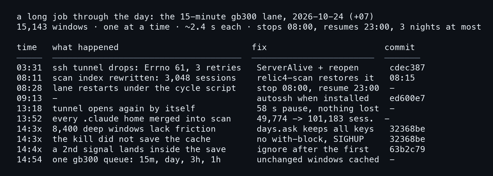

การ์ดชี้ว่าเรื่องที่ดูเหมือนเรื่องเดียว (งานช้า) จริงๆ มาจากสาเหตุที่ไม่เกี่ยวกันสามสาย
คือ tunnel, การเซฟตอนถูก kill และ index ของ relic-scan

## 12.2 ssh tunnel หลุดหลังอ่านไปได้ 825 หน้าต่าง

### ขั้นที่ 1 — ดู pane ตอนมันพัง

คำตอบสุดท้ายก่อนพังคือ 03:31:46 (capture 132) จากนั้น pane ของ lane 15 นาทีพิมพ์ error ซ้ำทุกหน้าต่าง ลองใหม่สามรอบแล้วก็ล้มทุกรอบ Nat เห็นแล้ว paste มาให้ตอน 08:05
**Errno 61 Connection refused แปลว่าปลายทางของ tunnel ไม่มีใครฟังอยู่แล้ว** ไม่ใช่ gb300 ตอบช้า

ข้างล่างคือที่ pane รายงานมาใน session ไม่ได้รันใหม่

```
  failed: URLError: <urlopen error [Errno 61] Connection refused>
    retry 1: URLError
    retry 2: URLError
    retry 3: URLError
```

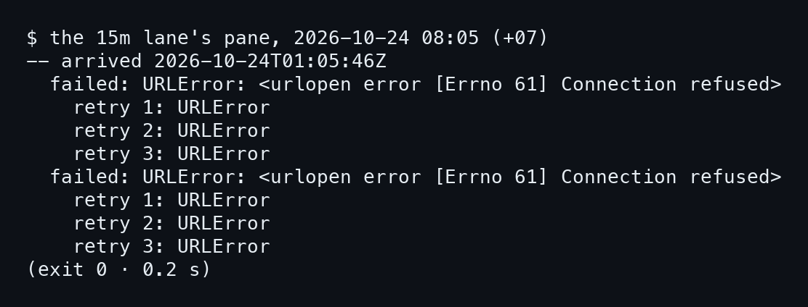

สาเหตุคือ tunnel ที่เปิดไว้ตอนเริ่มรัน ถ้า ssh ตายกลางทางก็ไม่มีอะไรเปิดให้ใหม่
Nat ถามสั้นๆ ว่า "make autossh ?" แล้วเราก็แก้สองชั้น

### ขั้นที่ 2 — อ่านโค้ดที่แก้

commit cdec387 (08:06) ใส่ ServerAlive และ `_reopen()` ให้ `ask()` เรียกหลัง retry ส่วน ed600e7 (09:13)
ใช้ autossh เมื่อติดตั้งไว้ โค้ดอยู่ใน `report/days.py` พิมพ์ดูได้เลย
**autossh ใช้ `-M 0` ให้ ServerAlive เป็นตัวจับ ไม่ต้องเปิด monitor port** ส่วน `_reopen()`
เช็ก port ก่อนว่ายังตอบไหม ถ้าตอบอยู่ก็ไม่ทำอะไร

```bash
sed -n '/^_TUN/,/time.sleep(3)/p' report/days.py
```

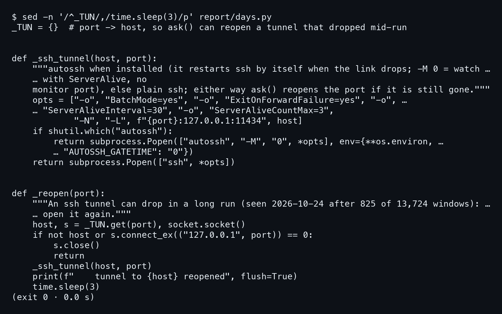

ใน docstring ของ `_reopen` เขียนไว้เองว่าเจอเมื่อ 2026-10-24 หลัง 825 จาก 13,724 หน้าต่าง
**กฎคืองานที่ยาวกว่า connection ต้องรู้จักเปิด connection ใหม่เอง** lane ถูกสตาร์ทใหม่ตอน 08:28:15
บนโค้ด 08:06 (ssh ธรรมดา บวก reopen)

## 12.3 reopen ที่ทำงานเองตอน 13:18

### ขั้นที่ 1 — หารอยหยุดใน readings.jsonl

โค้ดที่เพิ่งแก้ไม่เคยถูกพิสูจน์จนกว่าจะมีเหตุจริง ตอน 13:18:02 ssh process ตัวใหม่เกิดขึ้นเอง
`gaps.py` ไล่ readings.jsonl ของวันนั้นแล้วพิมพ์ช่วงที่ไม่มีคำตอบเข้ามาเลย
**ช่วงหยุด 58 วินาทีคือรอยของ tunnel ที่หลุดแล้วเปิดคืน** ไม่มีหน้าต่างไหนหาย

```bash
python3 gaps.py gb300 2026-10-24
```

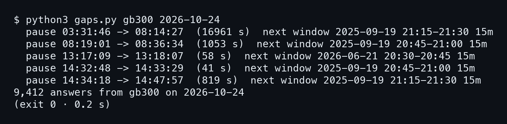

ช่วงอื่นในภาพอธิบายได้ ช่วงแรก 03:31 ถึง 08:14 ตรงกับตอนที่ tunnel หลุดจนถึงรอบทดสอบหลังแก้ ช่วง 08:19 ถึง 08:36 คร่อมตอนเริ่ม cycle ใหม่ (ps บอก 08:28:15) ส่วนสองช่วงหลัง 14:3x น่าจะเป็นตอนหยุดเพื่อแก้แล้วเริ่มใหม่
ส่วน 14:3x สองช่วงคือการ kill ที่เล่าใน 12.5

### ขั้นที่ 2 — เช็กว่าเครื่องอยู่ GMT+7 จริง

เวลาในบทนี้ล้วนเป็นเวลาเครื่อง Nat เลยขอให้เช็กว่าเราอยู่ GMT+7 จริง `date` กับ `/etc/localtime`
ตอบได้ในสองบรรทัด **เวลาที่ log ได้มาจากเขตเวลาของเครื่อง ไม่ใช่ UTC ที่บวกเอาเอง**

```bash
date; ls -l /etc/localtime
```

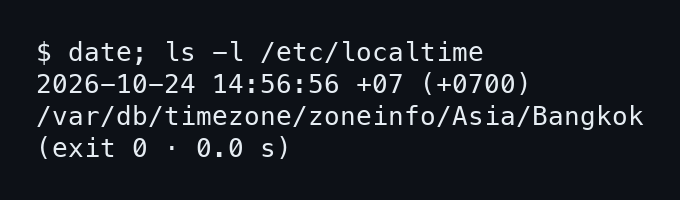

## 12.4 รอบ 23:00 ถึง 08:00 สามคืน

### ขั้นที่ 1 — สคริปต์ที่หยุดแล้วต่อเอง

Nat สั่งว่า "now please run for 3days and stop and resume at 23:00" เราเลือกตีความว่า เริ่มเลย หยุด 08:00
แล้วต่อ 23:00 ทุกคืน สคริปต์ `/tmp/relic-gb15-cycle.sh` ใช้ `kill -TERM` ตอน 08:00 และพึ่งว่า readings.py
เซฟ cache ตอนโดน TERM
**ทั้งรอบจึงขึ้นกับสิ่งเดียวคือการเซฟตอนถูก kill** ซึ่งตรงนี้เองที่พัง

```bash
cat /tmp/relic-gb15-cycle.sh
```

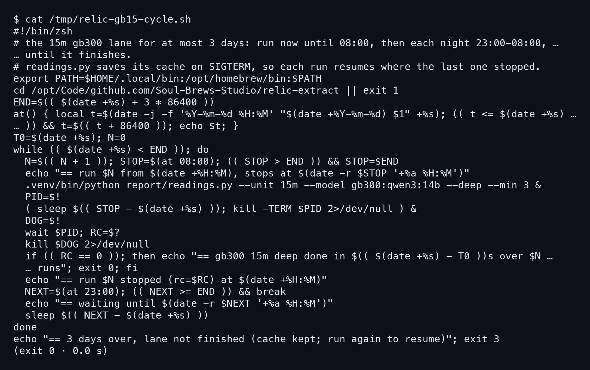

ถ้าครบสามวันแล้วยังไม่จบ สคริปต์ออกด้วย exit 3 และบอกว่า cache ยังอยู่ รันใหม่ก็ต่อได้

## 12.5 kill ที่ไม่เซฟ

### ขั้นที่ 1 — รู้ได้ยังไงว่าไม่เซฟ

afbc26e (08:26) ทำให้ SIGTERM เซฟ cache แต่พอหยุดจริง หน้าต่างสุดท้ายที่ pane พิมพ์ (ถึง 2026-07-20 08:15)
ไม่อยู่ใน cache เลย cache จบแค่ 2026-07-19 18:00 **สิ่งที่พิมพ์บนจอไม่ได้แปลว่าเซฟแล้ว** ต้องเทียบกับไฟล์

### ขั้นที่ 2 — สาเหตุสองชั้น

ชั้นแรก loop อยู่ใน `with ThreadPoolExecutor` และการออกจาก with-block รอทุกหน้าต่างที่ยังค้างในคิว
ก่อนจะถึง `finally` ที่เซฟ ชั้นที่สอง พอ pane ปิดก็ส่ง SIGHUP เข้ามาซ้ำ แก้ใน 32368be: ไม่ใช้ with
เรียก `shutdown(wait=False, cancel_futures=True)` ดัก SIGHUP และล้างตาราง `_TUN` ตอนหยุด
**ห้ามใส่ขั้นตอนเซฟไว้หลังจุดที่รอของที่ไม่รู้จบ**

```bash
git show 32368be -- report/readings.py | rg '^[-+] '
```

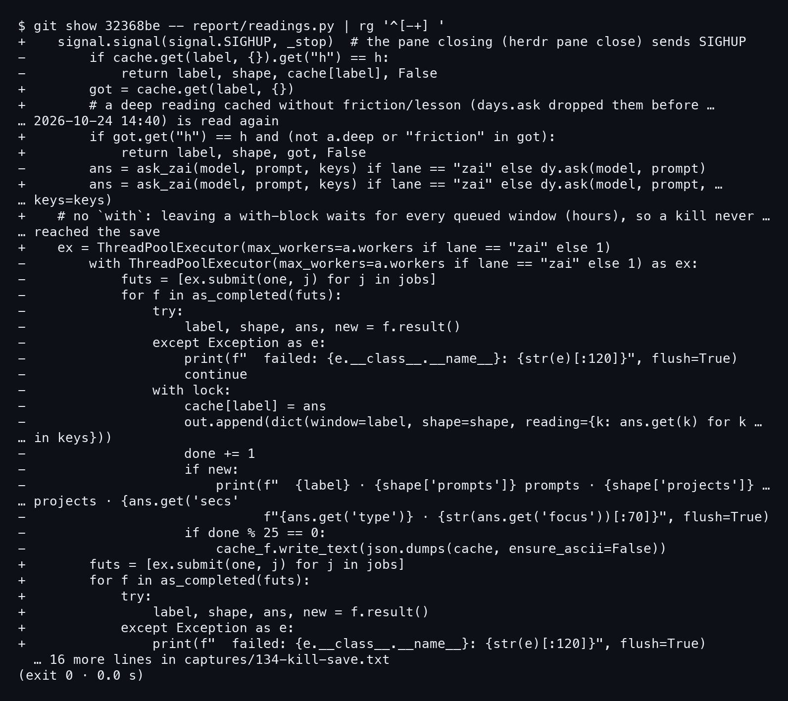

### ขั้นที่ 3 — สัญญาณที่สองซ้อนในการเซฟ

พอแก้เสร็จยังเจออีกชั้น สัญญาณที่สองมาตกกลางการเซฟ 63b2c79 จึงให้สัญญาณแรกหยุดงาน และ
สัญญาณถัดไปถูกเมินทั้งหมด (days.py กับ blocks.py หยุดแบบเดียวกัน เพื่อคิว 08:00 ของ gb300)
**หลังสัญญาณแรก ทุกสัญญาณต้องถูกเมินจนกว่าเซฟจะเสร็จ**

### ขั้นที่ 4 — ทดสอบด้วย TERM จริง

ทดสอบด้วย `timeout -s TERM 15` ให้งานอ่านจริงสิบห้าวินาทีแล้วโดน kill ผลคือบรรทัดนับ ซึ่งเป็นผลทดสอบ
ส่วน traceback `RuntimeError: release unlocked lock` ขึ้นตอนโปรเซสออกหลังหยุด ยังไม่ได้ไล่สาเหตุ แต่บรรทัดนับข้างล่างบอกว่าการเซฟไม่เสีย
หลังหยุดแล้ว ไม่ใช่ความล้มเหลวของการเซฟ

```
4 printed, 4 in the cache with friction
reopened lines: 0
```

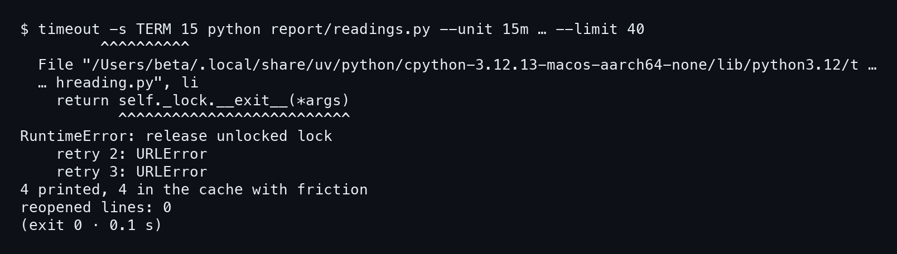

พิมพ์ 4 หน้าต่าง cache มี 4 ครบพร้อม friction ส่วน "reopened lines: 0" แปลว่าการรันที่ถูกหยุดไม่เปิด tunnel ใหม่

## 12.6 deep reading ที่ไม่มี friction และ lesson

### ขั้นที่ 1 — cache ที่ดูเต็มแต่ขาดสองคีย์

ราว 14:3x เปิด cache ของ lane deep พบ 8,400 หน้าต่าง และไม่มีหน้าต่างไหนมี friction หรือ lesson
สาเหตุคือ `days.ask()` ซึ่งเป็นทางของ gb300 คืนมาแค่แปดคีย์ของรายวัน ขณะที่ `ask_zai()` เก็บครบ
**เมื่อสองทางทำสิ่งเดียวกัน ให้เทสต์ทั้งสองทาง** ไม่ใช่เทสต์ทางเดียวแล้วเชื่อว่าอีกทางเหมือนกัน

แก้ใน 32368be (ดูท่อน `got.get("h") == h and (not a.deep or "friction" in got)` ใน diff ภาพ 134)
หน้าต่าง deep ที่ cache ไว้โดยไม่มี friction จะถูกอ่านใหม่ รวมแล้วต้องอ่าน 15,141 หน้าต่าง ซึ่งกำลังอ่านอยู่
จำนวนหน้าต่างโตจาก 13,725 ตอน 08:28 เป็น 15,141 ตอน 14:35 เพราะ index ของ relic-scan ที่คืนมา
กับ prompt ใหม่ของวัน

## 12.7 index ของ relic-scan หดเหลือ 3,048 session

### ขั้นที่ 1 — เจอจากการเทียบสอง build

ตอน 08:11 `meta/sessions.parquet` ถูกเขียนใหม่เหลือ 3,048 session กราฟ repo บนหน้าตกลง
ค่ารายเดือนของ repo จาก 1,386 เหลือ 1,204 **รู้เพราะ diff report.json สองรอบ ไม่ใช่เพราะมีใครแจ้ง**
เราแจ้ง relic4-scan (pane w11:p1) และมันกู้ให้ตอน 08:15

```
~/.relic-scan is whole again (08:15): meta/sessions.parquet has
all 49,774 sessions … The bad 3,048-session file at 08:11 came from
a setup script run in the wrong account
```

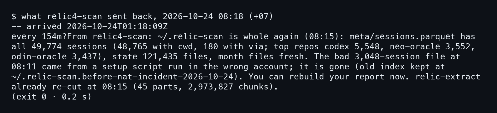

ข้อความนี้คือสิ่งที่มาถึง session ตอน 08:18 ไม่ได้รันใหม่ สาเหตุคือ setup script รันผิด account
สำเนาที่เก็บไว้ `~/.relic-scan.before-nat-incident-2026-10-24` จึงเป็นไฟล์เสียของ 08:11 เอง ไม่ใช่ไฟล์ดีเก่า

### ขั้นที่ 2 — เทียบสำเนากับไฟล์ปัจจุบัน

คิวรีนับ session ในไฟล์ปัจจุบันกับสำเนาที่เก็บไว้ เพื่อไม่ให้ใครเอาสำเนาไปใช้เป็นของดี
**ชื่อสำเนาบอกเหตุการณ์ แต่ไม่ได้บอกว่าข้างในดีหรือเสีย** ต้องนับเอง

```
│ now                 │   101183 │
│ before-nat-incident │     3048 │
```

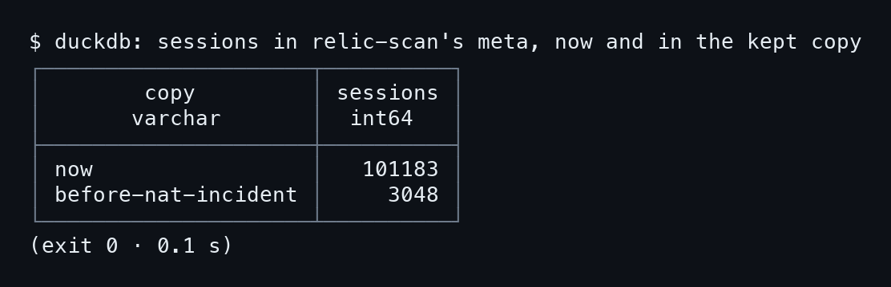

## 12.8 แล้วมันก็โตเป็นสองเท่า

### ขั้นที่ 1 — ตัวเลขกระโดดอีกรอบ

ตอน 13:52 กับ 14:34 relic4-scan รวมทุก `.claude` home เข้า index (home 17 GB ของ black, white, mba,
โฟลเดอร์ projects-* และ archive ของ neo) บวก transcript ของ Nat ผ่าน `/Users/Shared/nat-export`
session จาก 49,774 เป็น 101,183 **ข้อมูลโตจริง ไม่ใช่เปลี่ยนวิธีนับ**

```
… I merged every other .claude home into ~/.claude/projects …
(13:52 and 14:34 runs); it is settled now … from here it only
grows with live use.
```

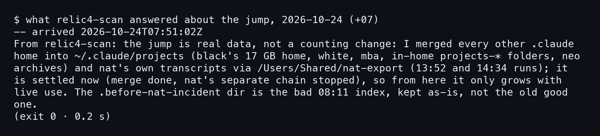

### ขั้นที่ 2 — ดู log ของการรวม

`relic-scan log` เห็นสองรอบใหญ่ตรงกัน รอบ 13:52 อ่านใหม่ 53,637 ไฟล์ และรอบ 14:34 อ่าน 56,504 ไฟล์
(14.81 GB) **สองรอบนี้คือที่ข้อมูลโต** ก่อนหน้านั้นรอบ 13:37 ก็ใหญ่ ไฟล์ใหม่ 37,845 หายไป 34,404 ส่วนรอบอื่นเปลี่ยนแค่หลักสิบ

```bash
relic-scan log | head -8
```

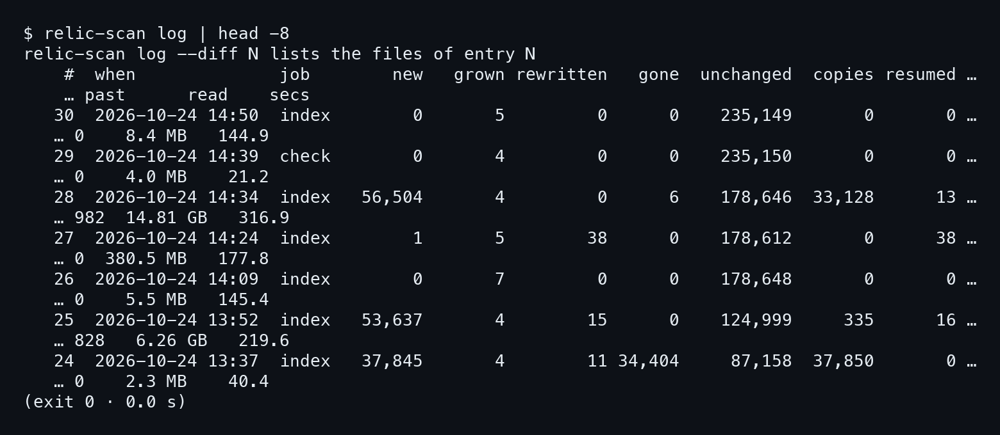

### ขั้นที่ 3 — แยกตาม tier

คิวรี duckdb นับ `meta/sessions.parquet` ตาม engine และ tier ได้ claude main 44,583, workflow-agent 25,068, subagent 22,646
และ codex main 8,703 **tier main คือ prompt ของคน** ที่เหลือเป็นงานของเอเจนต์

```
│ claude  │ main           │    44583 │
│ claude  │ workflow-agent │    25068 │
│ claude  │ subagent       │    22646 │
│ codex   │ main           │     8703 │
```

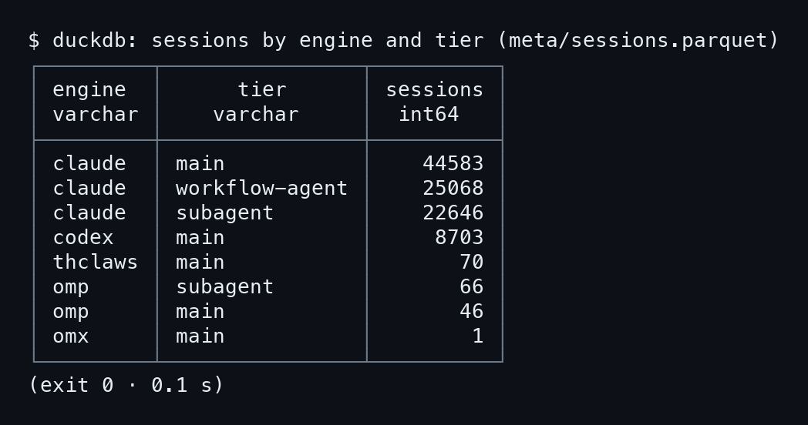

ผลตามมาคือทุก lane ที่อ่านก่อนรวมต้องเข้าคิวใหม่ ได้แก่ gb300 15 นาที → รายวัน → 3 ชั่วโมง → 1 ชั่วโมง
(`/tmp/relic-gb-queue.sh` pane w12:p17 หยุด 08:00 ต่อ 23:00 เหมือนเดิม) กับ lane z.ai (pane w12:p18)
หน้าต่างที่ prompt ไม่เปลี่ยนใช้ cache เดิมได้ เพราะ cache key คือ hash ของ prompt
**กฎคือ cache ต้องผูกกับเนื้อหาที่อ่าน ไม่ใช่ผูกกับเวลาหรือเลขลำดับ** ข้อมูลใต้ตัวโตสองเท่าก็เสียแค่ส่วนที่เปลี่ยน

stt.py ก็โดนเหมือนกัน prompt ของ tier main ที่เห็นเพิ่มจาก 210,866 เป็น 284,840

## 12.9 พลาดเอง — สคริปต์ที่สร้างมารันของทั้งเล่ม

### ขั้นที่ 1 — เกิดอะไรขึ้น

ราว 14:4x เราสร้าง `capture2.sh` จาก `capture.sh` ด้วย sed ที่ตัดช่วงตามเครื่องหมายปลายทาง
แต่เครื่องหมายนั้นไม่เคยตรง สคริปต์เลยแบกคำสั่งของภาค 1 ถึง 3 มาทั้งหมด พอรันก็รันซ้ำ 39 captures
ออกมาต่างจากเดิม 29 ไฟล์และถูกเขียนทับ (กู้คืนจาก git ส่วน 29 ไฟล์นั้นเก็บไว้ที่ `/tmp/bk/captures-rerun-1024`)
`relic-extract run --no-after` ถูกรัน และ **`just publish` ก็ deploy share view จริง**

```
29
4:2:47PM INF no leaks found
```

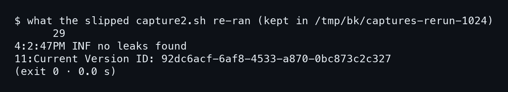

### ขั้นที่ 2 — ความเสียหายและกฎ

gitleaks ไม่พบ leak หน้าที่ deploy มี 1,386 ค่ารายเดือนซึ่งเป็นข้อมูลเต็ม 29 ไฟล์กู้คืนจาก git และ `relic-extract run --no-after` ตัด 0 part (ผลเหมือน capture 14 ทุกบรรทัด) ครั้งนี้จึงไม่มีอะไรเสีย
แต่นั่นคือโชค **กฎคืออ่านสคริปต์ที่สร้างขึ้นให้จบก่อนรัน** โดยเฉพาะสคริปต์ที่ตัดมาจากสคริปต์อื่นด้วย sed
เพราะ sed ที่ไม่ตรงเครื่องหมายไม่ error มันแค่ส่งทั้งไฟล์ผ่านไป

## 12.10 commit ของวัน

### ขั้นที่ 1 — อ่าน log กลับ

พิมพ์ commit ตั้งแต่ 68ddcb2 มาถึง HEAD แล้วจับคู่กับแถวบนการ์ด D5 ได้ครบ cdec387 คือ tunnel,
ed600e7 คือ autossh, afbc26e คือการเซฟแรก, 32368be คือ deep keys กับ kill, 63b2c79 คือสัญญาณที่สอง, f8ed5bf คือกฎ "top project leads" และ 6b49167 คือ --score-only
**ทุกแถวบนการ์ดมี commit รองรับ เว้นแถวที่เป็นการกู้ข้อมูลของคนอื่น**

```bash
git log --oneline 68ddcb2..HEAD
```

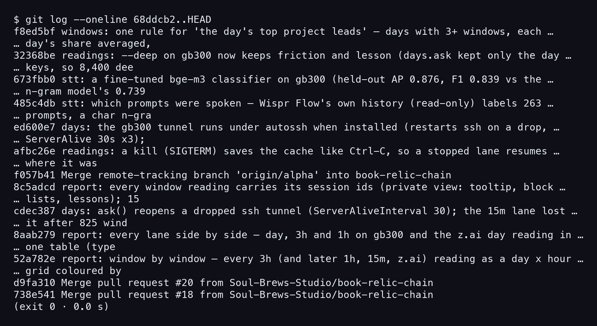

งานยาวต้องเปิด connection ใหม่เองได้ เซฟก่อนรอ และ cache ผูกกับเนื้อหา รอบ 23:00 คืนนี้จะบอกว่าครบหรือยัง
