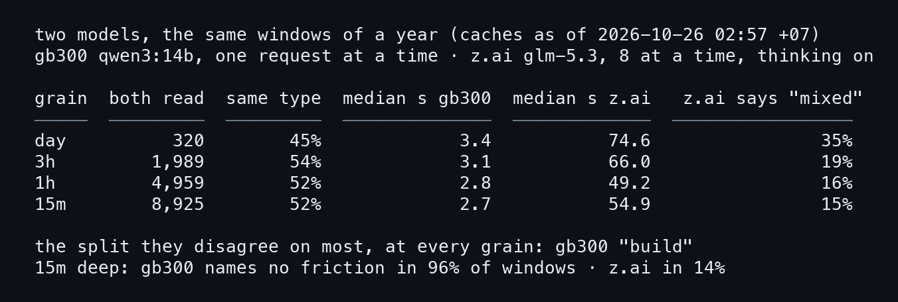
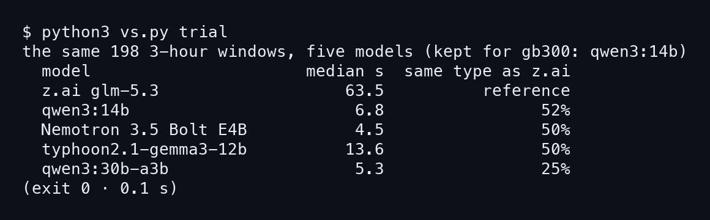
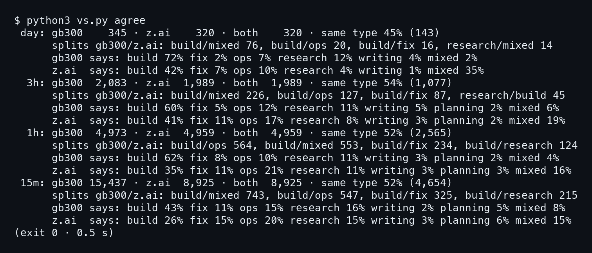
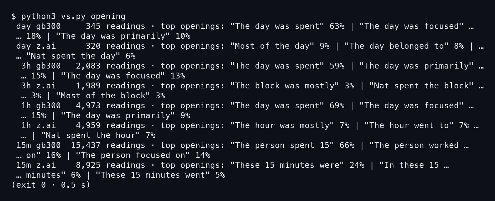
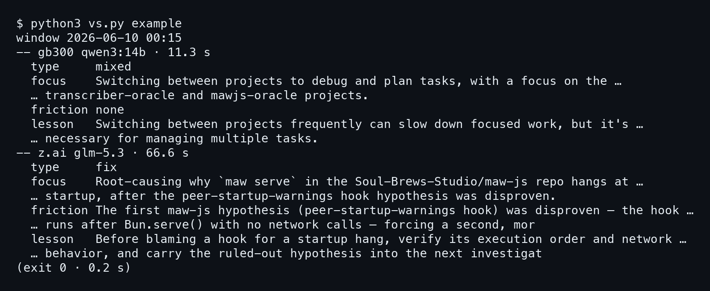

# บทที่ 13: สองโมเดล ช่วงเดียวกัน ทั้งปี

ถึงตอนนี้ทั้งปีอ่านสองรอบ ยกเว้น 15m ของ z.ai ที่ยังไม่จบ รอบแรกด้วย qwen3:14b บน gb300 ทีละหน้าต่าง รอบสองด้วย glm-5.3 ของ z.ai
ทีละแปดหน้าต่างพร้อมโหมด thinking บทนี้เอาสองรอบมาวางข้างกัน ดูว่าถ้าโมเดลสองตัวอ่านหน้าต่างเดียวกัน
จะเห็นตรงกันแค่ไหน เวลาทั้งหมดเป็น +07 (GMT+7) และตัวเลขมาจาก cache ตอน 2026-10-26 02:57

## 13.1 ภาพรวมบนการ์ดใบเดียว

### ขั้นที่ 1 — อ่านการ์ด D6 ทีละแถว

การ์ดมีสี่แถว คือสี่ขนาดหน้าต่าง (day, 3h, 1h, 15m) แต่ละแถวบอกว่าสองโมเดลอ่านหน้าต่างเดียวกันกี่อัน
type ตรงกันกี่เปอร์เซ็นต์ และใช้เวลากี่วินาที
**ตรงกันได้ราวครึ่งเดียวในทุกขนาด** และเวลาห่างกันสิบถึงยี่สิบกว่าเท่า



```
 grain  both read  same type  median s gb300  median s z.ai
 day          320        45%             3.4           74.6
 3h         1,989        54%             3.1           66.0
 1h         4,959        52%             2.8           49.2
 15m        8,925        52%             2.7           54.9
```

คอลัมน์ท้ายสุดคือสัดส่วนที่ z.ai ตอบ "mixed" ซึ่งมากถึง 35% ในระดับ day แล้วลดเหลือ 15% ที่ 15m
ส่วน gb300 ตอบ "build" มากกว่าที่อื่นทุกขนาด การ์ดจบด้วยบรรทัดว่า
ใน deep 15m gb300 ไม่เจอ friction เลยใน 96% ของหน้าต่าง ส่วน z.ai ไม่เจอใน 14%

lane 15m ของ z.ai ยังรันอยู่ตอนจับ capture ตัวเลข 8,925 จึงเป็นเฉพาะหน้าต่างที่ทั้งสองฝั่งอ่านไปแล้ว
ไม่ใช่ครบทั้ง 15,437 หน้าต่างของ gb300

## 13.2 ทำไมต้อง qwen3:14b บน gb300

### ขั้นที่ 1 — รัน trial บนหน้าต่าง 3h ที่แช่แข็งไว้

คำถามคือ ถ้า z.ai ช้ากว่า ทำไมไม่ใช้ z.ai ทั้งหมด คำตอบคือ gb300 อ่านเร็วกว่าราวสิบเท่าบน trial
เลยต้องรู้ว่าโมเดลเล็กตัวไหนใกล้ z.ai ที่สุด `vs.py trial` พิมพ์ผลของ 198 หน้าต่าง 3h
ที่แช่แข็งไว้ให้ทุกโมเดลอ่านชุดเดียวกัน
**qwen3:14b ตรงกับ z.ai 52% ที่ 6.8 วินาที ซึ่งสูงสุดในกลุ่ม**

```bash
python3 vs.py trial
```



```
  z.ai glm-5.3                   63.5          reference
  qwen3:14b                       6.8                52%
  Nemotron 3.5 Bolt E4B           4.5                50%
  typhoon2.1-gemma3-12b          13.6                50%
  qwen3:30b-a3b                   5.3                25%
```

Nemotron เร็วกว่านิดหน่อยและได้ 50% ส่วน typhoon2.1-gemma3-12b ช้ากว่า qwen3:14b สองเท่า (13.6 กับ 6.8) แต่ก็ได้ 50%
ส่วนต่างสองเปอร์เซ็นต์บน 198 อันยังไม่ใช่เหตุผลพอจะเปลี่ยน เราเลยคง qwen3:14b ไว้ตามผลของบทที่ 6

## 13.3 type ตรงกันแค่ครึ่งเดียว

### ขั้นที่ 1 — รัน vs.py agree

พอรู้ว่า 52% มาจากหน้าต่างชุดเล็ก ก็ถึงเวลาดูทั้งปี `vs.py agree` อ่านสอง cache แล้วนับต่อขนาด
ว่าอ่านทั้งคู่กี่อัน **type เดียวกันกี่อัน** และคู่ไหนไม่ตรงกันมากที่สุด

```bash
python3 vs.py agree
```



ระดับ day ตรงกัน 45% (143 จาก 320) ต่ำสุด ระดับ 3h ตรงกัน 54% (1,077 จาก 1,989)
ระดับ 1h 52% (2,565 จาก 4,959) และระดับ 15m 52% (4,654 จาก 8,925)

### ขั้นที่ 2 — อ่านคู่ที่แยกกัน

บรรทัด splits เขียนเป็น gb300/z.ai ทุกขนาดคำตอบที่ไม่ตรงกันมากสุดขึ้นต้นด้วย build ฝั่ง gb300
**gb300 เรียกเกือบทุกอย่างว่า build ส่วน z.ai เลือก mixed, ops หรือ fix**

ตัวเลขของคู่ที่แยกกันมากสุด: day build/mixed 76, 3h build/mixed 226, 1h build/ops 564 (build/mixed 553 ตามมาติด), 15m build/mixed 743

ดูสัดส่วน type ที่ระดับ day จะชัด **gb300 ตอบ build 72% ส่วน z.ai แค่ 42%** ส่วน mixed z.ai ตอบ 35% ระดับ 1h gb300 ตอบ build 62% z.ai 35% และ z.ai ตอบ ops 21%
เทียบกับ gb300 ที่ 10%

เรื่องนี้ไม่ได้แปลว่าฝั่งไหนผิด type เป็นช่องที่อ่อนอยู่แล้วตั้งแต่บทที่ 6 (v3 prompt
ทำให้ mixed ลดจาก 275 เหลือ 12 วัน แต่ build พุ่งเป็น 260) ข้อสรุปที่ใช้ได้จริงคือ
อย่าเอา type ของสองโมเดลมานับรวมกัน ต้องรู้ว่ามาจากฝั่งไหน

## 13.4 แต่ละโมเดลเริ่มประโยคยังไง

### ขั้นที่ 1 — รัน vs.py opening

นอกจาก type แล้ว ลายมือของโมเดลก็ต่างกัน `vs.py opening` นับว่าแต่ละฝั่งขึ้นต้นช่อง en ด้วยคำสามสี่คำอะไรบ่อยที่สุด
ต่อขนาดหน้าต่าง

```bash
python3 vs.py opening
```



gb300 ขึ้นต้นแทบทุกอันว่า "The day was spent" ไม่ว่าหน้าต่างจะเป็น day, 3h หรือ 1h
**หน้าต่าง 1 ชั่วโมงก็ถูกเรียกว่า "the day" ใน 69% ของคำตอบ** ระดับ 15m โมเดลเปลี่ยนเป็น
"The person spent 15" 66% คือไม่ใช่ชื่อ Nat

z.ai ขึ้นต้น 1h ว่า "The hour was mostly" 7% และ 15m ว่า "These 15 minutes were" 24%

ในวลีขึ้นต้นสามอันดับแรก z.ai เรียกขนาดหน้าต่างถูก (the block, the hour, these 15 minutes) และเรียก Nat ตรงๆ
เช่น "Nat spent the hour" 7% วลีขึ้นต้นของ z.ai กระจายกว่ามาก อันดับหนึ่งของ day แค่ 9%
ขณะที่ gb300 อยู่ที่ 63%

## 13.5 หน้าต่างเดียว วางข้างกัน

### ขั้นที่ 1 — รัน vs.py example

ตัวเลขยังไม่บอกว่าต่างกันตรงไหน **ต้องวางหน้าต่างเดียวเทียบกัน** `vs.py example` เลือกหน้าต่างหนึ่งที่ทั้งคู่อ่านแล้ว
(2026-06-10 00:15) พิมพ์สี่ช่อง type, focus, friction, lesson ของทั้งสองฝั่ง

```bash
python3 vs.py example
```



gb300 ใช้ 11.3 วินาที ตอบ type mixed, friction none และ focus ที่บอกแค่ว่าสลับระหว่างสองโปรเจกต์
เพื่อ debug กับวางแผน lesson เป็นประโยคกว้างๆ ว่าสลับบ่อยทำให้ช้า แต่จำเป็นสำหรับงานหลายอย่าง

### ขั้นที่ 2 — อ่านฝั่ง z.ai

z.ai ใช้ 66.6 วินาที ตอบ type fix และ focus ที่ระบุงานชัด คือหาสาเหตุที่ `maw serve` ค้างตอนเริ่ม
ใน repo maw-js หลังสมมติฐานเรื่อง hook ถูกหักล้าง
**ความต่างอยู่ที่ z.ai เก็บเรื่องที่ถูกตัดทิ้งไว้ใน friction และ lesson ส่วน gb300 บอกแค่ว่าสลับงาน**

```
  type     fix
  focus    Root-causing why `maw serve` in the Soul-Brews-Studio/maw-js …
  friction The first maw-js hypothesis (peer-startup-warnings hook) was …
```

ตัวอย่างนี้ถูกเลือกเพราะสองฝั่งต่างกันตรงนี้ ไม่ได้เป็นตัวแทนทั่วไป ส่วนตัวเลข 96% กับ 14% ในการ์ด D6 เป็นภาพรวมของ friction
ราคาของความเร็วคือความลึกที่หายไป บทถัดไปจะดูว่า friction ที่หายไปนี้มากแค่ไหนทั้งปี
