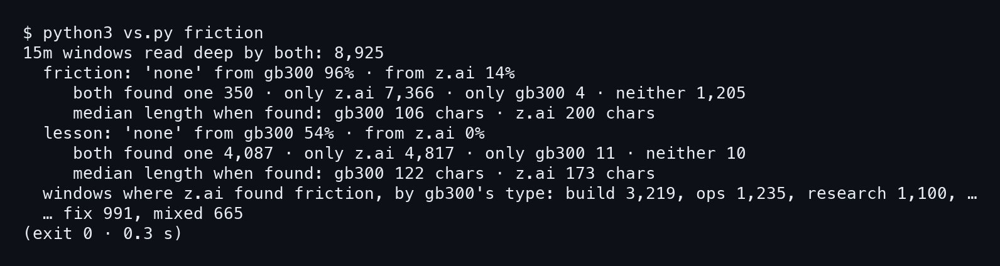
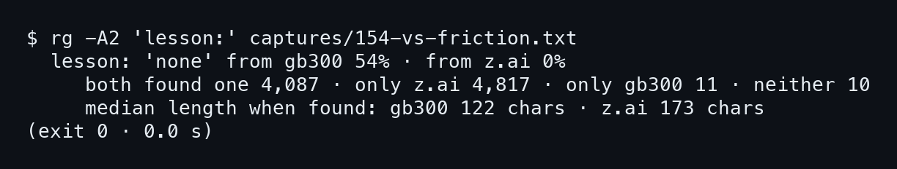
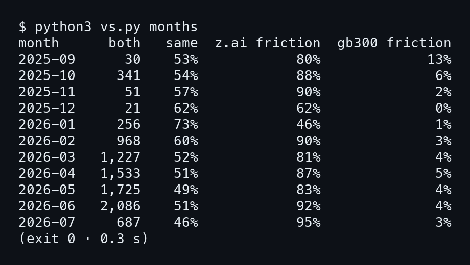

# บทที่ 14: friction กับ lesson ทุก 15 นาที

ตอนอ่านด้วย `--deep` แต่ละหน้าต่าง 15 นาทีไม่ได้ตอบแค่ว่าทำอะไร แต่ตอบอีกสองช่องด้วย
คือ friction (อะไรติดขัด) กับ lesson (ได้บทเรียนอะไร) บทนี้เทียบสองช่องนี้ระหว่าง gb300 กับ z.ai
บนหน้าต่างที่ทั้งสองโมเดลอ่านแบบ deep แล้ว

## 14.1 friction: gb300 ตอบ none เกือบทุกหน้าต่าง

### ขั้นที่ 1 — รัน vs.py friction

`vs.py` อ่าน cache ของสองเลนใน `~/.relic-extract/report` แล้วนับให้
**เทียบเฉพาะหน้าต่างที่ทั้งสองอ่านแล้ว** เพราะ z.ai ยังอ่านไม่ครบ

```bash
python3 vs.py friction
```



หน้าต่างที่ทั้งสองอ่านแล้วมี 8,925 หน้าต่าง บรรทัดที่ควรจำคือสามบรรทัดนี้

```
15m windows read deep by both: 8,925
  friction: 'none' from gb300 96% · from z.ai 14%
     both found one 350 · only z.ai 7,366 · only gb300 4 · neither 1,205
```

gb300 บอกว่าไม่มี friction ถึง 96% ส่วน z.ai บอกแค่ 14%
**ส่วนต่างอยู่ที่ "เฉพาะ z.ai เจอ" 7,366 หน้าต่าง** ขณะที่ "เฉพาะ gb300 เจอ" มีแค่ 4
ตอนที่เจอ z.ai ก็เขียนยาวกว่า ค่ากลางของ gb300 คือ 106 ตัวอักษร ของ z.ai คือ 200

## 14.2 lesson: z.ai แทบไม่เคยตอบ none

### ขั้นที่ 1 — อ่านบล็อก lesson ในผลเดิม

ผลเดียวกันมีอีกบล็อก ถ้า friction ต่างกันขนาดนี้ lesson ก็ต่างตาม
gb300 ตอบ none 54% ส่วน z.ai 0% ดึงเฉพาะบล็อกนี้ออกมาดู

```bash
rg -A2 'lesson:' captures/154-vs-friction.txt
```



**z.ai แทบไม่เคยตอบ none** (21 จาก 8,925 หน้าต่าง คือ "เฉพาะ gb300 เจอ" 11 บวก "ไม่เจอทั้งคู่" 10)
gb300 ให้ lesson ราวครึ่งเดียว และสั้นกว่า (122 ต่อ 173 ตัวอักษร)

## 14.3 z.ai เจอ friction ในหน้าต่างประเภทไหน

### ขั้นที่ 1 — ดูบรรทัดสุดท้ายของ capture 154

บรรทัดสุดท้ายแยกหน้าต่างที่ z.ai เจอ friction ตาม type ที่ gb300 ให้ไว้

```
  windows where z.ai found friction, by gb300's type:
     build 3,219, ops 1,235, research 1,100, fix 991, mixed 665
```

build มาก่อนที่ 3,219 หน้าต่าง แต่ตัวเลขนี้เป็นจำนวน ไม่ใช่อัตรา ต้องเทียบกับยอดของแต่ละ type
ใน 15m gb300 ให้ fix 11% ของ 8,925 หน้าต่าง ดังนั้น fix 991 หน้าต่างแทบเท่ากับ fix ทั้งหมด คือเกือบทุกหน้าต่าง fix มี friction ตามที่ z.ai อ่าน
**friction ไม่ได้อยู่แค่ในหน้าต่าง fix** มันโผล่ทั้งตอน build ตอน ops และตอนค้นข้อมูลด้วย

## 14.4 รายเดือน: ช่องว่างไม่หายไปไหน

### ขั้นที่ 1 — รัน vs.py months

ถ้าส่วนต่างมาจากเดือนเดียวที่ผิดปกติ ผลรวมก็หลอกเราได้ เลยแยกรายเดือนดู

```bash
python3 vs.py months
```



```
month      both   same  z.ai friction  gb300 friction
2025-10     341    54%            88%              6%
2026-02     968    60%            90%              3%
2026-06   2,086    51%            92%              4%
2026-07     687    46%            95%              3%
```

**ทุกเดือน z.ai เจอ friction ตั้งแต่ 46% ถึง 95% ส่วน gb300 ไม่เกิน 13%** คอลัมน์ same คือ type ตรงกัน
อยู่ระหว่าง 46% ถึง 73% ก็ไม่มีเดือนไหนหลุดจากช่วงนี้

## 14.5 แล้วหน้ารายงานควรใช้ใครอ่านอะไร

### ขั้นที่ 1 — แบ่งหน้าที่ตามที่วัดได้

สรุปตามตัวเลข สัญญาณ friction กับ lesson ต้องมาจาก z.ai
ส่วน 15 นาทีของ gb300 เร็วกว่ามาก ยังใช้ได้กับ type และ focus
**ใช้ gb300 อ่านให้ทั่ว ใช้ z.ai อ่านเอาความติดขัด**

เลน z.ai 15 นาทียังรันอยู่ตอนที่เก็บ capture ตัวเลขทั้งบทนี้จึงเป็นของ 8,925 หน้าต่างที่อ่านทันกัน
ไม่ใช่ทั้ง 15,440 หน้าต่าง บทหน้าดูว่าสองเลนอ่านเร็วช้าต่างกันเท่าไร และ GPU ของ gb300 ตกเป็นของใคร
