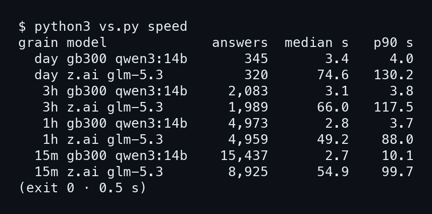
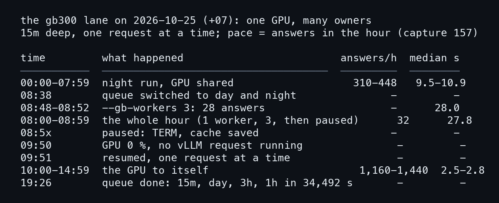
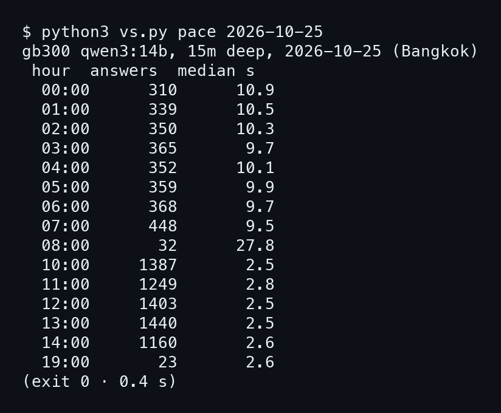
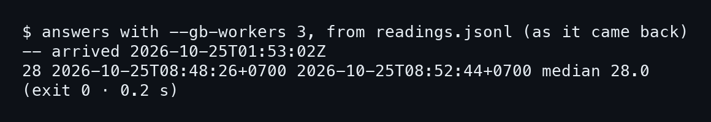
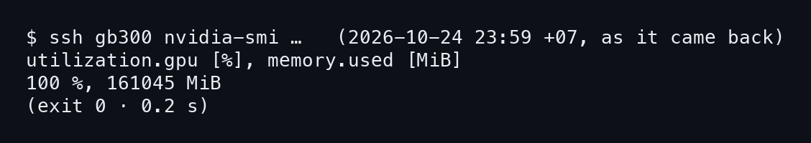
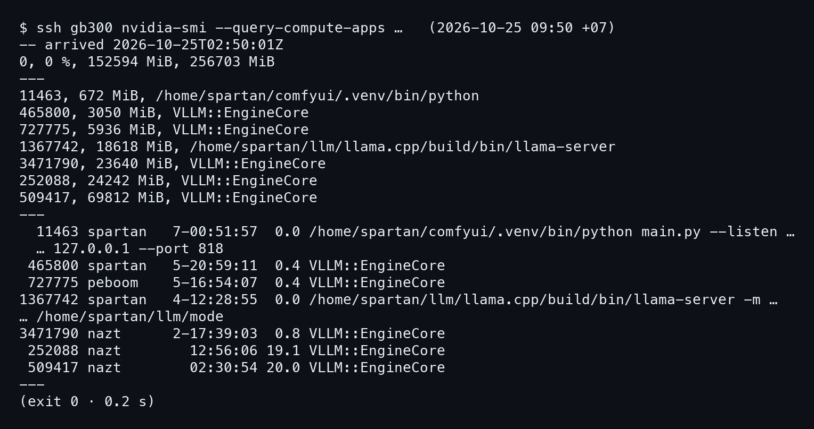
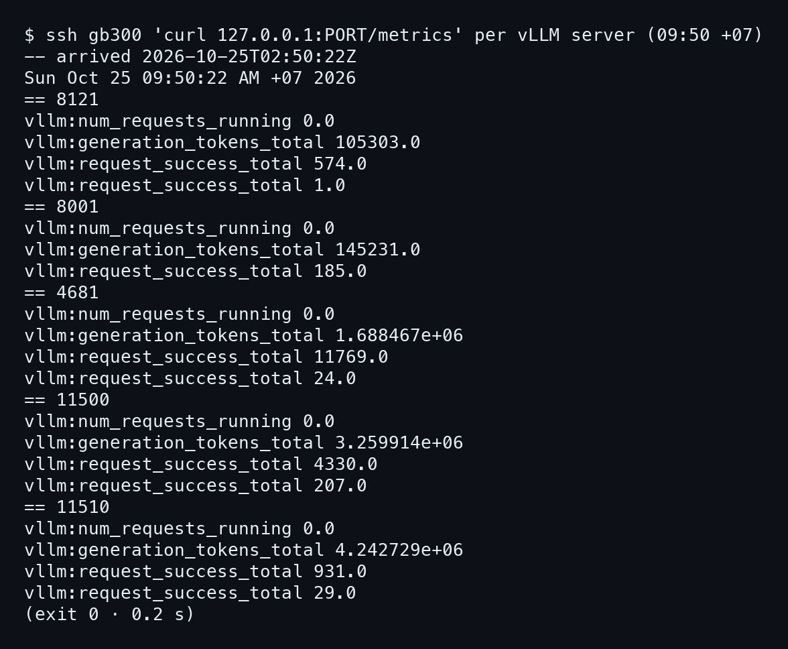
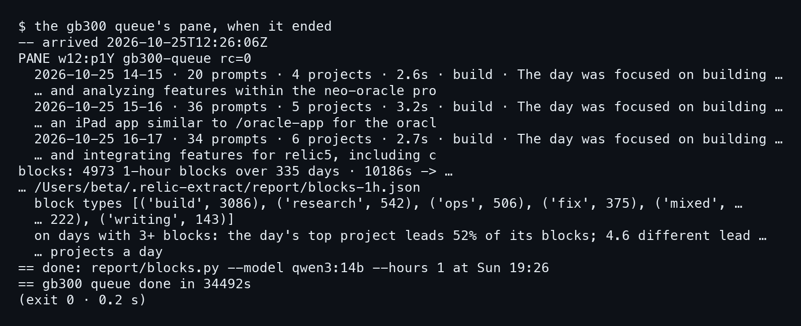
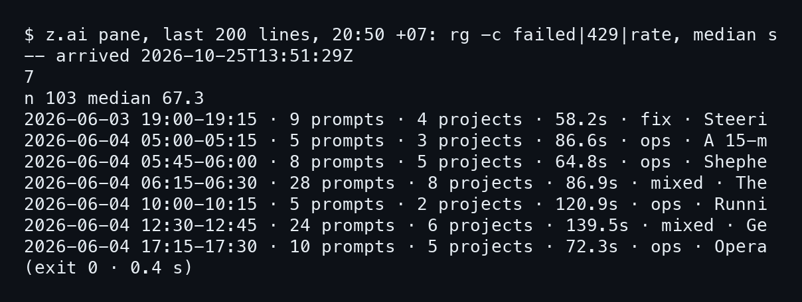

# บทที่ 15: เร็วแค่ไหน และ GPU เป็นของใคร

สองบทก่อนเทียบว่า gb300 กับ z.ai อ่านตรงกันแค่ไหน บทนี้เทียบเรื่องเวลา
gb300 ตอบราว 3 วินาที z.ai ตอบเป็นนาที แต่ gb300 เป็น GPU ที่คนอื่นใช้อยู่ด้วย
เลขความเร็วของมันเลยไม่ใช่ของเราคนเดียว เวลาทั้งหมดเป็น +07 (GMT+7)

## 15.1 วัดความเร็วของสองเลน

### ขั้นที่ 1 — พิมพ์ตารางความเร็วด้วย vs.py speed

`vs.py` อ่าน cache ของสองเลนใน `~/.relic-extract/report` แล้วนับจำนวนคำตอบ
กับวินาทีต่อคำตอบ แยกตามขนาดหน้าต่าง (day, 3h, 1h, 15m)
**ดูคอลัมน์ median กับ p90 คู่กัน** เพราะ median บอกว่าปกติเร็วแค่ไหน ส่วน p90 บอกว่าช้าสุดๆ ช้าแค่ไหน

```bash
python3 vs.py speed
```



gb300 ได้ median 2.7 ถึง 3.4 วินาทีทุกขนาดหน้าต่าง z.ai ได้ 49.2 ถึง 74.6 วินาที
ที่หน้าต่าง day z.ai มี p90 ถึง 130.2 วินาที ส่วน gb300 ที่เลน 15 นาทีมี p90 10.1 วินาที
สูงกว่า median เกือบสี่เท่า ซึ่งเป็นเบาะแสว่าบางช่วง gb300 ช้าลงเพราะอะไรบางอย่าง
ส่วนที่เหลือของบทตามเรื่องนั้น

เลน 15 นาทีของ z.ai อ่านได้ 8,925 หน้าต่างตอนวัด ยังไม่จบ จึงเทียบเฉพาะที่ทั้งคู่อ่านแล้ว

## 15.2 หนึ่งวันของเลน gb300

### ขั้นที่ 1 — อ่านการ์ด D7 ก่อนลงรายละเอียด

การ์ดเรียงเวลาของวันที่ 2026-10-25 ทั้งวัน ตั้งแต่คิวรันกลางคืนจนคิวจบ
**อ่านคอลัมน์ median s ลงมาตามเวลา** จะเห็นสามช่วงที่ต่างกันชัด
คือราว 10 วินาที, 27.8 วินาที และราว 2.5 วินาที



การ์ดบอกว่าเลนเดียวกัน โมเดลเดียวกัน ส่งทีละคำขอเหมือนกัน ให้ความเร็วต่างกันราวสิบเท่าในวันเดียว
สาเหตุที่ความเร็วเปลี่ยนไม่มี capture ไหนแยกให้ มีแต่เลขที่วัดได้ ส่วนเรื่องเพื่อนบ้านบน GPU เป็นแค่การคาด

### ขั้นที่ 2 — ดูรายชั่วโมงด้วย vs.py pace

ถ้าอยากได้เลขแต่ละชั่วโมง ให้ใส่วันที่ต่อท้าย คำสั่งนับคำตอบของเลน 15 นาทีในแต่ละชั่วโมง
เวลากรุงเทพ พร้อม median ของชั่วโมงนั้น

```bash
python3 vs.py pace 2026-10-25
```



```
  07:00      448       9.5
  08:00       32      27.8
  10:00     1387       2.5
  13:00     1440       2.5
```

ตลอดคืนได้ 310 ถึง 448 คำตอบต่อชั่วโมง median 9.5 ถึง 10.9 วินาที
ชั่วโมง 08:00 เหลือ 32 คำตอบ median 27.8 วินาที ส่วน 10:00 ถึง 14:00 ได้ 1,160 ถึง 1,440 ต่อชั่วโมง
median 2.5 ถึง 2.8 วินาที ชั่วโมงที่คิวหยุด (ระหว่างนั้นกับ 10:00) ไม่มีแถว

ตาราง 157 ไม่มีแถวหลัง 14:00 จนถึงก่อน 19:00 เหมือนกัน เพราะตอนนั้นคิวอ่านเลน day, 3h และ 1h
ซึ่งไม่เขียนคำตอบของเลน 15 นาที (คิวรัน 15m, day, 3h, 1h ตามลำดับ)
**วัดได้ว่าความเร็วต่างกันสิบเท่า ส่วนสาเหตุ (เพื่อนบ้านบน GPU หรือโหลดของเราเอง) ไม่มี capture แยกให้ เพื่อนบ้านน่าจะมีส่วนเท่านั้น**

## 15.3 "make it work asap"

### ขั้นที่ 1 — สั่งสามคำขอพร้อมกัน

จนถึง 08:00 คิวของ gb300 รันแค่กลางคืน (23:00 ถึง 08:00) ตอน 08:38 เปลี่ยนเป็นรันทั้งวันทั้งคืน
(commit be9089c) พร้อมเพิ่ม `readings.py --gb-workers N` ค่าตั้งต้นคือ 1
Nat สั่งสั้นๆ ว่า "make it work asap" เราเลยลอง `--gb-workers 3` เพื่อให้จบเร็วขึ้น **ตั้ง 3 worker ด้วยแฟลกเดียว**

### ขั้นที่ 2 — นับคำตอบจาก readings.jsonl

คำตอบทุกข้อมีเวลาใน `readings.jsonl` นับช่วง 08:48 ถึง 08:52 แล้วหา median
ข้างล่างคือที่คำสั่งนับส่งกลับมาใน session ไม่ได้รันใหม่

```
28 2026-10-25T08:48:26+0700 2026-10-25T08:52:44+0700 median 28.0
```



28 คำตอบใน 4 นาทีเศษ คิดเป็นราว 390 ต่อชั่วโมง ขณะที่ worker เดียวก่อนหน้านั้นทำได้ 449 ต่อชั่วโมง
**ตอนรัน 3 worker แต่ละข้อใช้ 28 วินาที และรวมแล้วช้ากว่าเดิม** แต่สาเหตุยังไม่แยกได้
อาจเป็นเพราะสามคำขอแย่งกันเอง หรือเพราะ 08:48 มีเพื่อนบ้านบน GPU (ดู 15.4) คิวจึงกลับไปใช้ 1 worker

## 15.4 "who eat 100%?"

### ขั้นที่ 1 — หาว่า GPU เคยเต็มจริงไหม

Nat ถามต่อว่าใครกิน 100% คำถามแรกที่ต้องตอบคือมันเต็มจริงหรือเปล่า
ผล nvidia-smi ที่เก็บไว้เมื่อคืนก่อนตอน 23:59 (ของวันที่ 24) ตอบว่าเต็มจริง

```
utilization.gpu [%], memory.used [MiB]
100 %, 161045 MiB
```



คืนนั้นเลนของเรารันอยู่ด้วย แต่ **ตัวเลขนี้ไม่บอกว่ากี่ส่วนเป็นของเรา**

### ขั้นที่ 2 — ถามตอน 09:50 ว่าใครอยู่บนการ์ด

หลังหยุดคิว (Nat ถามก่อนว่า "pause gb300 first?" เราส่ง SIGTERM ให้คิวกับ readings.py
cache เก็บไว้แล้ว 11,194 หน้าต่างของเลน 15 นาที) ตอน 09:50 เราถาม nvidia-smi อีกที
**GPU เป็น 0 % แต่มีเจ็ดโปรเซสของผู้ใช้อื่นบน gb300 ถือหน่วยความจำอยู่** ไม่มีโปรเซสของเราเลย

```
0, 0 %, 152594 MiB, 256703 MiB
509417, 69812 MiB, VLLM::EngineCore
252088, 24242 MiB, VLLM::EngineCore
```



หน่วยความจำใช้ไป 152,594 จาก 256,703 MiB ตารางล่างระบุเจ้าของและอายุโปรเซส
สองตัวที่ใหญ่สุดเป็นของผู้ใช้เดียวกัน อายุ 12 ชั่วโมงกับ 2 ชั่วโมงครึ่ง ใช้ CPU ราว 20%
ส่วนที่เหลือเปิดค้างมาหลายวัน ใกล้ 0% หมด

### ขั้นที่ 3 — อ่านตัวนับของ vLLM

vLLM แต่ละเซิร์ฟเวอร์มี `/metrics` ของตัวเอง เราไล่ curl ทีละพอร์ตตอน 09:50
ทุกตัว `num_requests_running` เป็น 0.0 หมด ไม่มีคำขอวิ่งอยู่ ollama บน gb300 ก็ไม่มีโมเดลโหลดไว้

```
== 11510
vllm:num_requests_running 0.0
vllm:generation_tokens_total 4.242729e+06
```



ตัวนับ generation_tokens_total ของห้าเซิร์ฟเวอร์ต่างกันมาก ตัวสูงสุดคือพอร์ต 11510
ที่ 4.24 ล้านโทเค็นในราว 2.5 ชั่วโมง เซิร์ฟเวอร์นั้นเปิดมาตั้งแต่ราว 07:20
**แต่ตัวนับเป็นยอดสะสมตั้งแต่เซิร์ฟเวอร์เริ่ม** มันบอกว่าใครทำงานหนักสุด ไม่ได้บอกว่าใครถือ GPU 100%
ตอน 08:48 เพราะบน gb300 ไม่มีอะไรบันทึกโหลด GPU ตามเวลาไว้เลย
เราจึงไม่ชี้ว่าใครเป็นต้นเหตุ ได้แค่บอกว่า ณ 09:50 การ์ดว่าง และข้างบนมีเพื่อนบ้านเยอะ

## 15.5 กลับมาทำทีละคำขอ

### ขั้นที่ 1 — resume ด้วย 1 worker

Nat สั่ง "resume gb300" ตอน 09:51 เรากลับไปใช้ **1 worker ค่าตั้งต้น** โค้ดเดียวกับรอบกลางคืน
ตั้งแต่ 10:01 ได้ราว 22 คำตอบต่อนาที median 2.4 วินาที เร็วกว่ากลางคืน (9.5 ถึง 10.9) ราวสี่เท่า
สาเหตุน่าจะเป็น GPU ที่ว่างกว่า แต่มีแค่ snapshot ตอน 09:50 เป็นหลักฐาน

### ขั้นที่ 2 — ดูตอนคิวจบ

คิวรันเลน 15m ก่อน แล้ว day, 3h, 1h ตามลำดับ pane รายงานตอนจบว่า rc=0
ข้างล่างคือที่ pane ส่งมา ไม่ได้รันใหม่

```
blocks: 4973 1-hour blocks over 335 days · 10186s -> …
== done: report/blocks.py --model qwen3:14b --hours 1 at Sun 19:26
== gb300 queue done in 34492s
```



คิวจบตอน 19:26 ใช้ 34,492 วินาที หลังจากนั้นมีรอบตามเก็บหน้าต่างที่เข้ามาระหว่างทางอีกราว 15 นาที
ในตาราง 157 ชั่วโมง 19:00 จึงมีแค่ 23 คำตอบ

## 15.6 z.ai ช้า ไม่ใช่พัง

### ขั้นที่ 1 — นับ error กับวินาทีต่อคำตอบจาก pane ของ z.ai

เลน z.ai ช้ากว่ามากในตาราง 156 คำถามคือช้าเพราะพังหรือเปล่า เรานับจากท้าย pane 200 บรรทัดตอน 20:50
ข้างล่างคือที่คำสั่งนับส่งกลับมา ไม่ได้รันใหม่ เลข 7 คือบรรทัดที่มีคำว่า failed, 429 หรือ rate
แต่ทั้ง 7 เป็นหน้าต่างที่ตอบแล้ว มีวินาทีครบ คำนั้นอยู่ในเนื้อความ ไม่ใช่บรรทัด `failed:` ที่ readings.py พิมพ์ตอนพัง

```
7
n 103 median 67.3
```



**z.ai ช้า แต่ไม่ได้ล้ม** 103 คำตอบ median 67.3 วินาที จึงคง 8 worker ไว้ เพราะมีแค่สอง key ที่ตอบ
และเมื่อวันที่ 24 key หนึ่งโดน rate limit ตอนใช้ 4 ต่อ key กฎของบทนี้: บน GPU ที่แชร์กัน วัดก่อนเพิ่ม worker
เพราะ pace น่าจะขึ้นกับเพื่อนบ้านด้วย บทหน้าคือบอร์ดที่บอกตัวเลขผิดสามครั้ง
