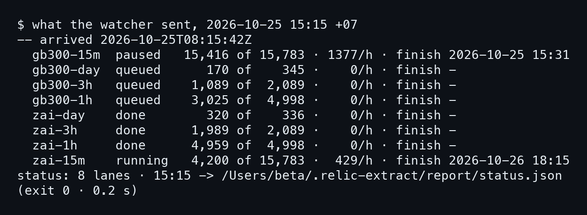
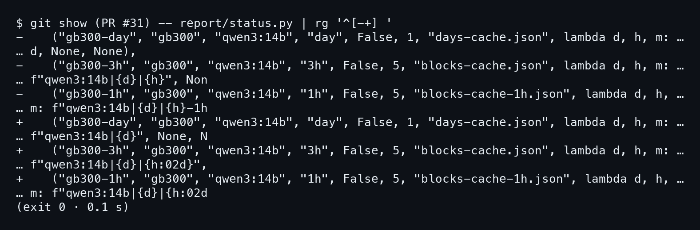
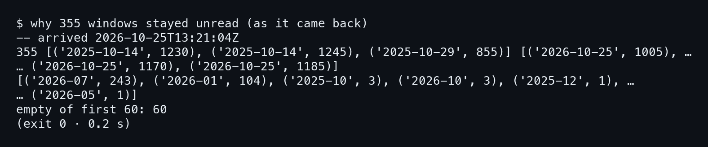
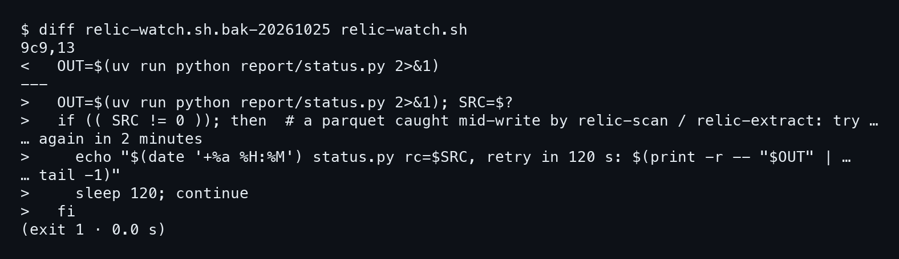
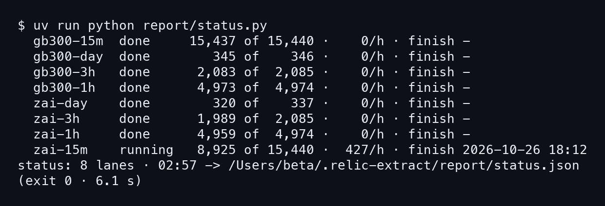
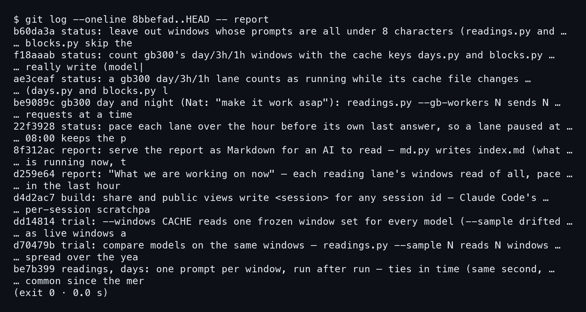

# บทที่ 16: ตัวเลขบนหน้าที่ผิด — status.py

หน้า report มีกล่อง "What we are working on now" บอกว่าแต่ละ lane อ่านไปกี่หน้าต่างจากกี่หน้าต่าง
และจะเสร็จเมื่อไร ตัวเลขชุดนี้มาจาก `report/status.py` วันที่ 2026-10-25 กล่องนี้ผิดสามรอบ
ทั้งที่ reader อ่านปกติดี บทนี้เก็บทีละรอบในรูปเดิม คือ เกิดอะไร · รู้ได้ยังไง · สาเหตุ · แก้ยังไง · กฎ
เวลาเป็น +07

## 16.1 "paused" ทั้งที่ gb300 กำลังอ่าน

### ขั้นที่ 1 — อ่านข้อความที่ watcher ส่งมา

ตอน 15:15 watcher ส่งตารางมาให้ เราเปิดดูแล้วมีสองบรรทัดที่ไม่ตรงกับที่รู้ว่าเกิดอะไรบน gb300
**lane 15 นาทีขึ้น paused และ lane 3h ขึ้น queued ทั้งที่ queue กำลังอ่านอยู่**
ข้างล่างคือที่ watcher ส่งมา ไม่ได้รันใหม่

```
gb300-15m  paused   15,416 of 15,783 · 1377/h
gb300-3h   queued    1,089 of  2,089 ·    0/h
zai-15m    running   4,200 of 15,783 ·  429/h
```



บรรทัด zai-15m ส่วน running กับ pace ถูก เพราะ lane ของ z.ai เขียน readings.jsonl ทุกคำตอบ
แต่ตัวหาร 15,783 สูงเกินจริง เพราะรวมหน้าต่างที่อ่านไม่ได้ไว้ด้วย ตัวเลขที่ถูกคือ 15,440 (capture 168)
ส่วน gb300 ผิด และ pace 0/h ของ lane ที่ queued บอกใบ้แล้วว่า status ไม่เห็นว่ามีใครอ่านอยู่

### ขั้นที่ 2 — หาสาเหตุ

status.py ตัดสินว่า lane วิ่งอยู่จากบรรทัดใหม่ใน `readings.jsonl`
แต่ `days.py` กับ `blocks.py` ซึ่งอ่าน lane day, 3h, 1h ไม่เขียนอะไรลง readings.jsonl เลย
เมื่อไม่มีบรรทัดใหม่ lane 3h ก็ดูเหมือนยังไม่เริ่ม และ lane 15 นาทีที่จบแล้วก็ดูเหมือนหยุดกลางทาง
**status ถามผิดแหล่ง ควรถามไฟล์ที่ reader เขียนจริง**

PR #30 (ae3ceaf) แก้สองอย่าง lane ถือว่าวิ่งอยู่ตราบที่ไฟล์ cache ของมันยังเปลี่ยน
และแต่ละเครื่องมี lane วิ่งได้ทีละ lane คือ lane ที่เขียนล่าสุด

**กฎ** สถานะ "วิ่งอยู่" ต้องอ่านจากร่องรอยที่ reader ทิ้งไว้จริง ไม่ใช่จากร่องรอยที่เราคิดว่ามันควรทิ้ง

## 16.2 อ่านไปเยอะ แต่กล่องบอกน้อย

### ขั้นที่ 1 — เทียบ key ที่ status ถามกับ key ที่ reader เขียน

หลังแก้ 16.1 แถว gb300-day ยังบอก 170 of 345 ทั้งที่ lane อ่านไปเกือบหมด
ตัวเลขน้อยเกินไปแบบที่ queue ไม่น่าเป็นได้ เราเลยเปิด diff ของ PR #31 ดูเฉพาะบรรทัดที่เปลี่ยน
**cache key ที่ status สร้างขึ้นไม่ตรงกับ key ที่ days.py และ blocks.py เขียนลงไฟล์**

```bash
git show (PR #31) -- report/status.py | rg '^[-+] '
```



ก่อนแก้ status ถาม `qwen3:14b|{d}|{h}` โดย h ไม่เติมศูนย์ ส่วน blocks.py เขียน `qwen3:14b|{d}|{h:02d}`
ชั่วโมง 10 ถึง 23 ตรงกันอยู่แล้ว ส่วนชั่วโมง 0 ถึง 9 หลุดหมด
lane day ผิดอีกแบบ คือ status ถามวันเปล่าๆ แต่ days.py เขียน `qwen3:14b|{d}`

### ขั้นที่ 2 — ดูตัวเลขหลังแก้

พอ key ตรงกัน ตัวเลขที่ถูกต้องก็โผล่ทันที ตัวเลข ณ ตอนที่แก้คือ day จาก 170 เป็น 345 of 345,
3h เป็น 2,082 of 2,090 และ 1h เป็น 4,602 of 5,000
**ข้อมูลไม่ได้เปลี่ยนเลย เปลี่ยนแค่ตัวเลขที่ไปถามมัน**

**กฎ** ฟังก์ชันที่สร้าง key ต้องมีที่เดียว ถ้า status ต้องเดา key ของ reader ด้วยโค้ดของตัวเอง
สักวัน key สองฝั่งก็เลิกตรงกัน

## 16.3 หน้าต่างที่ไม่มี reader ตัวไหนอ่านได้

### ขั้นที่ 1 — นับของที่ "เหลือ" แล้วเปิดดู

ตัวเลขดีขึ้นแต่ยังไม่ถึงเต็ม 100% เหลือหน้าต่างที่ไม่ถูกอ่านสักที
เราเลยดึงรายการที่ค้างมานับ ได้ 355 หน้าต่าง พิมพ์สามตัวแรกกับสามตัวท้าย
แล้วนับต่อตามเดือน ข้างล่างคือผลที่กลับมาใน session ไม่ได้รันใหม่

```
355 [('2025-10-14', 1230), … ('2026-10-25', 1185)]
[('2026-07', 243), ('2026-01', 104), ('2025-10', 3), …]
empty of first 60: 60
```



**ทั้ง 60 ตัวแรกที่เปิดดูว่าง** 60 ตัวนี้คือ 60 ตัวแรกเรียงตามวัน อยู่ในช่วง 2025-10 ถึง 2026-01 ไม่ใช่ 2026-07
ส่วนการแยกเดือนบอกว่า 243 ตัวอยู่ใน 2026-07 (บรรทัดที่สองของ capture 166) เหตุผลที่ว่า prompt สั้นกว่า 8 ตัวอักษรมาจาก PR #32 (FACTS)

### ขั้นที่ 2 — เทียบกับกฎของ reader

`readings.py` และ `blocks.py` ข้ามข้อความที่ `len(text.strip()) >= 8` ไม่ผ่าน
หน้าต่างที่ทุก prompt สั้นกว่านั้นจึงไม่มีวันถูกอ่าน แต่ status ยังนับเป็นส่วนของ "ทั้งหมด"
**ตัวหารของกล่องรวมของที่ไม่มีใครอ่านได้ ตัวเลขจึงไม่มีทางถึงเต็ม**

PR #32 (b60da3a) ตัดหน้าต่างพวกนี้ออกจากตัวหาร ใช้กฎเดียวกับ reader
และแก้อีกข้อ ถ้าเครื่องไหนไม่มี lane วิ่งอยู่เลย lane ของเครื่องนั้นแสดง done
เพราะก่อนหน้านี้ gb300 ขึ้น queued ทั้งที่ queue จบไปแล้ว

**กฎ** ตัวหารต้องนับเฉพาะสิ่งที่ reader อ่านได้ ใช้เงื่อนไขเดียวกับ reader ไม่ใช่เงื่อนไขที่คล้ายกัน

## 16.4 watcher ที่เห็นไฟล์เสียแล้วบอกว่า "เสร็จหมด"

### ขั้นที่ 1 — อ่านสิ่งที่ watcher ทำตอน 13:12

watcher เรียก `status.py` ทุกรอบแล้วดูว่าทุก lane done หรือยัง ตอน 13:12 relic-scan กับ relic-extract
กำลังเขียน parquet ใหม่ status.py อ่านไฟล์ที่เขียนไม่เสร็จด้วย duckdb แล้วล้ม
`_duckdb.Error: TProtocolException: Invalid data` output ที่ได้ไม่มีบรรทัด lane สักบรรทัด
**watcher ตีความ output ว่างเป็น "ไม่มี lane ค้าง" แล้วออกด้วย rc=0 บอกว่างานเสร็จ**

### ขั้นที่ 2 — ดู diff ของ script

ตัวแก้ไม่ใช่การเดาว่า parquet เสียตอนไหน แต่ดู exit code ของ status.py ก่อน
ถ้าไม่ใช่ศูนย์ก็พิมพ์บรรทัดเดียว รอ 120 วินาที แล้ววนรอบใหม่

```bash
diff relic-watch.sh.bak-20261025 relic-watch.sh
```



ในภาพบรรทัดสุดท้ายของ capture ขึ้น exit 1 นั่นคือ exit ของ `diff` เอง
ซึ่งคืน 1 เมื่อสองไฟล์ต่างกัน ไม่ใช่ความล้มเหลว
**กฎคือ output ว่างไม่ใช่คำตอบ ต้องเช็ก exit code ก่อนอ่าน output**

## 16.5 กล่องตอนนี้ และ commit ของวัน

### ขั้นที่ 1 — รัน status.py อีกรอบ

หลังรวมสามรอบ เรารันของจริงตอน 02:57 ของวันที่ 26 ตัวเลขใกล้เต็มทุก lane
**ทุก lane ของ gb300 done และ lane ที่ยังวิ่งอยู่มีแค่ zai-15m**

```bash
uv run python report/status.py
```



```
gb300-15m  done     15,437 of 15,440
gb300-3h   done      2,083 of  2,085
zai-15m    running   8,925 of 15,440 ·  427/h · finish 2026-10-26 18:12
```

ตัวเลขยังไม่ครบเต็ม (15,437 จาก 15,440) status ถือว่าส่วนที่เหลือเป็นหน้าต่างใหม่ (ใหม่ = ทั้งหมด ลบ ที่อ่านแล้ว)

### ขั้นที่ 2 — ดู commit ของส่วนนี้

`git log` ของโฟลเดอร์ report มีสี่บรรทัดบนสุดเป็นของ part 5
สามบรรทัดแรกคือ b60da3a, f18aaab, ae3ceaf ของบทนี้ ส่วน be9089c คือการเปิด gb300 กลางวันจากบทที่ 15

```bash
git log --oneline 8bbefad..HEAD -- report
```



สามรอบนี้มาจากที่เดียวกัน
**status board คือโปรแกรมตัวที่สอง ที่อ่านไฟล์ของโปรแกรมตัวแรก** จึงต้องทดสอบมันกับไฟล์จริง
zai-15m ยังวิ่งอยู่ ประมาณว่าจะจบ 18:12 ของวันที่ 26 แล้วเราจะเทียบสองฝั่งทั้ง 15,440 หน้าต่างได้เต็มๆ
