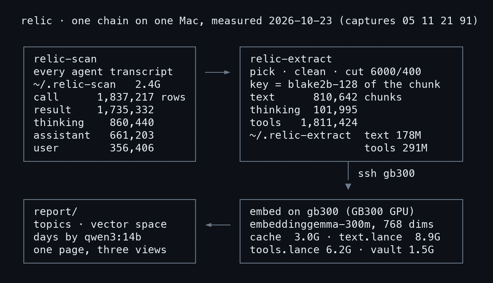

# หนึ่งปีในหน้าเดียว

**relic-scan → relic-extract → gb300 → รายงานทีละเดือน ทีละวัน**

ทุกคำสั่งรันจริง ทุก capture คือเทอร์มินัลจริง ยกเว้นภาพปกที่ AI วาด — 2026-10-23 ถึง 2026-10-25 · เขียนโดย relic-extract (AI) กับ Nat

| | บท |
|---|---|
|  | [คำนำ](00-foreword.md) |
| ภาค 1 | [บทที่ 1: relic-scan — เครื่องนี้มีอะไร](01-scan.md) |
|  | [บทที่ 2: relic-extract — ตัด ล้าง ใส่ key](02-extract.md) |
|  | [บทที่ 3: embed บน gb300](03-embed.md) |
| ภาค 2 | [บทที่ 4: ค้น — ของเรากับ relic3](04-search.md) |
|  | [บทที่ 5: จากตัวเลขเป็นหน้า](05-report.md) |
|  | [บทที่ 6: อ่านทีละวันด้วย model บน gb300](06-days.md) |
| ภาค 3 | [บทที่ 7: publish](07-publish.md) |
|  | [บทที่ 8: สิ่งที่พัง และกฎที่ได้](08-broke.md) |
| ภาค 4 | [บทที่ 9: อ่านทีละช่วง — 3 ชั่วโมง 1 ชั่วโมง 15 นาที](09-windows.md) |
|  | [บทที่ 10: สองโมเดล อ่านช่วงเดียวกัน](10-lanes.md) |
|  | [บทที่ 11: พูดหรือพิมพ์ — model จาก Wispr Flow](11-spoken.md) |
|  | [บทที่ 12: งานยาวข้ามคืน — สิ่งที่พังในวันที่สอง](12-overnight.md) |
| ภาค 5 | [บทที่ 13: สองโมเดล ช่วงเดียวกัน ทั้งปี](13-vs.md) |
|  | [บทที่ 14: friction กับ lesson ทุก 15 นาที](14-friction.md) |
|  | [บทที่ 15: เร็วแค่ไหน และ GPU เป็นของใคร](15-speed.md) |
|  | [บทที่ 16: ตัวเลขบนหน้าที่ผิด — status.py](16-status.md) |

PDF: `book.pdf` (build with `make pdf`).

## How this book was made (/oracle-write-proof-book)
- `capture.sh` (parts 1-3), `capture2.sh` (part 4) and `capture3.sh` (part 5) ran every command for real and kept the output verbatim in `captures/`.
- `cards.py` + `/ascii-diagram --png` rendered each capture to `images/NN-slug.png`; diagram cards
  in `diagrams/*.txt` became `images/Dn-*.png`. The text files are the source of truth.
- Chapters drafted in parallel from `BRIEF.md` + `OUTLINE.md`, reviewed 3 ways, fixed per `FIX-RULES.md`.
- `make pdf` → PyThaiNLP → pandoc → fixdash → imgwidth → typst 0.15.1 · `make check` gates.

## Cover art
`images/cover-art.jpg` is AI-generated (Codex `codex exec`, via `scripts/make-cover-art.sh`; subject: a quiet object for a year of transcripts read on one page). It is not a photograph and not a capture.
